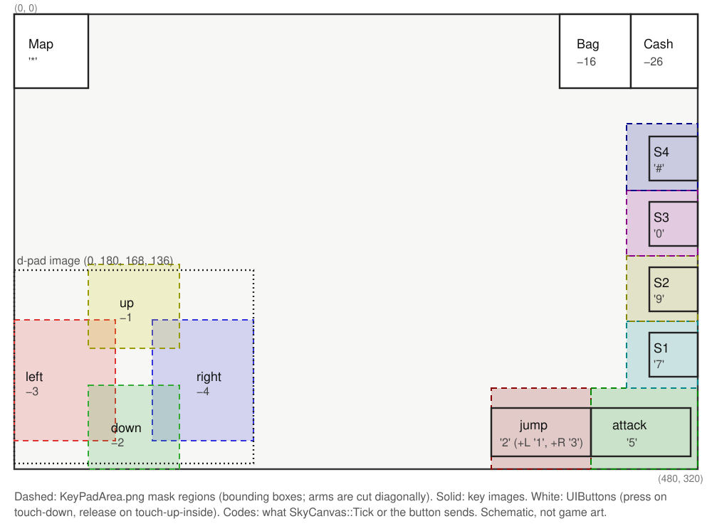

# The on-screen keypad and every action

How the iOS build turns touches into game actions, written down so the port can give every one of them a keyboard key and a controller button ([#66](https://github.com/armaatus/maplethief-port/issues/66), epic [#102](https://github.com/armaatus/maplethief-port/issues/102)). The gamepad action layer ([#67](https://github.com/armaatus/maplethief-port/issues/67)), the keyboard defaults ([#68](https://github.com/armaatus/maplethief-port/issues/68)), controller navigation in menus and popups ([#69](https://github.com/armaatus/maplethief-port/issues/69)) and the auto-hiding keypad ([#71](https://github.com/armaatus/maplethief-port/issues/71)) build on this page.

Everything here comes from the armv7 slice (Ghidra decompiles of the functions named below) and from `KeyPadArea.png`, the hit mask in the bundle. Rects are in **screen points** of the 480 × 320 landscape view, origin top left, written `(x, y, w, h)`. Guest addresses are armv7 VM addresses; function pointers carry the Thumb bit. The shell classes and their generated method tables are in [objc-shell.md](../re/objc-shell.md); the tick that polls the pad is in [program-flow.md](../re/program-flow.md#skycanvastick-0x2590d). The engine function names come from `FLOW_NAMES` in `tools/mtport/flow.py` (section "input (#66)").

[keypad.svg](keypad.svg) is a schematic of panel 0, our own drawing (no game art): the hit-mask regions and the buttons with their key codes.

## How a touch becomes an action

There are three input paths, and all of them end in a **phone key code**: the engine is a feature-phone port and has no idea of touches beyond a few GL widgets.

1. **Polled pad (panel 0).** `-[TouchKeyPadView touchesBegan/Moved/Ended:withEvent:]` hit-test each finger against the colour mask `KeyPadArea.png` and set ten BOOL ivars (`onLeftKey` … `onShort4Key`). `SkyCanvas::Tick` `0x2590D` reads them once per tick and turns the set into one key code, which it delivers as `OnKeyPressed`/`OnKeyReleased` (state vtable slots 6 and 7).
2. **UIKit buttons (all panels and the main menu).** Each button's target method calls a `TouchKeyPadView` `click…Button:` or `release…Button:` method, which is a 28-byte `Clet_HandleEvent(2 press | 3 release, code, 0)` `0x5A75` → `SkyCanvas::PostKeyEvent` `0x25801` → `SkyCanvas::KeyPress` `0x2578D` / `SkyCanvas::KeyRelease` `0x25735`. The next tick delivers it to the state.
3. **GL touch widgets (popup menu only).** While the popup menu is open, the same touch handlers forward every touch to `TouchWidgets_Dispatch(1 down | 3 moved | 2 up, x, y)` `0x8B85`, which runs the 11 widgets `Screen_Init` `0x9909` made (`TouchWidget_HandleTouch` `0xA18E5`, 300 ms double tap; sink `TouchWidget_OnEvent` `0xA0EAD`). Two of their events are key codes again (`Clet_HandleEvent(2, −16)` and `(2, −5)`); the rest are stored for the menu code (`CDataMgr::keyPopupItemInven_2` `0x554F1`).

Plus two engine-side touches: the map screen reads `-[MapKeyPadView touchPoint]` (town taps), and the shop reads `MarketKeyPadView`'s tracking points (list scroll and row taps). The title state turns any touch into OK (`CStateTitle::OnPointerEvent` `0x97E81`: `PostKeyEvent(2, −5)` on a touch-up).

**Delivery limits.** `SkyCanvas` holds **one pending press** (`+0xD8`) and **one pending release** (`+0xE8`); `KeyPress`/`KeyRelease` store only into an empty slot, so a second event before the next tick is **dropped**. The pad poll runs only when both slots are empty and `touchKeyPadEnable` is set. `KeyPress` maps the host soft keys `0x10004` → −5 (OK) and `0x10005` → −16 (Clear). A port that feeds keys must therefore space edges at least one tick apart (50 ms by default, [timing](../re/timing-threading.md)).

## The panels

`-[TouchKeyPadView initWithFrame:]` `0xBC189` adds eleven full-screen (480 × 320) panel containers as subviews 0–10. `enable:` `0xBA1F5` sets a panel's alpha to 1, `disable:` `0xBA0DD` to 0; `disableAll` `0xBA131` hides all of them and clears `touchKeyPadEnable` and `isJoyPad`; `enable` `0xBA24D` is `disableAll` + `enable:0` + `touchKeyPadEnable = 1` + `isJoyPad = 1`. The engine switches panels through twelve C bridges `Shell_Enable…`/`Shell_Disable…` → `EAGLView enable…Key` methods, which track the active panel in `EAGLView.statusOfTouchKeyPad` (ivar at +92; −1 = none).

| # | Panel (builder) | Enabled by (engine → EAGLView) | Game state | Contents |
|---|---|---|---|---|
| 0 | game pad (`initKeyPadType0:` `0xBA6A1`) | `Shell_EnableTouchKeyPad` `0x69C5` (12 call sites) → `enableTouchKeyPad` `0x4359`, status 0 | field play (mode 0) | d-pad, jump, attack, 4 short keys, Map / Bag / Cash buttons ([below](#panel-0-the-game-pad)) |
| 1 | popup menu (empty `UIView`) | `Shell_EnablePopupMenuKey` `0x6925` (from `CStateGame::OnKeyPressed`, `CStateGame::SetPigmeState` `0x823A1`) → `enablePopupMenuKey` `0x428D`, status 1 → `-[TouchKeyPadView enablePopupMenuKey]` `0xBA0A9` | popup menu (mode 1) | nothing; `disableAll` + `invenEnable = 1`, so touches go to the GL touch widgets ([below](#gl-touch-widgets-popup-menu)) |
| 2 | minimap (empty) | `enableMinimapKey` `0x41C1`, status 2: **no `Shell_` bridge sends it** | — (dead) | nothing |
| 3 | animation (`initKeyPadType3:` `0xBA3ED`) | `Shell_EnableAnimationKey` `0x6885` (from `0x853E5` scene start, `CStateGame::LoadGame` `0x86C1D`, `CStateGame::Paint` `0x87501`) → `enableAnimationKey` `0x40F5`, status 3 | cut scenes, speech boxes | one invisible button (0, 270, 480, 50) → `clickOkButton:`/`releaseOkButton:` (−5) |
| 4 | yes/no (empty) | `enableYesNoKey` `0x4029`, status 4: no `Shell_` bridge | — (dead) | nothing (`-[TouchKeyPadView enableYesNoKey]` `0xB9F99` only shows panel 4) |
| 5 | NPC chat (`NpcKeyPadView`) | `Shell_EnableNPCKey` `0x6835` (from `0x3573D`) → `enableNPCKey` `0x3F5D`, status 5 | NPC dialog (mode 4) | quest rows, Accept / Refuse / OK ([below](#panel-5-npc-chat-npckeypadview)) |
| 6 | market (`MarketKeyPadView`) | `Shell_EnableMarketKey` `0x67E5` (from `0x4628D`) → `enableMarketKey` `0x3E91`, status 6; also sends the market's `reset` | NPC shop (mode 2) | tabs, Buy / Sell, Charge, list area, close |
| 7 | alert (`PopupKeyPadView`) | `Shell_EnableAlertKey` `0x6795` (from `Popup_Open` `0x3EAA1`) → `enableAlertKey` `0x3DC5`, status 7 → `-[TouchKeyPadView enableAlertKey]` `0xB9E29` | any popup, over any mode | OK, Yes/No, ±, revival buttons ([below](#panel-7-popups-popupkeypadview)) |
| 8 | map (`MapKeyPadView`) | `Shell_EnableMapKey` `0x66F5` (from `CStateGame::OnKeyPressed`, key `'*'`) → `enableMapKey` `0x3CF9`, status 8 | map screens (mode 3) | close, World, Mini, town taps |
| 9 | cash shop (`CashShopKeyPadView`) | `Shell_EnableCashShopKey` `0x66A5` (from `CStateGame::OnKeyPressed` key −26, `CDataMgr::OnServerPacket`) → `enableCashShopKey` `0x3C2D`, status 9 | cash shop (mode 0xB) | 8 purchase tiles, close |
| 10 | help (`HelpScrollKeyPadView`) | `Shell_EnalbeHelpScrollKey` `0x6655` (sic; from the options menu `0x50131`) → `-[TouchKeyPadView enableHelpScrollKey]` `0xB9CE1` | help pages (from the menu) | paged scroll view, close |

The disable bridges set status −1. `Shell_DisableTouchKeyPad` `0x6975` has 11 call sites, among them `CStateGame::Enter` `0x80A35`. Two details matter for the port:

- **The alert panel keeps the pad live.** `-[TouchKeyPadView enableAlertKey]` hides panel 0 and shows panel 7 but leaves `touchKeyPadEnable` and `isJoyPad` set, and `onInGamePopup = 1`. The invisible pad still hit-tests (a touch beside the popup buttons lands on the full-screen panel 7 view, a plain `UIView` without touch methods, so UIKit passes it up to `TouchKeyPadView`): a touch where the d-pad was sends −3/−4 (the popup's ±) and one on the attack area sends `'5'` (OK). This follows from the code and UIKit's responder chain; it has not been tried on a device. `disableAlertKey` `0xB9DD1` hides panel 7 and clears `onInGamePopup`.
- The engine's game mode is the global `0x11AA00` (0 field, 1 popup menu, 2 shop, 3 map, 4 NPC chat, 0xB cash shop; `CStateGame::OnKeyPressed` ignores keys in modes 6–8). The open popup's id is `0x108C64` (−1 = none; `Popup_Open` sets it, `Popup_Close` `0x3E945` resets it), and the field checks the global popup id `*0xF1434`.

### Panel 0: the game pad

Built by `initKeyPadType0:` `0xBA6A1`. Images are bundle PNGs (CgBI); buttons made with the helper `addButtonWithImageName:selectedImageName:withFrame:withEdgeInsets:actionForTouchDown:actionForTouchUpInside:` `0xBBF51` send their first selector on touch-down and the second on touch-up-inside **only**: a finger that slides off the button never sends the release.

| Element | Rect | Image(s) | Input |
|---|---|---|---|
| d-pad (container `UIImageView`) | (0, 180, 168, 136) | `KeyPadButtons.png` (168 × 136); `KeyPadButtonsUpPressed` / `RightPressed` / `DownPressed` / `LeftPressed` over it while held; `KeyPadButtonsRed` = the "up" indicator near an NPC (`onUpIndicate` `0xB9065` / `offUpIndicate` `0xB9031`) | mask, `onUp/Down/Left/RightKey` |
| jump key | (335, 277, 70, 34) | `KeyButton.png` / `KeyButtonPressed.png`, `JumpIcon.png` at (356, 277, 28, 31) | mask, `onJumpKey` |
| attack key | (405, 277, 70, 34) | `KeyButton.png` / `KeyButtonPressed.png` | mask, `onAttackKey` |
| short key 1 | (446, 224, 34, 31) | `KeyButtonShort.png` / `KeyButtonShortPressed.png` | mask, `onShort1Key` |
| short key 2 | (446, 178, 34, 31) | same | mask, `onShort2Key` |
| short key 3 | (446, 132, 34, 31) | same | mask, `onShort3Key` |
| short key 4 | (446, 86, 34, 31) | same | mask, `onShort4Key` |
| Map button | (0, 0, 52, 52), insets (1, 2, 0, 0) | `map.png` / `mapOver.png` | `clickAsteriskButton:` / `releaseAsteriskButton:` → `'*'` (42) |
| Bag button | (383, 0, 50, 52) | `bag.png` / `bagOver.png` | `clickClearButton:` / `releaseClearButton:` → −16 |
| Cash button | (433, 0, 47, 52) | `cash.png` / `cashOver.png` | `clickCashButton:` / `releaseCashButton:` → −26 |

The images only show the pad; the **hit areas come from the mask**. `colorAtPixel:onImage:` `0xB4DB5` draws `KeyPadArea.png` (480 × 320) into a 1 × 1 `CGBitmapContext`, which is bottom-up, so screen point (x, y) reads file row 319 − y. Each colour is one pad key; everything else (alpha 0) is no key. The regions are not rectangles (the d-pad arms are cut diagonally), so the table gives the bounding box in screen points and the pixel count. `tests/test_keypad_real.py` checks this table against the shipped mask. Because the hit areas come from the mask and not from the images, the port can hide panel 0 in its compositor while the pad keeps working: `hide_keypad`, [ADR 0052](../adr/0052-hiding-the-on-screen-key-pad.md) (#71).

<!-- keypad-mask-table -->
| Colour (RGB) | Pad key (type) | Screen x | Screen y | Pixels |
|---|---|---|---|---|
| (255, 0, 0) | left (1) | 0–70 | 215–299 | 5208 |
| (0, 255, 0) | down (2) | 52–115 | 261–319 | 3310 |
| (0, 0, 255) | right (3) | 97–167 | 215–299 | 5208 |
| (255, 255, 0) | up (4) | 52–115 | 176–234 | 3310 |
| (127, 0, 0) | jump (10) | 335–404 | 263–319 | 3990 |
| (0, 127, 0) | attack (11) | 405–479 | 263–319 | 4275 |
| (0, 127, 127) | short 1 (20) | 430–479 | 216–262 | 2350 |
| (127, 127, 0) | short 2 (21) | 430–479 | 170–215 | 2300 |
| (127, 0, 127) | short 3 (22) | 430–479 | 124–169 | 2300 |
| (0, 0, 127) | short 4 (23) | 430–479 | 77–123 | 2350 |
<!-- /keypad-mask-table -->

There is no diagonal colour: a finger is always on one d-pad arm or none. Diagonal jumps need two fingers (one on an arm, one on jump).

`colorAtPixel:onImage:` (`@20@0:4{CGPoint=ff}8@16`: the point's x and y in r2 / r3 as float bits, the image on the stack) returns **nil** for a point outside the image. In `touchesBegan:` a nil colour skips the whole touch, including the NPC-touch check below, which runs only in the branch for a colour that is no key (alpha 0), on the raw touch point. So "no key" is a transparent pixel such as (240, 160), not an off-image point.

**What is drawn in GL.** Not every key's picture is a view. The attack key's weapon icon and the quick-slot items and skills on the short keys, with their counts, are drawn by the engine in GL. `QuickSlots_Paint(g, mode, x, y, state)` `0x4CAED` draws them. The field HUD `HUD_Paint` `0x5A465` calls it with mode 1, which puts slot 0 at (441, 292) on the attack key and slots 1–4 at (462, 239 / 193 / 147 / 101) on the short keys. Mode 0 is the popup menu's copy of the quick slots (callers `0x4E499`, `0x4FAD9`). Both functions are named in `tools/mtport/flow.py`.

**A custom layout (#159).** The port can resize, move and fade three groups of panel 0: the d-pad (0, 176, 168, 144), jump and attack (335, 263, 145, 57) and the quick slots (430, 77, 50, 186). Each rect is the union of the group's views and mask regions. Map, Bag and Cash stay where they are.

- The views move by a host transform in the compositor.
- The GL icons move by a draw filter around `QuickSlots_Paint`'s field mode.
- The hit areas move by a hook on `colorAtPixel:onImage:` that reads the mask under the drawn key. Where a key was and nothing is drawn now, it reads (240, 160), which is no key.

With `keypad_layout = original`, the default, nothing of this runs. See `keypad_layout` and the key pad editor, [ADR 0086](../adr/0086-customisable-touch-key-pad-layout.md).

**Widescreen (#168).** With the field wider than 480 points (`widescreen = auto`, [ADR 0090](../adr/0090-widescreen.md)) and `widescreen_hud = edges`, the default, the d-pad moves to the view's left edge and jump, attack and the quick slots to its right edge, (E − 480) / 2 points each, after any custom layout's move. The parts beside the 3:2 screen image are drawn in the wings, and touches there reach the pad. The GL icons move with their groups through the same draw filter, and the mask hook reads under the original key. The game pad's touches reach the guest in the engine's x (the screen image's + (E − 480) / 2). Map, Bag and Cash stay, except that with the port's minimap shown (`minimap = overlay`, or `border` without a bar) the Map button is drawn right of the minimap in the view's top left corner, and taps there and on the minimap reach it ([ADR 0098's addendum](../adr/0098-port-drawn-minimap.md#addendum-the-corner-with-the-key-pad-at-the-edges-2026-11-04)). `widescreen_hud = narrow` keeps the pad at 3:2. The key pad editor edits the 3:2 layout: while it is open the pad is shown unmoved. Details in [re/widescreen.md](../re/widescreen.md#with-the-touch-key-pad-168).

**Button labels.** With a gamepad or the keyboard in use, the port draws the glyph of each key's bound control beside jump, attack, the quick slots, Map, Bag and Cash, wherever the layout and widescreen put the key: `button_labels`, [ADR 0101](../adr/0101-button-labels-on-the-field-key-pad.md).

**Touch rules.** The key part of each handler runs only while `isJoyPad` is set; the widget dispatch at its end runs for every touch while `invenEnable` is set and `alertEnable` is not.

- `touchesBegan:` `0xB80F1` hit-tests each new touch, sets its `on…Key`, and records it as `firstPoint`/`secondPoint` with its type. Only two fingers are tracked; a third still sets its key but is never matched later, so its key stays set until a moved/unmatched touch clears everything. If `isNearNPC` is set and the touch lies in (npc.x − 24, npc.y − 58, 48, 58) around `npcPosition`, it sends `clickUpButton:` (press −1): **talking to an NPC by touching it**. The matching `releaseUpButton:` is never sent (no reference), so that −1 is never released. Then `setKeySequence:-1`, and `TouchWidgets_Dispatch(1, x, y)` if `invenEnable && !alertEnable`.
- `touchesMoved:` `0xB6BB5` matches each touch to a recorded finger by its previous location (within 50 pt, `TouchKeyPadView_Distance` `0xB45FD`). An unmatched touch **clears every key and both fingers**. A matched one clears its old key and hit-tests again, so a finger slides from one key to the next. Then `TouchWidgets_Dispatch(3, …)`.
- `touchesEnded:` `0xB5CF1` clears the matched finger's key and the key under the end point, then `TouchWidgets_Dispatch(2, …)`.
- `touchesCancelled:` `0xB6BA5` is an **empty** 16-byte method: an interrupted touch (incoming call, gesture) leaves its key held until the next touch.
- `checkCrossKeyPad` `0xB9099` swaps the d-pad's pressed images to match the BOOLs.
- **Dead chord mode.** `setKeySequence:` `0xB9A8D` and `pressJumpButton:` / `releaseJumpButton:` / `pressAttackButton:` / `releaseAttackButton:` (`0xB5861` / `0xB5689` / `0xB5B45` / `0xB5A0D`) would send key presses for a 9-key layout, but the only value ever passed is −1 (and `previousKeyIndex` stays −1), so none of them fires. The jump/attack chords are in `SkyCanvas::Tick` instead.

**`SkyCanvas::Tick` `0x2590D`** turns the ten BOOLs into one key per tick, by fixed priority (first match wins):

| Priority | Held | Pad id | Key code |
|---|---|---|---|
| 1 | attack | 11 | `'5'` (53) |
| 2 | short 1 | 20 | `'7'` (55) |
| 3 | short 2 | 21 | `'9'` (57) |
| 4 | short 3 | 22 | `'0'` (48) |
| 5 | short 4 | 23 | `'#'` (35) |
| 6 | left + jump | 30 | `'1'` (49) |
| 7 | right + jump | 32 | `'3'` (51) |
| 8 | up + jump | 33 | `'2'` (50) |
| 9 | down + jump | 31 | `'2'` (50) |
| 10 | left | 1 | −3 |
| 11 | right | 3 | −4 |
| 12 | up | 4 | −1 |
| 13 | down | 2 | −2 |
| 14 | jump | 10 | `'2'` (50) |

Edges: a key with nothing held before → press. A different key → release of the old one; the next tick sees "nothing held" and presses the new one, so a switch takes **two ticks**. Going from a diagonal jump (30/32) to a plain jump (10) sends no release. The pad never repeats: holding a key gives one press, and the hold itself is what the engine sees (below).

### Panel 3: cut scenes

`initKeyPadType3:` `0xBA3ED`: one imageless button over the bottom strip, (0, 270, 480, 50) → `clickOkButton:` / `releaseOkButton:` (−5). Tapping the speech box area advances it.

### Panel 5: NPC chat (`NpcKeyPadView`)

`initWithFrame:` `0xB0BCD`. All buttons are placed by the engine while it draws the chat box (`CChatBox::paint` `0x32BBD`):

| Element | Rect | Image | Sends |
|---|---|---|---|
| quest rows 1–6 | 161 × 20 each, parked at (480, 320); placed at (box x, row y − line height / 2), 20 pt apart | none | press: sets `questSelector` (the engine reads the selection) |
| `acceptRefuseView` | 160 × 30 at (box x, box y + box h − 25) | — | container, shown by `acceptRefuseViewOn` `0xB09C1` |
| Accept | (−20, −10, 100, 50) in that view | `npcAcceptButton.png` (`_kor`) | `releaseAcceptButton:` `0xB07E9` → `clickOkButton:` (−5) |
| Refuse | (80, −10, 100, 50) | `npcRefuseButton.png` (`_kor`) | `releaseRefuseButton:` `0xB0775` → `clickClearButton:` (−16) |
| OK | (20, −10, 120, 50) in its own view (`okeyViewOn` `0xB0945`) | `npcOkeyButton.png` | `releaseOkeyButton:` `0xB0701` → `clickOkButton:` (−5) |

### Panel 6: the shop (`MarketKeyPadView`)

`initWithFrame:` `0xAF7A9`. Every button starts at alpha 0; `setBuyButtons` `0xAF705` / `setSellButtons` `0xAF661` show the set for the open tab.

| Element | Rect | Image | Sends (on release) |
|---|---|---|---|
| close (added by `TouchKeyPadView`) | (345, 5, 41, 41) | `TouchCloseButton.png` | `clickClearButton:` / `releaseClearButton:` (−16) |
| buy tab | (132, 269, 115, 26) | `marketBuyTab.png` | `releaseBuyTabButton:` `0xAF359` → `click4Button:` (`'4'`) + `reset` |
| sell tab | (249, 269, 115, 26) | `marketSellTab.png` | `releaseSellTabButton:` `0xAF455` → `click6Button:` (`'6'`) + `reset` |
| Buy | (135, 265, 110, 30) | `marketBuyButton.png` | `releaseBuyButton:` `0xAF4DD` → `clickOkButton:` (−5) |
| Sell | (252, 265, 110, 30) | `marketSellButton.png` | `releaseSellButton:` `0xAF3E1` → `clickOkButton:` (−5) |
| Charge | (65, 10, 64, 68) | `marketChargeButton.png` | `releaseChargeButton:` `0xAF2E5` → `clickPoundButton:` (`'#'`) |
| list area | (130, 62, 236, 204) | — | `touchesBegan/Moved/Ended:` `0xAF09D` / `0xAEEC1` / `0xAEC75` record start / scroll / current points, read by the shop code (`0x56E91`, `0x4AB01`): drag scrolls, tap selects a row |

The panel buttons (here and on panels 5, 8 and 9) send **only the press** (`click…`), never the matching release.

A popup over the shop (panel 7: how many, buy?, bought) ends with `disableAlertKey`, which sets `statusOfTouchKeyPad` to −1 and hides panel 7 but leaves panel 6 shown, and the shop never sets the status back. The runtime then reports the panel the key pad still shows (`mt_input_panel`, #127), so the shop keeps its keys after a purchase. Charge is a touch-only button for a controller (panel 6 has no focus); the gamepad's RT and the keyboard's N send its `'#'`.

**The list by the keys (ADR 0102).** Rows are 38 points, 5 shown, from y 62. `Shop_Paint` `0x56E91` takes the drag from `MarketKeyPadView`'s ivars (moved point +64 plus scroll point +56, y; `forceScrollValue` +84 when its size is 2 or more), clamps it to [38 × (5 − rows), 0] and writes the tab's key scroll (`*(shop +0x114)[tab]`: +4 = −drag / 38, +0x14 = −drag) every frame, so the original's up / down (`Shop_OnKey` `0x46DB9`, moving the cursor inside that view) cannot pass the third row. The port's hook moves the cursor one row and the drag with it ([re/original-bugs.md](../re/original-bugs.md#12-the-shops-keys-stop-at-row-2)). The Sell tab lists the hero's items `CStateGame +0x30` → `+0xD4` (shop kind `+0x90` = 0) or `+0xD8`, up to the first empty entry. `TouchKeyPadView`'s `marketKeyPadView` is its ivar +60. Popup 5 (how many) keeps its amount at `*(*0xF144C) +0x18`: left / right ±1, up / down ±10, within 1 and meso / price (at most 100). **Paging and the amount's repeat ([ADR 0114](../adr/0114-paging-lists-quantity-repeat-crisp-prompts-price-line.md)).** With the port's `page` action held (LT, or Shift on the keyboard), up / down page the list: the cursor and the drag move by the 5 rows shown, clamped, the cursor's row kept wholly in view; the game never sees those directions. The item and equipment grids page the same way by the rows wholly inside their rect (the equipment grid shows two). With `menu_repeat`, a held direction repeats in popup 5 too (panel 7), at the menu's 0.40 s / 0.15 s.

### Panel 7: popups (`PopupKeyPadView`)

`initWithFrame:` `0xB33F9`: every button is parked off screen at (480, 320) until the engine moves it over the popup it drew in GL. `move…ButtonToX:toY:` puts the button's origin at (x − 5, y − 10), except Yes / OK / OK2 at (x − 20, y − 10) and ± at (x − 10, y − 10).

| Button | Size | Image | Sends |
|---|---|---|---|
| minus / plus | 50 × 48 | `popupMinusChangeAmount.png` / `popupPlusChangeAmount.png` | touch-down: `pressMinusButton:` `0xB1FD9` → `click4Button:` (`'4'`), `pressPlusButton:` `0xB1F65` → `click6Button:` (`'6'`); release does nothing |
| OK | 110 × 40 | `popupOkButton.png` | `releaseOkButton:` `0xB1EE5` → −5 |
| OK2 | 95 × 40 | `popupOkButton.png` | `releaseOk2Button:` `0xB1E71` → −5 |
| Cancel | 95 × 40 | `popupCancelButton.png` | `releaseCancelButton:` `0xB1DFD` → −16 |
| Yes | 95 × 40 | `popupYESButton.png` | `releaseYesButton:` `0xB1D89` → −5 |
| No | 95 × 40 | `popupNOButton.png` | `releaseNoButton:` `0xB1D15` → −16 |
| Empty | 0 × 0, resized by the engine | none | `releaseEmptyButton:` `0xB1CA1` → −5 |
| Go to main menu | 354 × 55 | `popupGoToMainMenu.png` (`_kor`) | `releaseGoMainMenuButton:` `0xB1BB9` → −16 |
| Return to town | 354 × 55 | `popupReturnToTown.png` (`_kor`) | `releaseReturnTownButton:` `0xB1C2D` → −5 |
| Revival | 354 × 55 | `popupRevivalButton.png` (`_kor`) | `releaseRevivalButton:` `0xB1B45` → −25 |
| Grade revival | 354 × 55 | `popupRevivalButtonPr.png` (`_kor`) | `releaseGradeRevivalButton:` `0xB1AD1` → −35 |

Placement: `Popup_PlaceShellButtons` `0x78E91` by popup kind (popup `+0x10`): kind 4 → OK2 and Cancel at (cx − 75, y) and (cx + 5, y); kind 3 → OK at cx − 35; kinds 1 and 2 → Yes / No; y = popup top + height − 34. `Popup_Paint` `0x791F5`: kind 0 lays the Empty button over the whole text box (a tap anywhere = OK); kind 4 places ± at cx − 75 and cx + 45. The death popup (id 0x68) is laid out in `CStateGame::Paint`: Grade revival at (cx − 169, cy − 88), Revival (cx − 169, cy − 41), Return to town (cx − 169, cy + 6), Go to main menu (cx − 169, cy + 53).

### Panel 8: maps (`MapKeyPadView`)

`initWithFrame:` `0xAE66D`. `touchesBegan:` `0xAE4D5` stores the location in `touchPoint`; moved / ended / cancelled reset it to (0, 0).

| Element | Initial rect | Image | Sends |
|---|---|---|---|
| close | (326, 46, 41, 41) | `TouchCloseButton.png` | −16 |
| World map | (152, 197, 87, 32) | `MapWorldButton.png` | `'*'` |
| Mini map | (319, 211, 87, 32), insets 5 | `MapMiniButton.png` | −5 |

The map screen has three submodes (`+0x1C`), each with a key handler and a painter: `Map_OnKeySub0` `0x48E39` / `Map_PaintSub0` `0x59BB1`, `Map_OnKeySub1` `0x48BD5` / `Map_PaintSub1` `0x59119`, `Map_OnKeySub2` `0x489ED` / `Map_PaintSub2` `0x58AE9`. The painters move the three buttons each frame with `setFrame:` (for example `Map_PaintSub2`: close at (384, 9), World off screen at (480, 320), Mini at (74, 264)). `Map_PaintSub2` (the world map) also reads `touchPoint`: a tap within a radius of one of the 7 towns selects it and switches to submode 1.

### Panel 9: the cash shop (`CashShopKeyPadView`)

`initWithFrame:` `0xBD365`: background `cash_back.png` at (10, 10), close (447, 6, 31, 31) → −16 (added by `TouchKeyPadView`), and eight 101 × 101 tiles whose `release…Button:` sends the matching `TouchKeyPadView click…Button:` (press only):

| Tile | Rect | Image | Code |
|---|---|---|---|
| 3,000 meso | (27, 68, 101, 101) | `cash_meso_3000.png` | −27 |
| 10,000 meso | (136, 68, 101, 101) | `cash_meso_10000.png` | −28 |
| 22,000 meso | (245, 68, 101, 101) | `cash_meso_22000.png` | −29 |
| 50,000 meso | (354, 68, 101, 101) | `cash_meso_50000.png` | −30 |
| 120,000 meso | (245, 187, 101, 101) | `cash_meso_120000.png` | −31 |
| 300,000 meso | (354, 187, 101, 101) | `cash_meso_300000.png` | −32 |
| EXP 40 | (27, 187, 101, 101) | `cash_exp_40.png` | −33 |
| EXP 80 | (136, 187, 101, 101) | `cash_exp_80.png` | −34 |

The engine turns −27 … −34 into StoreKit purchases ([network.md](../re/network.md)); without StoreKit the shop is reachable but cannot sell.

### Panel 10: help (`HelpScrollKeyPadView`)

`initWithFrame:` `0xC245D`: a paging, horizontally scrolling `UIScrollView` (0, 0, 480, 320) with the pages `MainMenuHelp.png` (Korean build: `MainMenuHelp_kor.png` + `MainMenuHelpGradeInfo.png`) and a `UIPageControl` updated by `scrollViewDidScroll:` `0xC21D1`; close (447, 6, 31, 31), imageless → −16. Paging is a swipe; no key turns the page.

### GL touch widgets (popup menu)

With panel 1 up, `invenEnable` is set and `TouchWidgets_Dispatch` `0x8B85` feeds the 11 widgets at the globals `0xF149C`–`0xF14C4` (`TouchWidget_HandleTouch` `0xA18E5`: the widget's items at +0, their count +4, enabled +12, rect +28). Read from guest memory on every tab (#69, `menu_nav_real_test explore` step `widgets`):

| Widget | Rect | Items (id +0x60, value +0x74) |
|---|---|---|
| `0xF14A0` | (70, 260, 335, 35) the tab bar | 6 × id 1, values 0–5: status, item, equip, skill, quest, option, 54 points wide from x 75 |
| `0xF14C4` | (0, 0, 480, 50) the top bar | id 11 value 0 (the close button), id 11 value 99 |
| `0xF149C` | (0, 160, 75, 160) the left column | id 13 (the trash can) |
| `0xF14AC` | (400, 50, 80, 300) the right column | 5 × id 12 (the quick slots) |
| `0xF14A4`, `0xF14A8`, `0xF14B4`, `0xF14B8`, `0xF14C0`, `0xF14B0`, `0xF14BC` | the lists in (70, 50, 330, 200) | the tabs' grids (100 or 48 items); `0xF14B0` two id-8 items at (238, 80) and (313, 80) |

`TouchWidget_OnEvent` `0xA0EAD` switches on the item's id. **Id 1 (a tab):** sets `CDataMgr +0xB0` (the tab) and `+0xA8` (the open tab) to its index and enables that tab's widgets (`0xA066C`) and disables the others' (`0xA0714`). The key that opens a tab (`Menu_OnKey`, −5) sets `+0xA8` only, so its widgets stay off and its list stays empty: a touch on the tab is the only way to fill it. Inside a tab opened by a touch the keys work (the d-pad moves the cursor, −5 chooses and a second −5 uses an item, −16 closes the tab; on the skill tab −16 closes the popup menu). **Id 11** on touch-down: value 0 sends `Clet_HandleEvent(2, −16)` (close), value 1 toggles the shortcut-key panel ("shortkey open/close", `CDataMgr +0xCC`), value 9 sends −5, value 99 ends a drag over the trash. **No item has value 1 or 9 on any tab**: the shortcut-key toggle is never registered in this version, so neither a touch nor a key reaches it. The other ids store their events for the menu code (`CDataMgr::keyPopupItemInven_2` `0x554F1`: double tap to use or equip an item, drags).

`CDataMgr::GetInstance` `0x5BAC1` keeps the instance at `0x11A984`.

**The list cursors (#146).** The item list's cursor is `CDataMgr +0xD8` (`CDataMgr::keyPopupItemInven` `0x5285D`; a memory diff over a d-pad right on real assets: 0 → 1), the equipment list's `+0xDC` (the equip tab's key handler `0x519F9`). Each is an index into its list widget's items (`0xF14B8`, `0xF14C0`): an item's rect is at +0x20 (x, y, w, h) plus the list's offset at +0x08 / +0x0C, so the item list's cells are 70 × 36 points from (83, 62), clipped to the widget's rect (+0x1C). **The engine draws no cursor on these lists**, only the selected tab on the tab bar; the port frames the cell (`prompts.h`). The two handlers step 6 cells for up and down (and move the key scroll `*(+0x10C)` past their rows), but the grids are drawn 4 to a row (72 points apart) and scrolled by the widget's drag +0x6C only; the port's hooks move by the cells drawn and set the drag (ADR 0102, [re/original-bugs.md](../re/original-bugs.md#13-the-item-and-equipment-grids-keys-assume-6-columns)), keeping the cursor a cell index with the key scroll at 0.

**The skill, quest and option tabs' cursors (#164).** The engine draws no cursor there either. **Skills** (`PopupMenu_SkillTabOnKey` `0x54051`): `CDataMgr +0xD4` is the visible row; the keys' scroll object is `*(+0x10C)` (+4 the first row, +8 the last). A row is two cells of `0xF14A8`, the skill and its + (offset (97, 70), rows 38 apart); A toggles the assign mode `+0xBC`. **Quests** (`PopupMenu_QuestTabOnKey` `0x5462D`): byte `+0xB4` set means the main quest (cell 0 of `0xF14B4`, placed alone); otherwise the cursor is the side quest row `+0xE4` plus the scroll, at cells 1 on (offset (102, 150), 33 apart, 4 rows shown). **Options** (`0x54BF9`): `+0xE0` indexes the four buttons of `0xF14A4` (145, 60 + 48 i, 200 × 40). `+0xAC` is set while a quest's or an option's page is open (no list cursor then). Left / right reaching tabs 3–5 open them with `+0xA8` and reset these fields to 0. **Widget fields:** +0x04 capacity, +0x08 used, +0x14 the touch selection, +0x6C the touch drag's y scroll, +0xB1 shown (`TouchWidget_Show` `0xA0715` sets it, `TouchWidget_Hide` `0xA063D` clears it, `TouchWidget_IsShown` `0xA0625`). A cell's rect (`0xA0370`) is its +0x20 plus the list offset, unless the cell's +0x5C is set (placed alone). The skill and quest paints (`PopupMenu_PaintSkillTab` `0x4E499`, `PopupMenu_PaintQuestTab` `0x4ED75`, from `PopupMenu_PaintTab` `0x56B99`) draw their lists only while the widget is shown, and scroll them by +0x6C only: the keys' scroll is not drawn, so the port's hooks on the two key handlers set +0x6C after each key (#166, below). The port's focus makes the tab touch once when a key opened such a tab with its list hidden (`focus.cpp`): left / right on the skill and quest tabs, and down (−2) or `'5'` / `'8'` on any tab, the item (`0xF14B8`) and equipment (`0xF14C0`) lists included. **OK on a quest (#167)** opens its page: the key handler looks the quest up but stores it only for its own page text (`+0x110`), while the page's paint reads the quest from `+0x530`, which only the touch handler `PopupMenu_QuestTabOnTouch` `0x502D9` writes. The device never sends a key there; in the port the paint read an unset word and faulted (SIGBUS). The hook `mt_hooks_install_quest_page_fix` stores the quest, in every mode ([re/original-bugs.md](../re/original-bugs.md#11-ok-on-a-quest-pages-a-quest-it-never-stored)); B closes the page.

**Scrolling the skill and quest lists (#166).** Two scrolls exist. **The keys' view** is the object `*(CDataMgr +0x10C)`: +4 the first row, +8 its maximum (rows − shown), +0xC the rows, +0x10 the rows shown (`KeyScroll_Init` `0x1B7D1`; `KeyScroll_Down` `0x1B859` and `KeyScroll_Up` `0x1B81D` step it and answer false at an end). The skill handler moves the cursor `+0xD4` down to the third row, then the view while it can, then the cursor to the fifth row (5 shown); up mirrors it. The quest handler does the same with `+0xE4` and 4 shown. **The touch drag** is the widget's +0x6C (`TouchWidget_GetDrag` `0xA0B49`), ≤ 0. `TouchWidget_HandleTouch` `0xA18E5` adds the finger's move to it while the finger is in the touch area (+0x3C x, y, w, h; the skill list's is y 70, 180 high) and clamps it to [+0x48 − +0x38, 0] (the touch area's height minus the content's: 180 − 494 = −314 with 13 skills). On the finger's lift a fling starts: +0x74 = 30 × the last move's delta, +0x78 its direction. `TouchWidget_PaintCells` `0xA20D1` moves the list by +0x74 / 75 a step and lowers +0x74 by 20, with the same clamp, before it draws the cells moved by +0x6C. Only the touch drag is drawn, and the skill tab's scroll bar follows it. The port's hooks (ADR 0051, #166 line; `popup_menu_follow_keys` in `prompts.cpp`) set +0x6C after each key (wrappers around the quest tab's handler, the quest page fix of #167: ADR 0069's #166 x #167 addendum): to the keys' view, moved on as far as the cursor's row needs to be wholly inside the list (the fifth skill row reaches past its bottom, 250), within the clamp, with +0x74 zeroed.

### Which panels have a cursor of the engine's own (#146)

From a shot at every screen state of the real-asset menu and play flows (`MT_SURVEY_SHOTS=1`, `tests/cpp/game_driver.h`):

| Panel | The engine's own selection | The port adds |
|---|---|---|
| 1, popup menu | the selected tab (pink); none in the item or equipment list | a frame on the list's cell; prompts for its close and, on the tab bar, the tab keys |
| 5, NPC chat | the quest row: a red arrow and purple text | prompts on Accept, Refuse and OK |
| 6, shop | the chosen row darkened, but nothing before the first choice (the selected row is −1 on entry) | prompts on Buy, Sell, the tabs, Charge and the close |
| 7, popups | none | prompts on every button, the death popup's four too |
| 8, maps | the world map's red pointer; the mini map has nothing to select | prompts on its buttons |
| −1, 9 | none (UIKit screens, the cash shop) | the focus frame (ADR 0051), shown from the start with a pad or the keyboard, and prompts |

## What the engine does with each key

`CStateGame::OnKeyPressed` `0x8D4C9` dispatches on the mode `0x11AA00` and the open popup; `CStateGame::OnKeyReleased` `0x80899` matters only in the field. Codes −7 and −10 are handled but **no shell method sends them** (feature-phone soft keys): on iOS they cannot happen. `'1'`–`'9'` without a source below are reachable only through `click1…9Button:`, which the shell sends only as listed.

| Mode | Keys → action |
|---|---|
| field (0), no popup | −16 (Bag) or −7 → popup menu (mode 1, `Shell_EnablePopupMenuKey`); −10 → save prompt (popup 2 / 0x12); −26 (Cash) → cash shop (mode 0xB) or the "cannot be used right now" popup (0x25B, during the tutorial) or the restore popup (0x25D); `'*'` (Map) → map (mode 3, `Shell_EnableMapKey`); anything else → `CStateGame::OnFieldKeyPressed` `0x817F1` |
| field, hero keys (`CStateGame::DoHeroKeyAction` `0x8163D`) | −1 up: `CHero::KeyUpDown(0)` `0x63665` (ladder / rope; at an NPC or portal, interact; the red "up" arrow shows when that applies); −2 or `'8'` down: `KeyUpDown(1)`; −3 or `'4'` left: `CHero::KeyWalk(0)` `0x60DD9`; −4 or `'6'` right: `KeyWalk(1)`; −5 / `'5'` attack and `'7'` `'9'` `'0'` `'#'` short slots 1–4: `CHero::KeyAttack(key)` `0x66DD9`; `'1'` / `'3'` jump left / right (two side steps, then `CHero::KeyJump` `0x61651` on the ground); `'2'` jump; `'*'` nothing; any other key stops the hero (`0x60579`) |
| any popup (id `0x108C64` ≠ −1) | −5 or `'5'` OK / Yes; −16 Cancel / No; −3 / −4 or `'4'` / `'6'` minus / plus or move the selection; −25 revive, −35 grade revive (death popup) |
| popup menu (1) | `Menu_OnKey` `0x53B5D`: −16 or −7 close; −3 / −4 or `'4'` / `'6'` cycle the 6 tabs; −5, −2, `'5'`, `'8'` open the tab's submenu (1 items `CDataMgr::keyPopupItemInven` `0x5285D`, 2 `0x519F9`, 3 `0x54051`, 4 `0x5462D`, 5 the option tab's handler `0x54BF9`, named `Game_ExitToMainMenu`; 2 is `PopupMenu_EquipTabOnKey`, 3 `PopupMenu_SkillTabOnKey`, 4 `PopupMenu_QuestTabOnKey`) |
| shop (2) | `Shop_OnKey` `0x46DB9` (the shop object `*(*0xF1454)`: tab `+0x5C`, each tab's selected row `+0x60 + 4 × tab`): up / down move in the list, left / right (and the tabs' `'4'` / `'6'`) switch Buy / Sell, −5 or `'5'` buy or sell the row (popup 5 "how many" for a potion, popup 3 for a stack sold whole such as throwing stars, popup 4 to sell, popup 7 short of meso, then popup 111 done). `'#'` is Charge: only in a shop of kind 1 (`+0x90`, the general stores) on the Sell tab, with throwing stars (etc item type 2, `+0x8C`) selected whose count (`+0x100`) is below the stack maximum (`+0xFC`); it costs `+0xA4 × missing / 10` meso and opens popup 9 (confirm) or 7 (short of meso) (#127). |
| map (3) | `Map_OnKeySub0/1/2`: the d-pad moves the cursor, −5, `'5'` or `'*'` select / switch view, −16 close |
| NPC chat (4) | `'2'` / −1 and `'8'` / −2 move the quest selection, `'4'` / `'6'` / −3 / −4 page, −5 or `'5'` accept / next, −16 refuse / close |
| cash shop (0xB) | −27 … −34 buy, −16 close |

Title (`CStateTitle`): any touch → −5. Main menu (`CStateMainMenu::OnKeyPressed` `0x9462D`): `MainMenuView` Play `0xAAAB9` and `ChooseCharacterView` Start `0xA5A61` send −5; Back `0xA3E51` −16; Delete `0xA461D` `'*'`; New `0xA4F75` `'#'`; the select / cancel sounds are `'7'` / `'9'` (`playSelectSound` / `playCancelSound`).

### Hold and repeat

- **Walking is the only held action.** `CStateGame::OnFieldKeyPressed` stores the key in `CStateGame +0x68`; `CStateGame::Paint` runs `DoHeroKeyAction(+0x68)` once per frame in field mode and then clears `+0x68` unless the key is left or right (−3, −4, `'4'`, `'6'`). So a held left/right walks every frame; attack, the short keys and jump fire **once per press** (hold attack = one attack); up/down start a climb that continues until release.
- **A held key blocks new ones.** `OnFieldKeyPressed` stores a key only if `+0x68` is empty (or latched), so a press arriving while left/right is held is ignored. The touch pad never hits this because `Tick` releases the old key first (the two-tick switch above); a keyboard or gamepad layer must do the same: release the walk key, wait a tick, press attack.
- **Double tap to run.** Tapping the same direction twice within 400 ms while walking (hero state 2) latches `+0x6C`: the release no longer stops the walk until the next key.
- **Release** (`CStateGame::OnFieldKeyReleased` `0x807B9`): clears `+0x68` unless latched, stops the walk (hero state 3) or the climb (state 4, `+0x1C`), and clears the jump-held flag `CHero +0x15C`.
- **Instant mode.** When the config byte `g_pConfig + 2` is 1, `OnFieldKeyPressed` runs `DoHeroKeyAction` at once and clears `+0x68`: every key is one action, walking included.
- No keypad key auto-repeats. Menus and popups act on presses only.

## All actions

Every key code the shell can produce, with what produces it. A port binding has to be able to send each of these.

| Code | Name | Produced by | Means |
|---|---|---|---|
| −1 | Up | pad up; NPC touch (`clickUpButton:`) | up / climb / interact; menu and chat cursor up |
| −2 | Down | pad down | down / climb down; cursor down; open submenu |
| −3 | Left | pad left | walk left; previous tab; minus |
| −4 | Right | pad right | walk right; next tab; plus |
| −5 | OK | animation strip, popup OK / Yes / OK2 / Empty / Return to town, NPC Accept / OK, shop Buy / Sell, map Mini, menu widget item 9, title touch, Play / Start | confirm; in the field also attack |
| −16 | Clear | Bag, every close button, popup Cancel / No / Go to main menu, NPC Refuse, Back, menu widget item 0 | open the popup menu (field); back / cancel / close |
| −25 | Revival | death popup | revive (item) |
| −26 | Cash | Cash button | open the cash shop |
| −27 … −34 | Cash items | cash shop tiles | buy (StoreKit) |
| −35 | Grade revival | death popup | premium revive |
| `'*'` 42 | Map | Map button, map World button, Delete | open the map; switch map view; delete a character |
| `'#'` 35 | Short 4 | pad short 4, shop Charge, New | skill slot 4; charge; new character |
| `'0'` 48 | Short 3 | pad short 3 | skill slot 3 |
| `'1'` 49 | Jump left | pad left + jump | jump to the left |
| `'2'` 50 | Jump | pad jump, up / down + jump | jump |
| `'3'` 51 | Jump right | pad right + jump | jump to the right |
| `'4'` 52 | Minus / buy tab | popup minus, shop buy tab | minus; previous tab |
| `'5'` 53 | Attack | pad attack | attack; OK in popups and menus |
| `'6'` 54 | Plus / sell tab | popup plus, shop sell tab | plus; next tab |
| `'7'` 55 | Short 1 | pad short 1, main-menu select sound | skill slot 1 |
| `'9'` 57 | Short 2 | pad short 2, main-menu cancel sound | skill slot 2 |

`'8'` (56) is handled (down) but no shell element sends it.

### Touch-only actions

What a touch can do that no key code reaches, for [#67](https://github.com/armaatus/maplethief-port/issues/67) and [#69](https://github.com/armaatus/maplethief-port/issues/69):

1. **Shortcut-key panel toggle** in the popup menu (`TouchWidget_OnEvent` id 11, value 1): no key code, and no widget item carries it in this version ([above](#gl-touch-widgets-popup-menu)), so it is unreachable by touch too. Nothing to bind (#69).
2. **The popup menu's tab contents** (GL widgets → `keyPopupItemInven_2`): only a touch on a tab enables its list. #69: OK on a tab is that touch (ADR 0051); inside the tab, choosing and using an item are keys (−5 twice). Dragging an item (to a quick slot, the trash) stays touch-only.
3. **Help pages**: the page swipe has no key; only close (−16) does.
4. **Main menu buttons** other than Play: Help `0xA9F41`, About `0xA8A0D`, Game Center `0xA85A5`, More Games `0xA8629`, the banner and its close button, the link URLs, and the Korean terms' agreement button (`TermsView`, (108, 245, 278, 35)) are UIKit actions without a key code. `ChooseCharacterView`'s slot selection is a touch too. The points #75's menu tests click (screen points; `tools/mtport/menuflows.py`): Play (106, 165), Help (106, 215), About (106, 265), Game Center (404, 290), More Games (452, 290), the banner (240, 215) and its close (462, 227), Help's and About's close (460, 15), the terms' agreement (247, 262); on `ChooseCharacterView` the slots (100, 220), (190, 220), (280, 220), Start (420, 70), New (420, 122), Delete (420, 172), Back (440, 20), and its alerts' Yes (209, 203), No (268, 203) and OK (240, 203).
5. **NPC chat quest rows**: a tap sets `questSelector` directly; the keys move the same selection, so it is reachable, but the tap is a different path.

Reachable by key as well, so not touch-only: shop list scroll and row taps (up / down / −5), world-map town taps (d-pad + −5), touching an NPC (up), every UIKit button that sends a `click…` code.

## Proposed default bindings

One mapping for the field and one for everything else, switched by the active panel (`EAGLView.statusOfTouchKeyPad`: 0 = field, 1 and 3–10 = menus, popups and screens). Keys go in as the pad BOOLs where the pad has them (so `Tick`'s priority, chords and two-tick switching stay the game's own) and as `Clet_HandleEvent(2/3, code, 0)` otherwise, with presses and releases spaced at least one tick apart.

### Keyboard

| Action | Field (panel 0) | Menus / popups | Key code |
|---|---|---|---|
| Move / cursor | arrow keys (alternative W A S D) | arrow keys | pad left / right / up / down (−3 / −4 / −1 / −2) |
| Jump | X (alternative Space, Alt) | — | pad jump (`'2'`; with left / right `'1'` / `'3'`) |
| Attack | Z (alternative Ctrl) | — | pad attack (`'5'`) |
| Short keys 1–4 | A, S, D, F (alternatives 1–4) | — | pad short 1–4 (`'7'` `'9'` `'0'` `'#'`) |
| OK / confirm | Enter | Enter, Z, Space | −5 |
| Back / cancel / menu | Esc (opens the popup menu) | Esc, X, Backspace | −16 |
| Map | M | M (switch view) | `'*'` |
| Cash shop | C | — | −26 |
| Minus / plus, tabs | — | Q / E, or left / right | `'4'` / `'6'`, −3 / −4 |
| Revive / grade revive | — | R / G (death popup) | −25 / −35 |

The keyboard defaults are implemented in [keyboard.md](keyboard.md) ([#68](https://github.com/armaatus/maplethief-port/issues/68)). W A S D are left out there, because A S D are the quick slots, and N and Delete are added for the character select's New and Delete.

### Gamepad (Xbox names, SDL3 names)

| Xbox | SDL3 | Field (panel 0) | Menus / popups |
|---|---|---|---|
| D-pad | `SDL_GAMEPAD_BUTTON_DPAD_UP` / `_DOWN` / `_LEFT` / `_RIGHT` | move (pad up / down / left / right) | cursor (−1 / −2 / −3 / −4) |
| Left stick | `SDL_GAMEPAD_AXIS_LEFTX` / `SDL_GAMEPAD_AXIS_LEFTY` (dead zone, then the 4 directions) | move | cursor |
| A | `SDL_GAMEPAD_BUTTON_SOUTH` | jump (pad jump) | OK (−5) |
| X | `SDL_GAMEPAD_BUTTON_WEST` | attack (pad attack) | revive on the death popup (−25) |
| B | `SDL_GAMEPAD_BUTTON_EAST` | short 2 (pad short 2) | back / cancel / close (−16) |
| Y | `SDL_GAMEPAD_BUTTON_NORTH` | short 1 (pad short 1) | grade revive on the death popup (−35) |
| LB | `SDL_GAMEPAD_BUTTON_LEFT_SHOULDER` | short 3 (pad short 3) | minus / previous tab (`'4'`) |
| RB | `SDL_GAMEPAD_BUTTON_RIGHT_SHOULDER` | short 4 (pad short 4) | plus / next tab (`'6'`) |
| RT | `SDL_GAMEPAD_AXIS_RIGHT_TRIGGER` (past half way) | attack (alternative) | `'#'`: the shop's Charge, the character select's New (#127) |
| LT | `SDL_GAMEPAD_AXIS_LEFT_TRIGGER` (past half way) | cash shop (−26) | the port's page, held: up / down page the shop's list and the popup menu's item and equipment grids by the rows in view ([ADR 0114](../adr/0114-paging-lists-quantity-repeat-crisp-prompts-price-line.md); never reaches the game; elsewhere up / down stay plain directions) |
| Menu (Start) | `SDL_GAMEPAD_BUTTON_START` | popup menu (−16) | close (−16) |
| View (Back) | `SDL_GAMEPAD_BUTTON_BACK` | map (`'*'`) | switch map view (`'*'`) |
| R3 (right stick click) | `SDL_GAMEPAD_BUTTON_RIGHT_STICK` | the port's fast-forward while held (`fast_forward = x2 \| x3`, [ADR 0087](../adr/0087-game-speed-and-fast-forward.md); never reaches the game). While the gamepad pointer is shown, held 0.3 s: its tap ([ADR 0107](../adr/0107-gamepad-pointer.md)) | same |
| Right stick | `SDL_GAMEPAD_AXIS_RIGHTX` / `SDL_GAMEPAD_AXIS_RIGHTY` | the port's gamepad pointer (`pad_pointer = stick \| both`, [ADR 0107](../adr/0107-gamepad-pointer.md)) | same |
| Touchpad | `SDL_EVENT_GAMEPAD_TOUCHPAD_*`, `SDL_GAMEPAD_BUTTON_TOUCHPAD` | fingers: touches on the picture (`pad_pointer = touchpad \| both`); click: the pointer's tap | same |
| L3 (left stick click) | `SDL_GAMEPAD_BUTTON_LEFT_STICK` | the port's auto-run: the walk goes on by itself until pressed again (`auto_run = on`, [ADR 0094](../adr/0094-controller-extras-auto-run-and-hold-or-toggle.md); never reaches the game) | — |

The SDL3 face-button names are positional, so on a PlayStation or Nintendo pad the same physical positions apply (South = Cross / B).

The gamepad table is implemented ([#67](https://github.com/armaatus/maplethief-port/issues/67), [ADR 0048](../adr/0048-gamepad-actions-and-delivery.md): `platform/src/actions.cpp`'s `default_gamepad_bindings()`), with the left stick as an 8-way d-pad (a diagonal holds two directions) and touch-only action 3 above as a synthetic swipe: on panel 10, right and left turn the help pages.

The touch-only actions 2 and 4 go through the controller focus ([#69](https://github.com/armaatus/maplethief-port/issues/69), [ADR 0051](../adr/0051-controller-focus-navigation.md), `platform/src/focus.cpp`): with no key pad panel (−1: the main menu, Help, About, the terms, the character screens and their alerts) and on the cash shop (9), the directions move a highlighted focus over the reachable UIKit controls, OK touches the focused one and back touches the screen's close / back / No button; a list with nothing more that way scrolls by a drag. On the popup menu (1), OK on a tab is a touch on it. Every other panel keeps the keys above.

## Method and checks

- Decompiles: `tools/ghidra/run-script decompile.py` on the addresses above (worktree-local Ghidra project after `scripts/re-analyze`).
- The mask table: `tests/test_keypad_real.py` decodes `KeyPadArea.png` from `work/ipa/` with `mtport.cgbi` and compares every colour's bounding box (flipped to screen points) and pixel count with the table between the `keypad-mask-table` markers; it skips without the IPA. It also checks that the pad's button rects lie inside the mask region they stand for.
- Names: the input functions are in `FLOW_NAMES` (`tools/mtport/flow.py`), checked against `LC_FUNCTION_STARTS` and the other names files by `tests/test_flow.py` and `tests/test_flow_real.py`.

Open: which hero state values `CHero::KeyUpDown` acts on (ladder, rope, portal, NPC) and what the 2nd–4th popup-menu submenus are; neither changes a binding.
