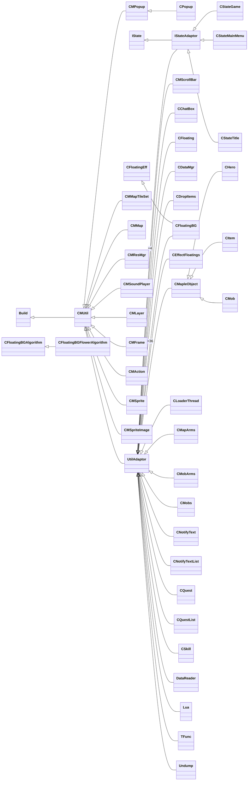

# C++ classes, RTTI and vtables

<!-- Generated by `python3 -m mtport.rtti generate` (tools/mtport/rtti.py). Do not edit by hand: rerun the generator. -->

Recovered from the `armv7` slice (`work/slices/MapleThief.armv7`, sha256 `60d4d5e75de5eb478ed320377babca8eab6616e9a94faad805f71cf8e084e467`) by `python3 -m mtport.rtti generate`, which also writes `work/re/vtables.json` and the Ghidra names `work/re/names/rtti.json`. Addresses are armv7 VM addresses; slot targets are function pointers (Thumb bit set). How the data is found and the naming rules are in the docstring of `tools/mtport/rtti.py`.

| | Count |
|---|---|
| Classes (`type_info` objects) | 63 (21 `__class_type_info`, 40 `__si_class_type_info`, 2 `__vmi_class_type_info`) |
| Classes with a vtable | 63 |
| Vtables | 68 (5 secondary) |
| Slots | 266 (31 pure virtual) |
| Distinct slot functions | 189 (53 virtual, 126 destructors, 10 thunks) |
| Slots that are not an `LC_FUNCTION_STARTS` function | 31 (all pure virtual: True) |

Function names: `Class::vfN` is slot N of the owning class's primary vtable (an override keeps its base's number), `Class::~Class` / `Class::~Class_deleting` are the complete-object (D1) and deleting (D0) destructors, and `Name@thunk-N` is a non-virtual thunk that adds -N to `this` and calls `Name`. Data labels: `Class::typeinfo`, `Class::typeinfo_name`, `Class::vtable` and `Class::vtable_for_Base` (a secondary vtable).

**63 classes, not 64.** docs/ANALYSIS.md used to list 64 RTTI names. The 64th, `CPW`, is not a type name: the bytes `43 50 57` (`CPW`) occur only six times, all inside one Thumb function in `__text` (`0xBCED8`–`0xBCFE6`), where they are `str r3, [r0, r1]` (`43 50`) followed by the first byte of an `ldr.w r0, [r7, #-0x1c]` (`57 f8 1c 0c`). No `type_info` points at them. Every `type_info` object in the image is reached from one of the 63 `__cxxabiv1` vtable binds, and every class name they hold is listed below.

## Hierarchy

Classes with no base and no derived class (17): `CMImage`, `CMSocket`, `CMTimer`, `SkyCanvas`, `CAniManager`, `CSelItem`, `CMsg`, `CDamageFloatings`, `CFloatingBGImage`, `CMapleWorld`, `CRequire`, `CReward`, `Stringtable`, `Symbol`, `Table`, `TaggedString`, `SVectorClass`.

## Classes

| Class | Bases | Derived | `type_info` | Vtable | Slots | Destructor slots |
|---|---|---|---|---|---|---|
| [`IState`](#istate) | – | `IStateAdaptor` | `0xFC714` (__class_type_info) | `0xFC6B0` | 23 | 0, 1 |
| [`UtilAdaptor`](#utiladaptor) | `CMUtil` | `IStateAdaptor`, `CMScrollBar`, `CChatBox`, `CFloating`, `CDataMgr`, `CDropItems`, `CFloatingBG`, `CEffectFloatings`, `CLoaderThread`, `CMapArms`, `CMapleObject`, `CMobArms`, `CMobs`, `CNotifyText`, `CNotifyTextList`, `CQuest`, `CQuestList`, `CSkill`, `DataReader`, `Lua`, `TFunc`, `Undump` | `0xFC72C` (__si_class_type_info) | `0xFC71C` | 2 | 0, 1 |
| [`CPopup`](#cpopup) | `CMPopup` | – | `0x11787C` (__si_class_type_info) | `0x11786C` | 2 | 0, 1 |
| [`IStateAdaptor`](#istateadaptor) | `IState`, `UtilAdaptor` (at +4) | `CStateGame`, `CStateMainMenu`, `CStateTitle` | `0x1195C0` (__vmi_class_type_info) | `0x119540` | 24 | 0, 1 |
| [`CMImage`](#cmimage) | – | – | `0x1195F0` (__class_type_info) | `0x1195E0` | 2 | 0, 1 |
| [`CMMapTileSet`](#cmmaptileset) | `CMUtil` | – | `0x119608` (__si_class_type_info) | `0x1195F8` | 2 | 0, 1 |
| [`CMMap`](#cmmap) | `CMUtil` | – | `0x119624` (__si_class_type_info) | `0x119614` | 2 | 0, 1 |
| [`CMPopup`](#cmpopup) | `CMUtil` | `CPopup` | `0x119640` (__si_class_type_info) | `0x119630` | 2 | 0, 1 |
| [`CMResMgr`](#cmresmgr) | `CMUtil` | – | `0x11965C` (__si_class_type_info) | `0x11964C` | 2 | 0, 1 |
| [`CMScrollBar`](#cmscrollbar) | `UtilAdaptor` | – | `0x119678` (__si_class_type_info) | `0x119668` | 2 | 0, 1 |
| [`CMSocket`](#cmsocket) | – | – | `0x119694` (__class_type_info) | `0x119684` | 2 | 0, 1 |
| [`CMSoundPlayer`](#cmsoundplayer) | `CMUtil` | – | `0x1196AC` (__si_class_type_info) | `0x11969C` | 2 | 0, 1 |
| [`CMLayer`](#cmlayer) | `CMUtil` | – | `0x1196C8` (__si_class_type_info) | `0x1196B8` | 2 | 0, 1 |
| [`CMFrame`](#cmframe) | `CMUtil` | – | `0x1196E4` (__si_class_type_info) | `0x1196D4` | 2 | 0, 1 |
| [`CMAction`](#cmaction) | `CMUtil` | – | `0x119700` (__si_class_type_info) | `0x1196F0` | 2 | 0, 1 |
| [`CMSprite`](#cmsprite) | `CMUtil` | – | `0x11971C` (__si_class_type_info) | `0x11970C` | 2 | 0, 1 |
| [`CMSpriteImage`](#cmspriteimage) | `CMUtil` | – | `0x119738` (__si_class_type_info) | `0x119728` | 2 | 0, 1 |
| [`CMTimer`](#cmtimer) | – | – | `0x119754` (__class_type_info) | `0x119744` | 2 | 0, 1 |
| [`CMUtil`](#cmutil) | `Build` | `UtilAdaptor`, `CMMapTileSet`, `CMMap`, `CMPopup`, `CMResMgr`, `CMSoundPlayer`, `CMLayer`, `CMFrame`, `CMAction`, `CMSprite`, `CMSpriteImage` | `0x11976C` (__si_class_type_info) | `0x11975C` | 2 | 0, 1 |
| [`SkyCanvas`](#skycanvas) | – | – | `0x119788` (__class_type_info) | `0x119778` | 2 | 0, 1 |
| [`Build`](#build) | – | `CMUtil` | `0x1197A0` (__class_type_info) | `0x119790` | 2 | 0, 1 |
| [`CAniManager`](#canimanager) | – | – | `0x1197B8` (__class_type_info) | `0x1197A8` | 2 | 0, 1 |
| [`CSelItem`](#cselitem) | – | – | `0x1197D0` (__class_type_info) | `0x1197C0` | 2 | 0, 1 |
| [`CMsg`](#cmsg) | – | – | `0x1197E8` (__class_type_info) | `0x1197D8` | 2 | 0, 1 |
| [`CChatBox`](#cchatbox) | `UtilAdaptor` | – | `0x119800` (__si_class_type_info) | `0x1197F0` | 2 | 0, 1 |
| [`CFloating`](#cfloating) | `UtilAdaptor` | – | `0x11981C` (__si_class_type_info) | `0x11980C` | 2 | 0, 1 |
| [`CDamageFloatings`](#cdamagefloatings) | – | – | `0x119838` (__class_type_info) | `0x119828` | 2 | 0, 1 |
| [`CDataMgr`](#cdatamgr) | `UtilAdaptor` | – | `0x119850` (__si_class_type_info) | `0x119840` | 2 | 0, 1 |
| [`CDropItems`](#cdropitems) | `UtilAdaptor` | – | `0x11986C` (__si_class_type_info) | `0x11985C` | 2 | 0, 1 |
| [`CFloatingEff`](#cfloatingeff) | – | `CFloatingBG` | `0x119894` (__class_type_info) | `0x119880` | 3 | 0, 1 |
| [`CFloatingBGAlgorithm`](#cfloatingbgalgorithm) | – | `CFloatingBGFlowerAlgorithm` | `0x1198BC` (__class_type_info) | `0x1198A0` | 5 | 0, 1 |
| [`CFloatingBGFlowerAlgorithm`](#cfloatingbgfloweralgorithm) | `CFloatingBGAlgorithm` | – | `0x1198EC` (__si_class_type_info) | `0x1198D0` | 5 | 0, 1 |
| [`CFloatingBGImage`](#cfloatingbgimage) | – | – | `0x119908` (__class_type_info) | `0x1198F8` | 2 | 0, 1 |
| [`CFloatingBG`](#cfloatingbg) | `CFloatingEff`, `UtilAdaptor` (at +36) | – | `0x119940` (__vmi_class_type_info) | `0x119910` | 3 | 0, 1 |
| [`CEffectFloatings`](#ceffectfloatings) | `UtilAdaptor` | – | `0x119970` (__si_class_type_info) | `0x119960` | 2 | 0, 1 |
| [`CHero`](#chero) | `CMapleObject` | – | `0x11999C` (__si_class_type_info) | `0x119980` | 5 | 0, 1 |
| [`CItem`](#citem) | `CMapleObject` | – | `0x1199CC` (__si_class_type_info) | `0x1199B0` | 5 | 0, 1 |
| [`CLoaderThread`](#cloaderthread) | `UtilAdaptor` | – | `0x1199E8` (__si_class_type_info) | `0x1199D8` | 2 | 0, 1 |
| [`CMapArms`](#cmaparms) | `UtilAdaptor` | – | `0x119A04` (__si_class_type_info) | `0x1199F4` | 2 | 0, 1 |
| [`CMapleObject`](#cmapleobject) | `UtilAdaptor` | `CHero`, `CItem`, `CMob` | `0x119A2C` (__si_class_type_info) | `0x119A10` | 5 | 0, 1 |
| [`CMapleWorld`](#cmapleworld) | – | – | `0x119A48` (__class_type_info) | `0x119A38` | 2 | 0, 1 |
| [`CMobArms`](#cmobarms) | `UtilAdaptor` | – | `0x119A60` (__si_class_type_info) | `0x119A50` | 2 | 0, 1 |
| [`CMob`](#cmob) | `CMapleObject` | – | `0x119A8C` (__si_class_type_info) | `0x119A70` | 5 | 0, 1 |
| [`CMobs`](#cmobs) | `UtilAdaptor` | – | `0x119AA8` (__si_class_type_info) | `0x119A98` | 2 | 0, 1 |
| [`CNotifyText`](#cnotifytext) | `UtilAdaptor` | – | `0x119AC4` (__si_class_type_info) | `0x119AB4` | 2 | 0, 1 |
| [`CNotifyTextList`](#cnotifytextlist) | `UtilAdaptor` | – | `0x119AE0` (__si_class_type_info) | `0x119AD0` | 2 | 0, 1 |
| [`CRequire`](#crequire) | – | – | `0x119AFC` (__class_type_info) | `0x119AEC` | 2 | 0, 1 |
| [`CReward`](#creward) | – | – | `0x119B14` (__class_type_info) | `0x119B04` | 2 | 0, 1 |
| [`CQuest`](#cquest) | `UtilAdaptor` | – | `0x119B2C` (__si_class_type_info) | `0x119B1C` | 2 | 0, 1 |
| [`CQuestList`](#cquestlist) | `UtilAdaptor` | – | `0x119B48` (__si_class_type_info) | `0x119B38` | 2 | 0, 1 |
| [`CSkill`](#cskill) | `UtilAdaptor` | – | `0x119B64` (__si_class_type_info) | `0x119B54` | 2 | 0, 1 |
| [`CStateGame`](#cstategame) | `IStateAdaptor` | – | `0x119BE8` (__si_class_type_info) | `0x119B70` | 24 | 0, 1 |
| [`CStateMainMenu`](#cstatemainmenu) | `IStateAdaptor` | – | `0x119C7C` (__si_class_type_info) | `0x119C00` | 25 | 0, 1 |
| [`CStateTitle`](#cstatetitle) | `IStateAdaptor` | – | `0x119D08` (__si_class_type_info) | `0x119C90` | 24 | 0, 1 |
| [`DataReader`](#datareader) | `UtilAdaptor` | – | `0x119D24` (__si_class_type_info) | `0x119D14` | 2 | 0, 1 |
| [`Lua`](#lua) | `UtilAdaptor` | – | `0x119D40` (__si_class_type_info) | `0x119D30` | 2 | 0, 1 |
| [`Stringtable`](#stringtable) | – | – | `0x119D5C` (__class_type_info) | `0x119D4C` | 2 | 0, 1 |
| [`Symbol`](#symbol) | – | – | `0x119D74` (__class_type_info) | `0x119D64` | 2 | 0, 1 |
| [`Table`](#table) | – | – | `0x119D8C` (__class_type_info) | `0x119D7C` | 2 | 0, 1 |
| [`TaggedString`](#taggedstring) | – | – | `0x119DA4` (__class_type_info) | `0x119D94` | 2 | 0, 1 |
| [`TFunc`](#tfunc) | `UtilAdaptor` | – | `0x119DBC` (__si_class_type_info) | `0x119DAC` | 2 | 0, 1 |
| [`Undump`](#undump) | `UtilAdaptor` | – | `0x119DD8` (__si_class_type_info) | `0x119DC8` | 2 | 0, 1 |
| [`SVectorClass`](#svectorclass) | – | – | `0x119DF4` (__class_type_info) | `0x119DE4` | 2 | 0, 1 |

## Virtual interfaces

Each class below declares virtual functions besides its destructor. The table shows every slot it declares and what each derived class puts there (*inherited* = the function of the class in brackets; sizes in bytes). Method names come from localization keys the functions look up: a function of class `C` that loads `C.Method.N` keys (`ScriptExtra.strings`, see docs/ANALYSIS.md) is `C::Method`. Other slots keep their number.

### IState interface

| Slot | Method | `IState` | `IStateAdaptor` | `CStateGame` | `CStateMainMenu` | `CStateTitle` |
|---|---|---|---|---|---|---|
| 2 | – | pure | pure | `0x80A35` 56 B | `0x97201` 596 B | `0x98751` 92 B |
| 3 | – | pure | pure | `0x80785` 8 B | `0x94361` 8 B | `0x97E5D` 8 B |
| 4 | – | pure | `0xB10D` 8 B | `0x80795` 8 B | *inherited* (IStateAdaptor) | *inherited* (IStateAdaptor) |
| 5 | – | pure | `0xB115` 8 B | `0x8078D` 8 B | *inherited* (IStateAdaptor) | *inherited* (IStateAdaptor) |
| 6 | OnKeyPressed | pure | pure | `0x8D4C9` 23344 B | `0x9462D` 8728 B | `0x97E65` 12 B |
| 7 | – | pure | `0xB129` 12 B | `0x80899` 156 B | *inherited* (IStateAdaptor) | *inherited* (IStateAdaptor) |
| 8 | – | pure | `0xB11D` 12 B | *inherited* (IStateAdaptor) | *inherited* (IStateAdaptor) | *inherited* (IStateAdaptor) |
| 9 | Paint | pure | pure | `0x87501` 24520 B | `0x944D1` 348 B | `0x981B9` 1432 B |
| 10 | – | pure | pure | `0x874E1` 32 B | `0x94369` 8 B | `0x97E71` 8 B |
| 11 | – | pure | `0xB135` 12 B | *inherited* (IStateAdaptor) | *inherited* (IStateAdaptor) | *inherited* (IStateAdaptor) |
| 12 | – | pure | `0xB0F5` 24 B | *inherited* (IStateAdaptor) | *inherited* (IStateAdaptor) | *inherited* (IStateAdaptor) |
| 13 | – | pure | `0xAF81` 148 B | *inherited* (IStateAdaptor) | *inherited* (IStateAdaptor) | *inherited* (IStateAdaptor) |
| 14 | – | pure | `0xAABD` 116 B | *inherited* (IStateAdaptor) | *inherited* (IStateAdaptor) | *inherited* (IStateAdaptor) |
| 15 | – | pure | `0xAB31` 184 B | *inherited* (IStateAdaptor) | *inherited* (IStateAdaptor) | *inherited* (IStateAdaptor) |
| 16 | – | pure | `0xABE9` 172 B | *inherited* (IStateAdaptor) | *inherited* (IStateAdaptor) | *inherited* (IStateAdaptor) |
| 17 | – | pure | `0xAC95` 140 B | *inherited* (IStateAdaptor) | *inherited* (IStateAdaptor) | *inherited* (IStateAdaptor) |
| 18 | – | pure | `0xAD41` 16 B | *inherited* (IStateAdaptor) | *inherited* (IStateAdaptor) | *inherited* (IStateAdaptor) |
| 19 | – | pure | `0xAD21` 32 B | *inherited* (IStateAdaptor) | *inherited* (IStateAdaptor) | *inherited* (IStateAdaptor) |
| 20 | – | pure | `0xAD51` 20 B | *inherited* (IStateAdaptor) | *inherited* (IStateAdaptor) | *inherited* (IStateAdaptor) |
| 21 | – | pure | `0xAD65` 92 B | *inherited* (IStateAdaptor) | *inherited* (IStateAdaptor) | *inherited* (IStateAdaptor) |
| 22 | – | pure | `0xADC1` 44 B | `0x8079D` 28 B | `0x94371` 16 B | `0x97E81` 92 B |

- slot 6 = `OnKeyPressed`: 0x8D4C9 (CStateGame, slot 6) looks up 6 CStateGame.OnKeyPressed.N
- slot 9 = `Paint`: 0x87501 (CStateGame, slot 9) looks up 7 CStateGame.Paint.N; 0x981B9 (CStateTitle, slot 9) looks up 7 CStateTitle.Paint.N

### IStateAdaptor interface

| Slot | Method | `IStateAdaptor` | `CStateGame` | `CStateMainMenu` | `CStateTitle` |
|---|---|---|---|---|---|
| 23 | – | `0xB141` 12 B | *inherited* (IStateAdaptor) | *inherited* (IStateAdaptor) | *inherited* (IStateAdaptor) |

### CFloatingEff interface

| Slot | Method | `CFloatingEff` | `CFloatingBG` |
|---|---|---|---|
| 2 | – | `0x5D035` 180 B | `0x5D1D5` 76 B |

### CFloatingBGAlgorithm interface

| Slot | Method | `CFloatingBGAlgorithm` | `CFloatingBGFlowerAlgorithm` |
|---|---|---|---|
| 2 | – | pure | `0x5D429` 48 B |
| 3 | – | pure | `0x5D459` 288 B |
| 4 | – | pure | `0x5D579` 604 B |

### CMapleObject interface

| Slot | Method | `CMapleObject` | `CHero` | `CItem` | `CMob` |
|---|---|---|---|---|---|
| 2 | – | pure | `0x66189` 964 B | `0x69361` 352 B | `0x72CB5` 1684 B |
| 3 | – | `0x6AEAD` 8 B | `0x61895` 76 B | *inherited* (CMapleObject) | `0x728E1` 296 B |
| 4 | Flush | pure | `0x62ADD` 1716 B | `0x69279` 8 B | `0x7458D` 2360 B |

- slot 4 = `Flush`: 0x62ADD (CHero, slot 4) looks up 7 CHero.Flush.N

### CStateMainMenu interface

| Slot | Method | `CStateMainMenu` |
|---|---|---|
| 24 | – | `0x96845` 2492 B |

## Vtables

### IState

- `__class_type_info` at `0xFC714`, name `6IState` at `0xEA590`
- bases: –

Primary vtable at `0xFC6B0` (offset_to_top 0, address point `0xFC6B8`, 23 slots, followed by typeinfo):

| Slot | Target | Function | Bytes | Defined in |
|---|---|---|---|---|
| 0 | `0xB169` | `IState::~IState` | 44 | this class |
| 1 | `0xB195` | `IState::~IState_deleting` | 44 | this class |
| 2 | – | pure virtual (`___cxa_pure_virtual`) | – | – |
| 3 | – | pure virtual (`___cxa_pure_virtual`) | – | – |
| 4 | – | pure virtual (`___cxa_pure_virtual`) | – | – |
| 5 | – | pure virtual (`___cxa_pure_virtual`) | – | – |
| 6 | – | pure virtual `OnKeyPressed` (`___cxa_pure_virtual`) | – | – |
| 7 | – | pure virtual (`___cxa_pure_virtual`) | – | – |
| 8 | – | pure virtual (`___cxa_pure_virtual`) | – | – |
| 9 | – | pure virtual `Paint` (`___cxa_pure_virtual`) | – | – |
| 10 | – | pure virtual (`___cxa_pure_virtual`) | – | – |
| 11 | – | pure virtual (`___cxa_pure_virtual`) | – | – |
| 12 | – | pure virtual (`___cxa_pure_virtual`) | – | – |
| 13 | – | pure virtual (`___cxa_pure_virtual`) | – | – |
| 14 | – | pure virtual (`___cxa_pure_virtual`) | – | – |
| 15 | – | pure virtual (`___cxa_pure_virtual`) | – | – |
| 16 | – | pure virtual (`___cxa_pure_virtual`) | – | – |
| 17 | – | pure virtual (`___cxa_pure_virtual`) | – | – |
| 18 | – | pure virtual (`___cxa_pure_virtual`) | – | – |
| 19 | – | pure virtual (`___cxa_pure_virtual`) | – | – |
| 20 | – | pure virtual (`___cxa_pure_virtual`) | – | – |
| 21 | – | pure virtual (`___cxa_pure_virtual`) | – | – |
| 22 | – | pure virtual (`___cxa_pure_virtual`) | – | – |

### UtilAdaptor

- `__si_class_type_info` at `0xFC72C`, name `11UtilAdaptor` at `0xEA598`
- bases: `CMUtil`

Primary vtable at `0xFC71C` (offset_to_top 0, address point `0xFC724`, 2 slots, followed by typeinfo):

| Slot | Target | Function | Bytes | Defined in |
|---|---|---|---|---|
| 0 | `0xB221` | `UtilAdaptor::~UtilAdaptor` | 52 | this class |
| 1 | `0xB255` | `UtilAdaptor::~UtilAdaptor_deleting` | 52 | this class |

### CPopup

- `__si_class_type_info` at `0x11787C`, name `6CPopup` at `0xEAD38`
- bases: `CMPopup`

Primary vtable at `0x11786C` (offset_to_top 0, address point `0x117874`, 2 slots, followed by typeinfo):

| Slot | Target | Function | Bytes | Defined in |
|---|---|---|---|---|
| 0 | `0x79949` | `CPopup::~CPopup` | 52 | this class |
| 1 | `0x7997D` | `CPopup::~CPopup_deleting` | 52 | this class |

### IStateAdaptor

- `__vmi_class_type_info` at `0x1195C0`, name `13IStateAdaptor` at `0xE27AA`
- bases: `IState`, `UtilAdaptor` (at +4)
- `__flags` 0

Primary vtable at `0x119540` (offset_to_top 0, address point `0x119548`, 24 slots, followed by vtable):

| Slot | Target | Function | Bytes | Defined in |
|---|---|---|---|---|
| 0 | `0xB069` | `IStateAdaptor::~IStateAdaptor` | 56 | this class |
| 1 | `0xB031` | `IStateAdaptor::~IStateAdaptor_deleting` | 56 | this class |
| 2 | – | pure virtual (`___cxa_pure_virtual`) | – | – |
| 3 | – | pure virtual (`___cxa_pure_virtual`) | – | – |
| 4 | `0xB10D` | `IStateAdaptor::vf4` | 8 | this class |
| 5 | `0xB115` | `IStateAdaptor::vf5` | 8 | this class |
| 6 | – | pure virtual `OnKeyPressed` (`___cxa_pure_virtual`) | – | – |
| 7 | `0xB129` | `IStateAdaptor::vf7` | 12 | this class |
| 8 | `0xB11D` | `IStateAdaptor::vf8` | 12 | this class |
| 9 | – | pure virtual `Paint` (`___cxa_pure_virtual`) | – | – |
| 10 | – | pure virtual (`___cxa_pure_virtual`) | – | – |
| 11 | `0xB135` | `IStateAdaptor::vf11` | 12 | this class |
| 12 | `0xB0F5` | `IStateAdaptor::vf12` | 24 | this class |
| 13 | `0xAF81` | `IStateAdaptor::vf13` | 148 | this class |
| 14 | `0xAABD` | `IStateAdaptor::vf14` | 116 | this class |
| 15 | `0xAB31` | `IStateAdaptor::vf15` | 184 | this class |
| 16 | `0xABE9` | `IStateAdaptor::vf16` | 172 | this class |
| 17 | `0xAC95` | `IStateAdaptor::vf17` | 140 | this class |
| 18 | `0xAD41` | `IStateAdaptor::vf18` | 16 | this class |
| 19 | `0xAD21` | `IStateAdaptor::vf19` | 32 | this class |
| 20 | `0xAD51` | `IStateAdaptor::vf20` | 20 | this class |
| 21 | `0xAD65` | `IStateAdaptor::vf21` | 92 | this class |
| 22 | `0xADC1` | `IStateAdaptor::vf22` | 44 | this class |
| 23 | `0xB141` | `IStateAdaptor::vf23` | 12 | this class |

Vtable for the `UtilAdaptor` base at `0x1195A8` (offset_to_top -4, address point `0x1195B0`, 2 slots, followed by data):

| Slot | Target | Function | Bytes | Defined in |
|---|---|---|---|---|
| 0 | `0xB0A1` | `IStateAdaptor::~IStateAdaptor@thunk-4` | 28 | this class |
| 1 | `0xB015` | `IStateAdaptor::~IStateAdaptor_deleting@thunk-4` | 28 | this class |

### CMImage

- `__class_type_info` at `0x1195F0`, name `7CMImage` at `0xE27C5`
- bases: –

Primary vtable at `0x1195E0` (offset_to_top 0, address point `0x1195E8`, 2 slots, followed by typeinfo):

| Slot | Target | Function | Bytes | Defined in |
|---|---|---|---|---|
| 0 | `0xB8A5` | `CMImage::~CMImage` | 52 | this class |
| 1 | `0xB8D9` | `CMImage::~CMImage_deleting` | 52 | this class |

### CMMapTileSet

- `__si_class_type_info` at `0x119608`, name `12CMMapTileSet` at `0xE27F5`
- bases: `CMUtil`

Primary vtable at `0x1195F8` (offset_to_top 0, address point `0x119600`, 2 slots, followed by typeinfo):

| Slot | Target | Function | Bytes | Defined in |
|---|---|---|---|---|
| 0 | `0xC75D` | `CMMapTileSet::~CMMapTileSet` | 492 | this class |
| 1 | `0xC571` | `CMMapTileSet::~CMMapTileSet_deleting` | 492 | this class |

### CMMap

- `__si_class_type_info` at `0x119624`, name `5CMMap` at `0xE2804`
- bases: `CMUtil`

Primary vtable at `0x119614` (offset_to_top 0, address point `0x11961C`, 2 slots, followed by typeinfo):

| Slot | Target | Function | Bytes | Defined in |
|---|---|---|---|---|
| 0 | `0xCBD5` | `CMMap::~CMMap` | 652 | this class |
| 1 | `0xC949` | `CMMap::~CMMap_deleting` | 652 | this class |

### CMPopup

- `__si_class_type_info` at `0x119640`, name `7CMPopup` at `0xE2838`
- bases: `CMUtil`

Primary vtable at `0x119630` (offset_to_top 0, address point `0x119638`, 2 slots, followed by typeinfo):

| Slot | Target | Function | Bytes | Defined in |
|---|---|---|---|---|
| 0 | `0xED69` | `CMPopup::~CMPopup` | 664 | this class |
| 1 | `0xEAD1` | `CMPopup::~CMPopup_deleting` | 664 | this class |

### CMResMgr

- `__si_class_type_info` at `0x11965C`, name `8CMResMgr` at `0xE3714`
- bases: `CMUtil`

Primary vtable at `0x11964C` (offset_to_top 0, address point `0x119654`, 2 slots, followed by typeinfo):

| Slot | Target | Function | Bytes | Defined in |
|---|---|---|---|---|
| 0 | `0x19689` | `CMResMgr::~CMResMgr` | 4052 | this class |
| 1 | `0x186B5` | `CMResMgr::~CMResMgr_deleting` | 4052 | this class |

### CMScrollBar

- `__si_class_type_info` at `0x119678`, name `11CMScrollBar` at `0xE371E`
- bases: `UtilAdaptor`

Primary vtable at `0x119668` (offset_to_top 0, address point `0x119670`, 2 slots, followed by typeinfo):

| Slot | Target | Function | Bytes | Defined in |
|---|---|---|---|---|
| 0 | `0x1BB31` | `CMScrollBar::~CMScrollBar` | 52 | this class |
| 1 | `0x1BAFD` | `CMScrollBar::~CMScrollBar_deleting` | 52 | this class |

### CMSocket

- `__class_type_info` at `0x119694`, name `8CMSocket` at `0xE372C`
- bases: –

Primary vtable at `0x119684` (offset_to_top 0, address point `0x11968C`, 2 slots, followed by typeinfo):

| Slot | Target | Function | Bytes | Defined in |
|---|---|---|---|---|
| 0 | `0x1C7B5` | `CMSocket::~CMSocket` | 256 | this class |
| 1 | `0x1C6B5` | `CMSocket::~CMSocket_deleting` | 256 | this class |

### CMSoundPlayer

- `__si_class_type_info` at `0x1196AC`, name `13CMSoundPlayer` at `0xE37D9`
- bases: `CMUtil`

Primary vtable at `0x11969C` (offset_to_top 0, address point `0x1196A4`, 2 slots, followed by typeinfo):

| Slot | Target | Function | Bytes | Defined in |
|---|---|---|---|---|
| 0 | `0x1DB19` | `CMSoundPlayer::~CMSoundPlayer` | 704 | this class |
| 1 | `0x1DDD9` | `CMSoundPlayer::~CMSoundPlayer_deleting` | 704 | this class |

### CMLayer

- `__si_class_type_info` at `0x1196C8`, name `7CMLayer` at `0xE3879`
- bases: `CMUtil`

Primary vtable at `0x1196B8` (offset_to_top 0, address point `0x1196C0`, 2 slots, followed by typeinfo):

| Slot | Target | Function | Bytes | Defined in |
|---|---|---|---|---|
| 0 | `0x1E6E1` | `CMLayer::~CMLayer` | 52 | this class |
| 1 | `0x1E6AD` | `CMLayer::~CMLayer_deleting` | 52 | this class |

### CMFrame

- `__si_class_type_info` at `0x1196E4`, name `7CMFrame` at `0xE3882`
- bases: `CMUtil`

Primary vtable at `0x1196D4` (offset_to_top 0, address point `0x1196DC`, 2 slots, followed by typeinfo):

| Slot | Target | Function | Bytes | Defined in |
|---|---|---|---|---|
| 0 | `0x1F58D` | `CMFrame::~CMFrame` | 532 | this class |
| 1 | `0x1F379` | `CMFrame::~CMFrame_deleting` | 532 | this class |

### CMAction

- `__si_class_type_info` at `0x119700`, name `8CMAction` at `0xE388B`
- bases: `CMUtil`

Primary vtable at `0x1196F0` (offset_to_top 0, address point `0x1196F8`, 2 slots, followed by typeinfo):

| Slot | Target | Function | Bytes | Defined in |
|---|---|---|---|---|
| 0 | `0x1FB89` | `CMAction::~CMAction` | 532 | this class |
| 1 | `0x1F975` | `CMAction::~CMAction_deleting` | 532 | this class |

### CMSprite

- `__si_class_type_info` at `0x11971C`, name `8CMSprite` at `0xE38B3`
- bases: `CMUtil`

Primary vtable at `0x11970C` (offset_to_top 0, address point `0x119714`, 2 slots, followed by typeinfo):

| Slot | Target | Function | Bytes | Defined in |
|---|---|---|---|---|
| 0 | `0x20C2D` | `CMSprite::~CMSprite` | 660 | this class |
| 1 | `0x20EC1` | `CMSprite::~CMSprite_deleting` | 660 | this class |

### CMSpriteImage

- `__si_class_type_info` at `0x119738`, name `13CMSpriteImage` at `0xE38CF`
- bases: `CMUtil`

Primary vtable at `0x119728` (offset_to_top 0, address point `0x119730`, 2 slots, followed by typeinfo):

| Slot | Target | Function | Bytes | Defined in |
|---|---|---|---|---|
| 0 | `0x216D1` | `CMSpriteImage::~CMSpriteImage` | 544 | this class |
| 1 | `0x214B1` | `CMSpriteImage::~CMSpriteImage_deleting` | 544 | this class |

### CMTimer

- `__class_type_info` at `0x119754`, name `7CMTimer` at `0xE38DF`
- bases: –

Primary vtable at `0x119744` (offset_to_top 0, address point `0x11974C`, 2 slots, followed by typeinfo):

| Slot | Target | Function | Bytes | Defined in |
|---|---|---|---|---|
| 0 | `0x22139` | `CMTimer::~CMTimer` | 44 | this class |
| 1 | `0x2210D` | `CMTimer::~CMTimer_deleting` | 44 | this class |

### CMUtil

- `__si_class_type_info` at `0x11976C`, name `6CMUtil` at `0xE38FD`
- bases: `Build`

Primary vtable at `0x11975C` (offset_to_top 0, address point `0x119764`, 2 slots, followed by typeinfo):

| Slot | Target | Function | Bytes | Defined in |
|---|---|---|---|---|
| 0 | `0x24E39` | `CMUtil::~CMUtil` | 52 | this class |
| 1 | `0x24E05` | `CMUtil::~CMUtil_deleting` | 52 | this class |

### SkyCanvas

- `__class_type_info` at `0x119788`, name `9SkyCanvas` at `0xE3905`
- bases: –

Primary vtable at `0x119778` (offset_to_top 0, address point `0x119780`, 2 slots, followed by typeinfo):

| Slot | Target | Function | Bytes | Defined in |
|---|---|---|---|---|
| 0 | `0x264FD` | `SkyCanvas::~SkyCanvas` | 44 | this class |
| 1 | `0x264D1` | `SkyCanvas::~SkyCanvas_deleting` | 44 | this class |

### Build

- `__class_type_info` at `0x1197A0`, name `5Build` at `0xE393C`
- bases: –

Primary vtable at `0x119790` (offset_to_top 0, address point `0x119798`, 2 slots, followed by typeinfo):

| Slot | Target | Function | Bytes | Defined in |
|---|---|---|---|---|
| 0 | `0x26785` | `Build::~Build` | 44 | this class |
| 1 | `0x267B1` | `Build::~Build_deleting` | 44 | this class |

### CAniManager

- `__class_type_info` at `0x1197B8`, name `11CAniManager` at `0xE3943`
- bases: –

Primary vtable at `0x1197A8` (offset_to_top 0, address point `0x1197B0`, 2 slots, followed by typeinfo):

| Slot | Target | Function | Bytes | Defined in |
|---|---|---|---|---|
| 0 | `0x26DA9` | `CAniManager::~CAniManager` | 376 | this class |
| 1 | `0x26C31` | `CAniManager::~CAniManager_deleting` | 376 | this class |

### CSelItem

- `__class_type_info` at `0x1197D0`, name `8CSelItem` at `0xE4640`
- bases: –

Primary vtable at `0x1197C0` (offset_to_top 0, address point `0x1197C8`, 2 slots, followed by typeinfo):

| Slot | Target | Function | Bytes | Defined in |
|---|---|---|---|---|
| 0 | `0x31C19` | `CSelItem::~CSelItem` | 96 | this class |
| 1 | `0x31BB9` | `CSelItem::~CSelItem_deleting` | 96 | this class |

### CMsg

- `__class_type_info` at `0x1197E8`, name `4CMsg` at `0xE464A`
- bases: –

Primary vtable at `0x1197D8` (offset_to_top 0, address point `0x1197E0`, 2 slots, followed by typeinfo):

| Slot | Target | Function | Bytes | Defined in |
|---|---|---|---|---|
| 0 | `0x31CD9` | `CMsg::~CMsg` | 96 | this class |
| 1 | `0x31C79` | `CMsg::~CMsg_deleting` | 96 | this class |

### CChatBox

- `__si_class_type_info` at `0x119800`, name `8CChatBox` at `0xE475B`
- bases: `UtilAdaptor`

Primary vtable at `0x1197F0` (offset_to_top 0, address point `0x1197F8`, 2 slots, followed by typeinfo):

| Slot | Target | Function | Bytes | Defined in |
|---|---|---|---|---|
| 0 | `0x361E5` | `CChatBox::~CChatBox` | 488 | this class |
| 1 | `0x35FFD` | `CChatBox::~CChatBox_deleting` | 488 | this class |

### CFloating

- `__si_class_type_info` at `0x11981C`, name `9CFloating` at `0xE4765`
- bases: `UtilAdaptor`

Primary vtable at `0x11980C` (offset_to_top 0, address point `0x119814`, 2 slots, followed by typeinfo):

| Slot | Target | Function | Bytes | Defined in |
|---|---|---|---|---|
| 0 | `0x367F1` | `CFloating::~CFloating` | 52 | this class |
| 1 | `0x367BD` | `CFloating::~CFloating_deleting` | 52 | this class |

### CDamageFloatings

- `__class_type_info` at `0x119838`, name `16CDamageFloatings` at `0xE4770`
- bases: –

Primary vtable at `0x119828` (offset_to_top 0, address point `0x119830`, 2 slots, followed by typeinfo):

| Slot | Target | Function | Bytes | Defined in |
|---|---|---|---|---|
| 0 | `0x36CA1` | `CDamageFloatings::~CDamageFloatings` | 64 | this class |
| 1 | `0x36C61` | `CDamageFloatings::~CDamageFloatings_deleting` | 64 | this class |

### CDataMgr

- `__si_class_type_info` at `0x119850`, name `8CDataMgr` at `0xE4E1D`
- bases: `UtilAdaptor`

Primary vtable at `0x119840` (offset_to_top 0, address point `0x119848`, 2 slots, followed by typeinfo):

| Slot | Target | Function | Bytes | Defined in |
|---|---|---|---|---|
| 0 | `0x5ADCD` | `CDataMgr::~CDataMgr` | 108 | this class |
| 1 | `0x5AD61` | `CDataMgr::~CDataMgr_deleting` | 108 | this class |

### CDropItems

- `__si_class_type_info` at `0x11986C`, name `10CDropItems` at `0xE4F0F`
- bases: `UtilAdaptor`

Primary vtable at `0x11985C` (offset_to_top 0, address point `0x119864`, 2 slots, followed by typeinfo):

| Slot | Target | Function | Bytes | Defined in |
|---|---|---|---|---|
| 0 | `0x5CCA1` | `CDropItems::~CDropItems` | 364 | this class |
| 1 | `0x5CB35` | `CDropItems::~CDropItems_deleting` | 364 | this class |

### CFloatingEff

- `__class_type_info` at `0x119894`, name `12CFloatingEff` at `0xE4F1C`
- bases: –

Primary vtable at `0x119880` (offset_to_top 0, address point `0x119888`, 3 slots, followed by typeinfo):

| Slot | Target | Function | Bytes | Defined in |
|---|---|---|---|---|
| 0 | `0x5CFDD` | `CFloatingEff::~CFloatingEff` | 44 | this class |
| 1 | `0x5D009` | `CFloatingEff::~CFloatingEff_deleting` | 44 | this class |
| 2 | `0x5D035` | `CFloatingEff::vf2` | 180 | this class |

### CFloatingBGAlgorithm

- `__class_type_info` at `0x1198BC`, name `20CFloatingBGAlgorithm` at `0xE4F2B`
- bases: –

Primary vtable at `0x1198A0` (offset_to_top 0, address point `0x1198A8`, 5 slots, followed by typeinfo):

| Slot | Target | Function | Bytes | Defined in |
|---|---|---|---|---|
| 0 | `0x5D249` | `CFloatingBGAlgorithm::~CFloatingBGAlgorithm` | 44 | this class |
| 1 | `0x5D275` | `CFloatingBGAlgorithm::~CFloatingBGAlgorithm_deleting` | 44 | this class |
| 2 | – | pure virtual (`___cxa_pure_virtual`) | – | – |
| 3 | – | pure virtual (`___cxa_pure_virtual`) | – | – |
| 4 | – | pure virtual (`___cxa_pure_virtual`) | – | – |

### CFloatingBGFlowerAlgorithm

- `__si_class_type_info` at `0x1198EC`, name `26CFloatingBGFlowerAlgorithm` at `0xE4F42`
- bases: `CFloatingBGAlgorithm`

Primary vtable at `0x1198D0` (offset_to_top 0, address point `0x1198D8`, 5 slots, followed by typeinfo):

| Slot | Target | Function | Bytes | Defined in |
|---|---|---|---|---|
| 0 | `0x5D2A1` | `CFloatingBGFlowerAlgorithm::~CFloatingBGFlowerAlgorithm` | 196 | this class |
| 1 | `0x5D365` | `CFloatingBGFlowerAlgorithm::~CFloatingBGFlowerAlgorithm_deleting` | 196 | this class |
| 2 | `0x5D429` | `CFloatingBGFlowerAlgorithm::vf2` | 48 | this class |
| 3 | `0x5D459` | `CFloatingBGFlowerAlgorithm::vf3` | 288 | this class |
| 4 | `0x5D579` | `CFloatingBGFlowerAlgorithm::vf4` | 604 | this class |

### CFloatingBGImage

- `__class_type_info` at `0x119908`, name `16CFloatingBGImage` at `0xE4F5F`
- bases: –

Primary vtable at `0x1198F8` (offset_to_top 0, address point `0x119900`, 2 slots, followed by typeinfo):

| Slot | Target | Function | Bytes | Defined in |
|---|---|---|---|---|
| 0 | `0x5DA39` | `CFloatingBGImage::~CFloatingBGImage` | 416 | this class |
| 1 | `0x5D899` | `CFloatingBGImage::~CFloatingBGImage_deleting` | 416 | this class |

### CFloatingBG

- `__vmi_class_type_info` at `0x119940`, name `11CFloatingBG` at `0xE4F72`
- bases: `CFloatingEff`, `UtilAdaptor` (at +36)
- `__flags` 0

Primary vtable at `0x119910` (offset_to_top 0, address point `0x119918`, 3 slots, followed by vtable):

| Slot | Target | Function | Bytes | Defined in |
|---|---|---|---|---|
| 0 | `0x5E06D` | `CFloatingBG::~CFloatingBG` | 768 | this class |
| 1 | `0x5DD6D` | `CFloatingBG::~CFloatingBG_deleting` | 768 | this class |
| 2 | `0x5D1D5` | `CFloatingBG::vf2` | 76 | this class |

Vtable for the `UtilAdaptor` base at `0x119924` (offset_to_top -36, address point `0x11992C`, 2 slots, followed by data):

| Slot | Target | Function | Bytes | Defined in |
|---|---|---|---|---|
| 0 | `0x5E36D` | `CFloatingBG::~CFloatingBG@thunk-36` | 28 | this class |
| 1 | `0x5DD51` | `CFloatingBG::~CFloatingBG_deleting@thunk-36` | 28 | this class |

### CEffectFloatings

- `__si_class_type_info` at `0x119970`, name `16CEffectFloatings` at `0xE4F99`
- bases: `UtilAdaptor`

Primary vtable at `0x119960` (offset_to_top 0, address point `0x119968`, 2 slots, followed by typeinfo):

| Slot | Target | Function | Bytes | Defined in |
|---|---|---|---|---|
| 0 | `0x5ED7D` | `CEffectFloatings::~CEffectFloatings` | 464 | this class |
| 1 | `0x5EBAD` | `CEffectFloatings::~CEffectFloatings_deleting` | 464 | this class |

### CHero

- `__si_class_type_info` at `0x11999C`, name `5CHero` at `0xE516A`
- bases: `CMapleObject`

Primary vtable at `0x119980` (offset_to_top 0, address point `0x119988`, 5 slots, followed by typeinfo):

| Slot | Target | Function | Bytes | Defined in |
|---|---|---|---|---|
| 0 | `0x68575` | `CHero::~CHero` | 1252 | this class |
| 1 | `0x68091` | `CHero::~CHero_deleting` | 1252 | this class |
| 2 | `0x66189` | `CHero::vf2` | 964 | this class |
| 3 | `0x61895` | `CHero::vf3` | 76 | this class |
| 4 | `0x62ADD` | `CHero::Flush` | 1716 | this class |

### CItem

- `__si_class_type_info` at `0x1199CC`, name `5CItem` at `0xE5171`
- bases: `CMapleObject`

Primary vtable at `0x1199B0` (offset_to_top 0, address point `0x1199B8`, 5 slots, followed by typeinfo):

| Slot | Target | Function | Bytes | Defined in |
|---|---|---|---|---|
| 0 | `0x69EED` | `CItem::~CItem` | 108 | this class |
| 1 | `0x69E81` | `CItem::~CItem_deleting` | 108 | this class |
| 2 | `0x69361` | `CItem::vf2` | 352 | this class |
| 3 | `0x6AEAD` | `CMapleObject::vf3` | 8 | `CMapleObject` |
| 4 | `0x69279` | `CItem::Flush` | 8 | this class |

### CLoaderThread

- `__si_class_type_info` at `0x1199E8`, name `13CLoaderThread` at `0xE51B8`
- bases: `UtilAdaptor`

Primary vtable at `0x1199D8` (offset_to_top 0, address point `0x1199E0`, 2 slots, followed by typeinfo):

| Slot | Target | Function | Bytes | Defined in |
|---|---|---|---|---|
| 0 | `0x6B4BD` | `CLoaderThread::~CLoaderThread` | 584 | this class |
| 1 | `0x6B275` | `CLoaderThread::~CLoaderThread_deleting` | 584 | this class |

### CMapArms

- `__si_class_type_info` at `0x119A04`, name `8CMapArms` at `0xE51E8`
- bases: `UtilAdaptor`

Primary vtable at `0x1199F4` (offset_to_top 0, address point `0x1199FC`, 2 slots, followed by typeinfo):

| Slot | Target | Function | Bytes | Defined in |
|---|---|---|---|---|
| 0 | `0x6C5DD` | `CMapArms::~CMapArms` | 52 | this class |
| 1 | `0x6C5A9` | `CMapArms::~CMapArms_deleting` | 52 | this class |

### CMapleObject

- `__si_class_type_info` at `0x119A2C`, name `12CMapleObject` at `0xE51F2`
- bases: `UtilAdaptor`

Primary vtable at `0x119A10` (offset_to_top 0, address point `0x119A18`, 5 slots, followed by typeinfo):

| Slot | Target | Function | Bytes | Defined in |
|---|---|---|---|---|
| 0 | `0x6DB8D` | `CMapleObject::~CMapleObject` | 52 | this class |
| 1 | `0x6DB59` | `CMapleObject::~CMapleObject_deleting` | 52 | this class |
| 2 | – | pure virtual (`___cxa_pure_virtual`) | – | – |
| 3 | `0x6AEAD` | `CMapleObject::vf3` | 8 | this class |
| 4 | – | pure virtual `Flush` (`___cxa_pure_virtual`) | – | – |

### CMapleWorld

- `__class_type_info` at `0x119A48`, name `11CMapleWorld` at `0xE5201`
- bases: –

Primary vtable at `0x119A38` (offset_to_top 0, address point `0x119A40`, 2 slots, followed by typeinfo):

| Slot | Target | Function | Bytes | Defined in |
|---|---|---|---|---|
| 0 | `0x6DEA1` | `CMapleWorld::~CMapleWorld` | 60 | this class |
| 1 | `0x6DE65` | `CMapleWorld::~CMapleWorld_deleting` | 60 | this class |

### CMobArms

- `__si_class_type_info` at `0x119A60`, name `8CMobArms` at `0xE520F`
- bases: `UtilAdaptor`

Primary vtable at `0x119A50` (offset_to_top 0, address point `0x119A58`, 2 slots, followed by typeinfo):

| Slot | Target | Function | Bytes | Defined in |
|---|---|---|---|---|
| 0 | `0x6ED15` | `CMobArms::~CMobArms` | 52 | this class |
| 1 | `0x6ECE1` | `CMobArms::~CMobArms_deleting` | 52 | this class |

### CMob

- `__si_class_type_info` at `0x119A8C`, name `4CMob` at `0xE5247`
- bases: `CMapleObject`

Primary vtable at `0x119A70` (offset_to_top 0, address point `0x119A78`, 5 slots, followed by typeinfo):

| Slot | Target | Function | Bytes | Defined in |
|---|---|---|---|---|
| 0 | `0x742E9` | `CMob::~CMob` | 676 | this class |
| 1 | `0x74045` | `CMob::~CMob_deleting` | 676 | this class |
| 2 | `0x72CB5` | `CMob::vf2` | 1684 | this class |
| 3 | `0x728E1` | `CMob::vf3` | 296 | this class |
| 4 | `0x7458D` | `CMob::Flush` | 2360 | this class |

### CMobs

- `__si_class_type_info` at `0x119AA8`, name `5CMobs` at `0xE525B`
- bases: `UtilAdaptor`

Primary vtable at `0x119A98` (offset_to_top 0, address point `0x119AA0`, 2 slots, followed by typeinfo):

| Slot | Target | Function | Bytes | Defined in |
|---|---|---|---|---|
| 0 | `0x77421` | `CMobs::~CMobs` | 444 | this class |
| 1 | `0x77265` | `CMobs::~CMobs_deleting` | 444 | this class |

### CNotifyText

- `__si_class_type_info` at `0x119AC4`, name `11CNotifyText` at `0xE5262`
- bases: `UtilAdaptor`

Primary vtable at `0x119AB4` (offset_to_top 0, address point `0x119ABC`, 2 slots, followed by typeinfo):

| Slot | Target | Function | Bytes | Defined in |
|---|---|---|---|---|
| 0 | `0x7789D` | `CNotifyText::~CNotifyText` | 240 | this class |
| 1 | `0x777AD` | `CNotifyText::~CNotifyText_deleting` | 240 | this class |

### CNotifyTextList

- `__si_class_type_info` at `0x119AE0`, name `15CNotifyTextList` at `0xE5270`
- bases: `UtilAdaptor`

Primary vtable at `0x119AD0` (offset_to_top 0, address point `0x119AD8`, 2 slots, followed by typeinfo):

| Slot | Target | Function | Bytes | Defined in |
|---|---|---|---|---|
| 0 | `0x78741` | `CNotifyTextList::~CNotifyTextList` | 360 | this class |
| 1 | `0x785D9` | `CNotifyTextList::~CNotifyTextList_deleting` | 360 | this class |

### CRequire

- `__class_type_info` at `0x119AFC`, name `8CRequire` at `0xE5282`
- bases: –

Primary vtable at `0x119AEC` (offset_to_top 0, address point `0x119AF4`, 2 slots, followed by typeinfo):

| Slot | Target | Function | Bytes | Defined in |
|---|---|---|---|---|
| 0 | `0x79A21` | `CRequire::~CRequire` | 44 | this class |
| 1 | `0x79A4D` | `CRequire::~CRequire_deleting` | 44 | this class |

### CReward

- `__class_type_info` at `0x119B14`, name `7CReward` at `0xE528C`
- bases: –

Primary vtable at `0x119B04` (offset_to_top 0, address point `0x119B0C`, 2 slots, followed by typeinfo):

| Slot | Target | Function | Bytes | Defined in |
|---|---|---|---|---|
| 0 | `0x79B99` | `CReward::~CReward` | 244 | this class |
| 1 | `0x79C8D` | `CReward::~CReward_deleting` | 244 | this class |

### CQuest

- `__si_class_type_info` at `0x119B2C`, name `6CQuest` at `0xE5295`
- bases: `UtilAdaptor`

Primary vtable at `0x119B1C` (offset_to_top 0, address point `0x119B24`, 2 slots, followed by typeinfo):

| Slot | Target | Function | Bytes | Defined in |
|---|---|---|---|---|
| 0 | `0x7A5DD` | `CQuest::~CQuest` | 956 | this class |
| 1 | `0x7A221` | `CQuest::~CQuest_deleting` | 956 | this class |

### CQuestList

- `__si_class_type_info` at `0x119B48`, name `10CQuestList` at `0xE529D`
- bases: `UtilAdaptor`

Primary vtable at `0x119B38` (offset_to_top 0, address point `0x119B40`, 2 slots, followed by typeinfo):

| Slot | Target | Function | Bytes | Defined in |
|---|---|---|---|---|
| 0 | `0x7AB81` | `CQuestList::~CQuestList` | 488 | this class |
| 1 | `0x7A999` | `CQuestList::~CQuestList_deleting` | 488 | this class |

### CSkill

- `__si_class_type_info` at `0x119B64`, name `6CSkill` at `0xE5435`
- bases: `UtilAdaptor`

Primary vtable at `0x119B54` (offset_to_top 0, address point `0x119B5C`, 2 slots, followed by typeinfo):

| Slot | Target | Function | Bytes | Defined in |
|---|---|---|---|---|
| 0 | `0x80315` | `CSkill::~CSkill` | 556 | this class |
| 1 | `0x800E9` | `CSkill::~CSkill_deleting` | 556 | this class |

### CStateGame

- `__si_class_type_info` at `0x119BE8`, name `10CStateGame` at `0xE5CEE`
- bases: `IStateAdaptor`

Primary vtable at `0x119B70` (offset_to_top 0, address point `0x119B78`, 24 slots, followed by vtable):

| Slot | Target | Function | Bytes | Defined in |
|---|---|---|---|---|
| 0 | `0x93869` | `CStateGame::~CStateGame` | 2132 | this class |
| 1 | `0x93015` | `CStateGame::~CStateGame_deleting` | 2132 | this class |
| 2 | `0x80A35` | `CStateGame::vf2` | 56 | this class |
| 3 | `0x80785` | `CStateGame::vf3` | 8 | this class |
| 4 | `0x80795` | `CStateGame::vf4` | 8 | this class |
| 5 | `0x8078D` | `CStateGame::vf5` | 8 | this class |
| 6 | `0x8D4C9` | `CStateGame::OnKeyPressed` | 23344 | this class |
| 7 | `0x80899` | `CStateGame::vf7` | 156 | this class |
| 8 | `0xB11D` | `IStateAdaptor::vf8` | 12 | `IStateAdaptor` |
| 9 | `0x87501` | `CStateGame::Paint` | 24520 | this class |
| 10 | `0x874E1` | `CStateGame::vf10` | 32 | this class |
| 11 | `0xB135` | `IStateAdaptor::vf11` | 12 | `IStateAdaptor` |
| 12 | `0xB0F5` | `IStateAdaptor::vf12` | 24 | `IStateAdaptor` |
| 13 | `0xAF81` | `IStateAdaptor::vf13` | 148 | `IStateAdaptor` |
| 14 | `0xAABD` | `IStateAdaptor::vf14` | 116 | `IStateAdaptor` |
| 15 | `0xAB31` | `IStateAdaptor::vf15` | 184 | `IStateAdaptor` |
| 16 | `0xABE9` | `IStateAdaptor::vf16` | 172 | `IStateAdaptor` |
| 17 | `0xAC95` | `IStateAdaptor::vf17` | 140 | `IStateAdaptor` |
| 18 | `0xAD41` | `IStateAdaptor::vf18` | 16 | `IStateAdaptor` |
| 19 | `0xAD21` | `IStateAdaptor::vf19` | 32 | `IStateAdaptor` |
| 20 | `0xAD51` | `IStateAdaptor::vf20` | 20 | `IStateAdaptor` |
| 21 | `0xAD65` | `IStateAdaptor::vf21` | 92 | `IStateAdaptor` |
| 22 | `0x8079D` | `CStateGame::vf22` | 28 | this class |
| 23 | `0xB141` | `IStateAdaptor::vf23` | 12 | `IStateAdaptor` |

Vtable for the `UtilAdaptor` base at `0x119BD8` (offset_to_top -4, address point `0x119BE0`, 2 slots, followed by typeinfo):

| Slot | Target | Function | Bytes | Defined in |
|---|---|---|---|---|
| 0 | `0x940BD` | `CStateGame::~CStateGame@thunk-4` | 28 | this class |
| 1 | `0x92FF9` | `CStateGame::~CStateGame_deleting@thunk-4` | 28 | this class |

### CStateMainMenu

- `__si_class_type_info` at `0x119C7C`, name `14CStateMainMenu` at `0xE5DC2`
- bases: `IStateAdaptor`

Primary vtable at `0x119C00` (offset_to_top 0, address point `0x119C08`, 25 slots, followed by vtable):

| Slot | Target | Function | Bytes | Defined in |
|---|---|---|---|---|
| 0 | `0x97809` | `CStateMainMenu::~CStateMainMenu` | 920 | this class |
| 1 | `0x97471` | `CStateMainMenu::~CStateMainMenu_deleting` | 920 | this class |
| 2 | `0x97201` | `CStateMainMenu::vf2` | 596 | this class |
| 3 | `0x94361` | `CStateMainMenu::vf3` | 8 | this class |
| 4 | `0xB10D` | `IStateAdaptor::vf4` | 8 | `IStateAdaptor` |
| 5 | `0xB115` | `IStateAdaptor::vf5` | 8 | `IStateAdaptor` |
| 6 | `0x9462D` | `CStateMainMenu::OnKeyPressed` | 8728 | this class |
| 7 | `0xB129` | `IStateAdaptor::vf7` | 12 | `IStateAdaptor` |
| 8 | `0xB11D` | `IStateAdaptor::vf8` | 12 | `IStateAdaptor` |
| 9 | `0x944D1` | `CStateMainMenu::Paint` | 348 | this class |
| 10 | `0x94369` | `CStateMainMenu::vf10` | 8 | this class |
| 11 | `0xB135` | `IStateAdaptor::vf11` | 12 | `IStateAdaptor` |
| 12 | `0xB0F5` | `IStateAdaptor::vf12` | 24 | `IStateAdaptor` |
| 13 | `0xAF81` | `IStateAdaptor::vf13` | 148 | `IStateAdaptor` |
| 14 | `0xAABD` | `IStateAdaptor::vf14` | 116 | `IStateAdaptor` |
| 15 | `0xAB31` | `IStateAdaptor::vf15` | 184 | `IStateAdaptor` |
| 16 | `0xABE9` | `IStateAdaptor::vf16` | 172 | `IStateAdaptor` |
| 17 | `0xAC95` | `IStateAdaptor::vf17` | 140 | `IStateAdaptor` |
| 18 | `0xAD41` | `IStateAdaptor::vf18` | 16 | `IStateAdaptor` |
| 19 | `0xAD21` | `IStateAdaptor::vf19` | 32 | `IStateAdaptor` |
| 20 | `0xAD51` | `IStateAdaptor::vf20` | 20 | `IStateAdaptor` |
| 21 | `0xAD65` | `IStateAdaptor::vf21` | 92 | `IStateAdaptor` |
| 22 | `0x94371` | `CStateMainMenu::vf22` | 16 | this class |
| 23 | `0xB141` | `IStateAdaptor::vf23` | 12 | `IStateAdaptor` |
| 24 | `0x96845` | `CStateMainMenu::vf24` | 2492 | this class |

Vtable for the `UtilAdaptor` base at `0x119C6C` (offset_to_top -4, address point `0x119C74`, 2 slots, followed by typeinfo):

| Slot | Target | Function | Bytes | Defined in |
|---|---|---|---|---|
| 0 | `0x97BA1` | `CStateMainMenu::~CStateMainMenu@thunk-4` | 28 | this class |
| 1 | `0x97455` | `CStateMainMenu::~CStateMainMenu_deleting@thunk-4` | 28 | this class |

### CStateTitle

- `__si_class_type_info` at `0x119D08`, name `11CStateTitle` at `0xE5EA5`
- bases: `IStateAdaptor`

Primary vtable at `0x119C90` (offset_to_top 0, address point `0x119C98`, 24 slots, followed by vtable):

| Slot | Target | Function | Bytes | Defined in |
|---|---|---|---|---|
| 0 | `0x98809` | `CStateTitle::~CStateTitle` | 64 | this class |
| 1 | `0x987C9` | `CStateTitle::~CStateTitle_deleting` | 64 | this class |
| 2 | `0x98751` | `CStateTitle::vf2` | 92 | this class |
| 3 | `0x97E5D` | `CStateTitle::vf3` | 8 | this class |
| 4 | `0xB10D` | `IStateAdaptor::vf4` | 8 | `IStateAdaptor` |
| 5 | `0xB115` | `IStateAdaptor::vf5` | 8 | `IStateAdaptor` |
| 6 | `0x97E65` | `CStateTitle::OnKeyPressed` | 12 | this class |
| 7 | `0xB129` | `IStateAdaptor::vf7` | 12 | `IStateAdaptor` |
| 8 | `0xB11D` | `IStateAdaptor::vf8` | 12 | `IStateAdaptor` |
| 9 | `0x981B9` | `CStateTitle::Paint` | 1432 | this class |
| 10 | `0x97E71` | `CStateTitle::vf10` | 8 | this class |
| 11 | `0xB135` | `IStateAdaptor::vf11` | 12 | `IStateAdaptor` |
| 12 | `0xB0F5` | `IStateAdaptor::vf12` | 24 | `IStateAdaptor` |
| 13 | `0xAF81` | `IStateAdaptor::vf13` | 148 | `IStateAdaptor` |
| 14 | `0xAABD` | `IStateAdaptor::vf14` | 116 | `IStateAdaptor` |
| 15 | `0xAB31` | `IStateAdaptor::vf15` | 184 | `IStateAdaptor` |
| 16 | `0xABE9` | `IStateAdaptor::vf16` | 172 | `IStateAdaptor` |
| 17 | `0xAC95` | `IStateAdaptor::vf17` | 140 | `IStateAdaptor` |
| 18 | `0xAD41` | `IStateAdaptor::vf18` | 16 | `IStateAdaptor` |
| 19 | `0xAD21` | `IStateAdaptor::vf19` | 32 | `IStateAdaptor` |
| 20 | `0xAD51` | `IStateAdaptor::vf20` | 20 | `IStateAdaptor` |
| 21 | `0xAD65` | `IStateAdaptor::vf21` | 92 | `IStateAdaptor` |
| 22 | `0x97E81` | `CStateTitle::vf22` | 92 | this class |
| 23 | `0xB141` | `IStateAdaptor::vf23` | 12 | `IStateAdaptor` |

Vtable for the `UtilAdaptor` base at `0x119CF8` (offset_to_top -4, address point `0x119D00`, 2 slots, followed by typeinfo):

| Slot | Target | Function | Bytes | Defined in |
|---|---|---|---|---|
| 0 | `0x98849` | `CStateTitle::~CStateTitle@thunk-4` | 28 | this class |
| 1 | `0x987AD` | `CStateTitle::~CStateTitle_deleting@thunk-4` | 28 | this class |

### DataReader

- `__si_class_type_info` at `0x119D24`, name `10DataReader` at `0xE5EB3`
- bases: `UtilAdaptor`

Primary vtable at `0x119D14` (offset_to_top 0, address point `0x119D1C`, 2 slots, followed by typeinfo):

| Slot | Target | Function | Bytes | Defined in |
|---|---|---|---|---|
| 0 | `0x99069` | `DataReader::~DataReader` | 100 | this class |
| 1 | `0x99005` | `DataReader::~DataReader_deleting` | 100 | this class |

### Lua

- `__si_class_type_info` at `0x119D40`, name `3Lua` at `0xE5ECC`
- bases: `UtilAdaptor`

Primary vtable at `0x119D30` (offset_to_top 0, address point `0x119D38`, 2 slots, followed by typeinfo):

| Slot | Target | Function | Bytes | Defined in |
|---|---|---|---|---|
| 0 | `0x9D415` | `Lua::~Lua` | 432 | this class |
| 1 | `0x9D265` | `Lua::~Lua_deleting` | 432 | this class |

### Stringtable

- `__class_type_info` at `0x119D5C`, name `11Stringtable` at `0xE5ED1`
- bases: –

Primary vtable at `0x119D4C` (offset_to_top 0, address point `0x119D54`, 2 slots, followed by typeinfo):

| Slot | Target | Function | Bytes | Defined in |
|---|---|---|---|---|
| 0 | `0x9D7A1` | `Stringtable::~Stringtable` | 316 | this class |
| 1 | `0x9D8DD` | `Stringtable::~Stringtable_deleting` | 316 | this class |

### Symbol

- `__class_type_info` at `0x119D74`, name `6Symbol` at `0xE5EDF`
- bases: –

Primary vtable at `0x119D64` (offset_to_top 0, address point `0x119D6C`, 2 slots, followed by typeinfo):

| Slot | Target | Function | Bytes | Defined in |
|---|---|---|---|---|
| 0 | `0x9E0B1` | `Symbol::~Symbol` | 72 | this class |
| 1 | `0x9E0F9` | `Symbol::~Symbol_deleting` | 72 | this class |

### Table

- `__class_type_info` at `0x119D8C`, name `5Table` at `0xE61C0`
- bases: –

Primary vtable at `0x119D7C` (offset_to_top 0, address point `0x119D84`, 2 slots, followed by typeinfo):

| Slot | Target | Function | Bytes | Defined in |
|---|---|---|---|---|
| 0 | `0x9E79D` | `Table::~Table` | 496 | this class |
| 1 | `0x9E5AD` | `Table::~Table_deleting` | 496 | this class |

### TaggedString

- `__class_type_info` at `0x119DA4`, name `12TaggedString` at `0xE61C7`
- bases: –

Primary vtable at `0x119D94` (offset_to_top 0, address point `0x119D9C`, 2 slots, followed by typeinfo):

| Slot | Target | Function | Bytes | Defined in |
|---|---|---|---|---|
| 0 | `0x9EB15` | `TaggedString::~TaggedString` | 96 | this class |
| 1 | `0x9EB75` | `TaggedString::~TaggedString_deleting` | 96 | this class |

### TFunc

- `__si_class_type_info` at `0x119DBC`, name `5TFunc` at `0xE61D6`
- bases: `UtilAdaptor`

Primary vtable at `0x119DAC` (offset_to_top 0, address point `0x119DB4`, 2 slots, followed by typeinfo):

| Slot | Target | Function | Bytes | Defined in |
|---|---|---|---|---|
| 0 | `0x9F07D` | `TFunc::~TFunc` | 452 | this class |
| 1 | `0x9EEB9` | `TFunc::~TFunc_deleting` | 452 | this class |

### Undump

- `__si_class_type_info` at `0x119DD8`, name `6Undump` at `0xE61DD`
- bases: `UtilAdaptor`

Primary vtable at `0x119DC8` (offset_to_top 0, address point `0x119DD0`, 2 slots, followed by typeinfo):

| Slot | Target | Function | Bytes | Defined in |
|---|---|---|---|---|
| 0 | `0x9F97D` | `Undump::~Undump` | 404 | this class |
| 1 | `0x9F7E9` | `Undump::~Undump_deleting` | 404 | this class |

### SVectorClass

- `__class_type_info` at `0x119DF4`, name `12SVectorClass` at `0xE7CB5`
- bases: –

Primary vtable at `0x119DE4` (offset_to_top 0, address point `0x119DEC`, 2 slots, followed by typeinfo):

| Slot | Target | Function | Bytes | Defined in |
|---|---|---|---|---|
| 0 | `0xC0B41` | `SVectorClass::~SVectorClass` | 44 | this class |
| 1 | `0xC0B6D` | `SVectorClass::~SVectorClass_deleting` | 44 | this class |

## Slot check

Every slot of every vtable above is checked against `LC_FUNCTION_STARTS` (`tests/test_rtti_real.py`). The exceptions are the pure virtual slots: the compiler leaves them 0 and dyld binds them to `___cxa_pure_virtual` from libstdc++, which aborts if a pure virtual function is ever called. There is no function to name.

31 exceptions:

| Class | Vtable | Slot | Slot address | Reason |
|---|---|---|---|---|
| `IState` | `0xFC6B0` | 2 | `0xFC6C0` | pure virtual: bound to ___cxa_pure_virtual (0 in the file) |
| `IState` | `0xFC6B0` | 3 | `0xFC6C4` | pure virtual: bound to ___cxa_pure_virtual (0 in the file) |
| `IState` | `0xFC6B0` | 4 | `0xFC6C8` | pure virtual: bound to ___cxa_pure_virtual (0 in the file) |
| `IState` | `0xFC6B0` | 5 | `0xFC6CC` | pure virtual: bound to ___cxa_pure_virtual (0 in the file) |
| `IState` | `0xFC6B0` | 6 | `0xFC6D0` | pure virtual: bound to ___cxa_pure_virtual (0 in the file) |
| `IState` | `0xFC6B0` | 7 | `0xFC6D4` | pure virtual: bound to ___cxa_pure_virtual (0 in the file) |
| `IState` | `0xFC6B0` | 8 | `0xFC6D8` | pure virtual: bound to ___cxa_pure_virtual (0 in the file) |
| `IState` | `0xFC6B0` | 9 | `0xFC6DC` | pure virtual: bound to ___cxa_pure_virtual (0 in the file) |
| `IState` | `0xFC6B0` | 10 | `0xFC6E0` | pure virtual: bound to ___cxa_pure_virtual (0 in the file) |
| `IState` | `0xFC6B0` | 11 | `0xFC6E4` | pure virtual: bound to ___cxa_pure_virtual (0 in the file) |
| `IState` | `0xFC6B0` | 12 | `0xFC6E8` | pure virtual: bound to ___cxa_pure_virtual (0 in the file) |
| `IState` | `0xFC6B0` | 13 | `0xFC6EC` | pure virtual: bound to ___cxa_pure_virtual (0 in the file) |
| `IState` | `0xFC6B0` | 14 | `0xFC6F0` | pure virtual: bound to ___cxa_pure_virtual (0 in the file) |
| `IState` | `0xFC6B0` | 15 | `0xFC6F4` | pure virtual: bound to ___cxa_pure_virtual (0 in the file) |
| `IState` | `0xFC6B0` | 16 | `0xFC6F8` | pure virtual: bound to ___cxa_pure_virtual (0 in the file) |
| `IState` | `0xFC6B0` | 17 | `0xFC6FC` | pure virtual: bound to ___cxa_pure_virtual (0 in the file) |
| `IState` | `0xFC6B0` | 18 | `0xFC700` | pure virtual: bound to ___cxa_pure_virtual (0 in the file) |
| `IState` | `0xFC6B0` | 19 | `0xFC704` | pure virtual: bound to ___cxa_pure_virtual (0 in the file) |
| `IState` | `0xFC6B0` | 20 | `0xFC708` | pure virtual: bound to ___cxa_pure_virtual (0 in the file) |
| `IState` | `0xFC6B0` | 21 | `0xFC70C` | pure virtual: bound to ___cxa_pure_virtual (0 in the file) |
| `IState` | `0xFC6B0` | 22 | `0xFC710` | pure virtual: bound to ___cxa_pure_virtual (0 in the file) |
| `IStateAdaptor` | `0x119540` | 2 | `0x119550` | pure virtual: bound to ___cxa_pure_virtual (0 in the file) |
| `IStateAdaptor` | `0x119540` | 3 | `0x119554` | pure virtual: bound to ___cxa_pure_virtual (0 in the file) |
| `IStateAdaptor` | `0x119540` | 6 | `0x119560` | pure virtual: bound to ___cxa_pure_virtual (0 in the file) |
| `IStateAdaptor` | `0x119540` | 9 | `0x11956C` | pure virtual: bound to ___cxa_pure_virtual (0 in the file) |
| `IStateAdaptor` | `0x119540` | 10 | `0x119570` | pure virtual: bound to ___cxa_pure_virtual (0 in the file) |
| `CFloatingBGAlgorithm` | `0x1198A0` | 2 | `0x1198B0` | pure virtual: bound to ___cxa_pure_virtual (0 in the file) |
| `CFloatingBGAlgorithm` | `0x1198A0` | 3 | `0x1198B4` | pure virtual: bound to ___cxa_pure_virtual (0 in the file) |
| `CFloatingBGAlgorithm` | `0x1198A0` | 4 | `0x1198B8` | pure virtual: bound to ___cxa_pure_virtual (0 in the file) |
| `CMapleObject` | `0x119A10` | 2 | `0x119A20` | pure virtual: bound to ___cxa_pure_virtual (0 in the file) |
| `CMapleObject` | `0x119A10` | 4 | `0x119A28` | pure virtual: bound to ___cxa_pure_virtual (0 in the file) |

Layout cross-checks (base slot counts, secondary vtables): all consistent.
