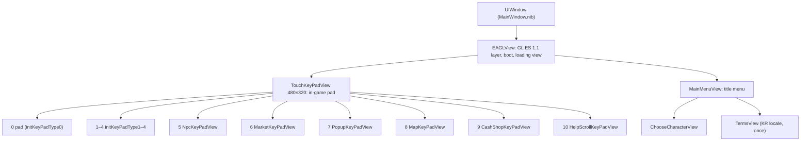

# The Objective-C shell

What each of the 18 app classes does, which UIKit (and other framework) classes and selectors it uses, which C++ engine functions it calls and which call it, which images it loads and how it handles touches ([#22](https://github.com/armaatus/maplethief-port/issues/22)). The per-class effort table at the [end](#effort-native-rewrite-vs-uikit-emulation) is input for the ObjC strategy ADR ([#46](https://github.com/armaatus/maplethief-port/issues/46)) and for input work ([#66](https://github.com/armaatus/maplethief-port/issues/66)).

Addresses are armv7 VM addresses. Function pointers carry the Thumb bit (`0x5A75`). Every function this page names has that name in Ghidra: ObjC methods from `objc.json` ([objc.md](objc.md)), engine functions from the other names files, and the shell helpers and engine-to-shell bridges from `work/re/names/objcshell.json` (`SHELL_NAMES`, `GAMECENTER_BLOCKS` and `BRIDGES` in [`tools/mtport/objcshell.py`](../../tools/mtport/objcshell.py)).

**Generated and hand-written parts.** The blocks between `<!-- BEGIN generated:… -->` and `<!-- END generated:… -->` are written by `python3 -m mtport.objcshell generate` (run by `scripts/re-analyze`). It sweeps the armv7 slice with Capstone (`mtport.armscan`), resolves each `objc_msgSend` the way [imports.md](imports.md) does, and joins the result with the function tags of [libraries.md](libraries.md), the Ghidra export, the extracted bundle and `MainWindow.nib`. `tests/test_objcshell_real.py` checks that the blocks are current. Everything outside the blocks is hand-written, from the decompiler and from `python3 -m mtport.objcshell trace FUNCTION`, which prints a function's calls, sends with their arguments, and ivar and string references in order.

How to read a class block:

- **Code**: the class's methods plus its file-local helpers (inline `CGRectMake`-style copies, block bodies). *Created by* lists the functions outside the class that send it `+alloc`.
- **Framework classes / messages**: what the class needs from UIKit, Foundation, GameKit, StoreKit and the rest, with send counts. `UIImage +imageNamed:` has a known receiver. *Receiver not determined* lists selectors sent to an object the scan can't type (an ivar, an argument). Together they are the HLE surface the class needs under emulation.
- **Messages to other shell classes**: sends whose selector only app classes implement. Most go through `+[EAGLView_Instance Instance].objView` (the `EAGLView`) to its `touchKeyPadView`.
- **Selectors passed to**: action selectors, mostly given to the class's `addButtonWithImageName:selectedImageName:withFrame:withEdgeInsets:actionForTouchDown:actionForTouchUpInside:` helper. That helper creates a custom `UIButton`, sets the two images for `UIControlStateNormal`/`Highlighted`, and wires `actionForTouchDown` to `UIControlEventTouchDown` (1) and `actionForTouchUpInside` to `UIControlEventTouchUpInside` (0x40), each only when not nil (read in `-[MapKeyPadView addButtonWithImageName:…]` `0xAE1F5`). Nine classes have their own copy: eight of 199 instructions and one of 183 instructions, in `CashShopKeyPadView`'s Objective-C++ file.
- **No selector reference**: methods no code names. They are reached only by the frameworks (`drawRect:`, touches, delegate callbacks, `layerClass`), or are dead.
- **ObjC → C++**: direct calls into `engine`-tagged functions. **C++ → ObjC**: `engine` functions whose sends reach the class.

## How the shell works

The shell is a thin UIKit layer over one OpenGL ES 1.1 view. The engine owns the game loop and draws everything in the game itself. The shell supplies the GL surface and boot, the two menus before the game (main menu and character select), the Korean terms screen, and the touch controls. The controls are a pad drawn over the GL view, plus button panels that the engine shows and hides.

The numbers are `TouchKeyPadView`'s subview indexes. `-enable:` `0xBA1F5` and `-disable:` `0xBA0DD` set `subviews[i].alpha` to 1 or 0. UIKit doesn't hit-test views with alpha below 0.01, so alpha 0 also disables a panel's buttons. `-disableAll` `0xBA131` hides every panel. The `enable…Key` methods call `disableAll` and then `enable:` with their index (0 game pad, 2 minimap, 3 animation, 4 yes/no, 5 NPC, 6 market, 7 popup/alert, 8 map, 9 cash shop, 10 help). `initKeyPadType5:` exists but isn't called.

**Shell → engine.** There are four paths:

1. Lifecycle calls from `EAGLView` and the delegate: `Clet_Start`, `Clet_Pause`, `Clet_Resume`, `Screen_Init`, `Device_SetModel`/`Device_SetKorean` ([program-flow.md](program-flow.md)).
2. **Phone key events.** Every button in every panel and menu ends in a `TouchKeyPadView` `click…Button:`/`release…Button:` method. Each one is a 28-byte call `Clet_HandleEvent(2 or 3, code, 0)` `0x5A75` (2 press, 3 release; table in [TouchKeyPadView](#touchkeypadview)). The menus use the same keys. For example, `-[MainMenuView playSelectSound]` sends `click7Button:`, which `CStateMainMenu::OnKeyPressed` handles like any other key.
3. **Polled pad state.** `SkyCanvas::Tick` `0x2590D` reads `TouchKeyPadView`'s `on…Key` BOOLs every frame (the d-pad and jump/attack/short keys of the touch handlers, mapped to key codes in [program-flow.md → SkyCanvas::Tick](program-flow.md#skycanvastick-0x2590d)).
4. A few direct engine calls: `SaveFile_*` for `CTerms` and the receipt lists ([save.md](../formats/save.md)), `CMSocket` for purchase receipts ([network.md](network.md)), and `TouchWidgets_Dispatch`.

**Engine → shell.** The engine reaches the view through `+[EAGLView_Instance Instance]` `0x5839` → `objView` and then sends to it, its `touchKeyPadView`, or one of that view's panels. Twelve 61-byte C bridges `Shell_Enable…`/`Shell_Disable…` (`0x6655`–`0x69C5`) wrap the `EAGLView` show/hide calls. `EAGLView` keeps the current state in `statusOfTouchKeyPad` and skips a call that wouldn't change it. Other engine functions query or position panel widgets directly. `CChatBox::paint` reads the NPC panel's quest buttons, the popup code calls `move…ButtonToX:toY:`, and the market and map code read tracking points. `CStateMainMenu` reads and writes `EAGLView`'s character-slot properties (`characterInfos`, `robinImages`, `characterCount`, `selectedCharacterIndex`), which `ChooseCharacterView` displays. The [summary](#summary) counts the edges, and each class block lists them.

**Dead code.** `MoviePlayerController` and `MovieOverlayView` are never created: nothing sends `initWithMovieFile:` ([program-flow.md](program-flow.md#boot)). The logo and timer path in `EAGLView` (`startAppEnv`, `drawMapleLogo__`, `movieFinishedCallback:`) is dead too, along with `-[MainMenuView redraw:]` and its `move…:` animation steps, `-[ChooseCharacterView animateStatus:]`, `-[TouchKeyPadView sampleButtonClicked:]` and `initKeyPadType5:`. No game code schedules an `NSTimer` (the only `scheduledTimerWithTimeInterval:` send is Chartboost's), and nothing references these selectors.

**StoreKit and Game Center are optional at boot.** `-[EAGLView initWithCoder:]` creates `InAppPurchaseManager` only if `+[SKPaymentQueue canMakePayments]`, and `GameCenterManager` only if `+[GameCenterManager IsGameCenterAvailable]` (which needs `GKLocalPlayer` and iOS ≥ 4.1). Otherwise `m_pINAPMgr`/`m_pGameCenterManager` stay nil, and the engine's sends to them are messages to nil, which return 0. A port can answer *no* to both checks and drop both classes, but a cash-shop purchase does not check `canMakePayments` and then waits for ever on a nil manager. The port answers *yes* to both and emulates the frameworks ([ADR 0034](../adr/0034-offline-services.md)).

## Summary

<!-- BEGIN generated:summary -->
<!-- Generated by `python3 -m mtport.objcshell generate`: do not edit by hand. -->
| Class | Superclass | Methods | Helpers | Bytes | Framework classes | Framework selectors | ObjC → C++ | C++ → ObjC | Images | Created by |
|---|---|---|---|---|---|---|---|---|---|---|
| [`MapleThiefAppDelegate`](#maplethiefappdelegate) | `NSObject` | 12 | 0 | 1,228 | 3 | 11 | 4 | 0 | 0 | `MainWindow.nib` |
| [`EAGLView`](#eaglview) | `UIView` | 80 | 3 | 10,580 | 18 | 56 | 6 | 28 | 2 | `MainWindow.nib` |
| [`EAGLView_Instance`](#eaglview_instance) | `NSObject` | 9 | 0 | 988 | 1 | 3 | 0 | 2 | 0 | – |
| [`MoviePlayerController`](#movieplayercontroller) | `UIViewController` | 6 | 1 | 1,100 | 6 | 19 | 0 | 0 | 0 | – |
| [`MovieOverlayView`](#movieoverlayview) | `UIView` | 2 | 0 | 180 | 1 | 2 | 0 | 0 | 0 | `-[MoviePlayerController viewDidLoad]` `0x9FD49` |
| [`ChooseCharacterView`](#choosecharacterview) | `UIView` | 29 | 5 | 22,016 | 9 | 37 | 0 | 2 | 15 | `-[MainMenuView clickPlay:]` `0xAAAB9` |
| [`MainMenuView`](#mainmenuview) | `UIView` | 57 | 5 | 25,880 | 14 | 68 | 2 | 1 | 25 | `-[EAGLView showMainMenu:]` `0x442D` |
| [`MapKeyPadView`](#mapkeypadview) | `UIView` | 15 | 1 | 1,688 | 3 | 14 | 0 | 5 | 0 | `-[TouchKeyPadView initWithFrame:]` `0xBC189` |
| [`MarketKeyPadView`](#marketkeypadview) | `UIView` | 40 | 3 | 6,240 | 3 | 16 | 0 | 17 | 5 | `-[TouchKeyPadView initWithFrame:]` `0xBC189` |
| [`NpcKeyPadView`](#npckeypadview) | `UIView` | 47 | 2 | 6,276 | 4 | 15 | 1 | 12 | 5 | `-[TouchKeyPadView initWithFrame:]` `0xBC189` |
| [`PopupKeyPadView`](#popupkeypadview) | `UIView` | 42 | 2 | 11,760 | 3 | 14 | 1 | 12 | 14 | `-[TouchKeyPadView initWithFrame:]` `0xBC189` |
| [`TouchKeyPadView`](#touchkeypadview) | `UIView` | 149 | 4 | 35,868 | 5 | 30 | 2 | 32 | 21 | `-[EAGLView startApp]` `0x4501` |
| [`EAGLViewController`](#eaglviewcontroller) | `UIViewController` | 7 | 0 | 332 | 1 | 4 | 0 | 0 | 0 | `-[MapleThiefAppDelegate application:didFinishLaunchingWithOptions:]` `0x2BFD` |
| [`CashShopKeyPadView`](#cashshopkeypadview) | `UIView` | 21 | 2 | 4,324 | 4 | 13 | 0 | 1 | 9 | `-[TouchKeyPadView initWithFrame:]` `0xBC189` |
| [`InAppPurchaseManager`](#inapppurchasemanager) | `NSObject` | 19 | 0 | 5,016 | 8 | 31 | 12 | 5 | 0 | `-[EAGLView initWithCoder:]` `0x4F6D` |
| [`GameCenterManager`](#gamecentermanager) | `NSObject` | 18 | 24 | 4,960 | 10 | 38 | 0 | 1 | 0 | `-[EAGLView initWithCoder:]` `0x4F6D` |
| [`TermsView`](#termsview) | `UIView` | 5 | 3 | 3,432 | 8 | 28 | 2 | 0 | 4 | `-[MainMenuView drawRect:]` `0xABC85` |
| [`HelpScrollKeyPadView`](#helpscrollkeypadview) | `UIView` | 5 | 3 | 3,212 | 6 | 31 | 1 | 1 | 3 | `-[TouchKeyPadView initWithFrame:]` `0xBC189` |
| **Total** | | 563 | 58 | 145,080 | 42 | 196 | 25 | 119 | 98 | |

*Framework classes*: distinct imported classes loaded or messaged. *Framework selectors*: distinct selectors of framework messages. *ObjC → C++*: distinct `engine` functions called. *C++ → ObjC*: distinct selectors of this class that `engine` code sends. *Images*: distinct strings naming a bundle file. The bundle has 115 root PNGs: 98 are named by shell code, 0 only by engine code, 17 by neither (see [Images](#images-and-the-bundle)).

Across the boundary: shell code calls 25 distinct `engine` functions directly. `engine` code sends 108 distinct selectors that reach shell classes, from 39 functions, and 71 distinct selectors that reach framework classes, from 50 functions (378 sends). A selector that several app classes implement is counted for each of them when the receiver is unknown.
<!-- END generated:summary -->

## Effort: native rewrite vs UIKit emulation

The two options of [#46](https://github.com/armaatus/maplethief-port/issues/46), per class:

- **Native rewrite**: our own C++ code reproduces the class on the port's UI layer (SDL3 + the GL ES 1.1 emulation). It draws the same bundle PNGs at the same coordinates, which are recoverable from the generated listings and the decompiler, and calls the same engine entry points.
- **Emulation**: the recompiled ObjC methods run unchanged on an HLE Objective-C runtime with host implementations of the UIKit/Foundation classes they message.

The estimates are working days for one developer or agent, including tests against reference screenshots (a human hand-off).

Emulation needs a one-time core that no per-class number includes:

- an ObjC runtime (`objc_msgSend` over the guest metadata, `alloc`/`init`, retain/release, properties, `super`);
- a `UIView` tree with frame, bounds, center, transform, alpha and tag, compositing over the GL surface;
- UIKit hit-testing and touch delivery (`UITouch`, `UIEvent`, `NSSet`, multi-touch);
- `UIImage imageNamed:` with CgBI PNGs;
- `UIImageView`, `UIButton` with target/action and states, and `UILabel`/`UITextView` text with the two fonts used (`MarkerFelt-Thin`, `Helvetica`, Korean glyphs for `TermsView`);
- `UIView` begin/commit animations with delay, duration and curve;
- `UIScrollView` paging and `UIPageControl`;
- the Foundation basics (`NSString`, `NSArray`, `NSNumber`, `NSNull`, `NSLocale`, `NSURL`).

That's about **15–25 days**. Much of the ObjC runtime is needed either way. `engine` code itself sends 71 framework selectors: text rendering through UIKit in `TextCache_DrawText`, `UIDevice`/`NSLocale` in `CStateTitle`, `AVAudioPlayer`, and the selectors that reach the shell (see the summary). The port's choice is therefore between implementing roughly 196 receiver/selector pairs of UIKit behaviour faithfully, and rewriting about 20 screens and panels natively behind a selector table for the about 108 shell selectors the engine sends.

| Class | Role | Native rewrite | Emulation (on the core) | Notes for #46 |
|---|---|---|---|---|
| `MapleThiefAppDelegate` | app lifecycle → `Clet_Pause`/`Clet_Resume`; push-token hex into `CDataMgr` | 0.5 | 0.5 | Native is just SDL lifecycle events. Push registration and the badge are no-ops. |
| `EAGLView` | GL ES 1.1 surface and present, boot sequence, main-menu show/close, loading spinner, character-slot data store, panel enable/disable gate, Game Center leaderboard | 3 | 4 | The GL part belongs in `platform/` either way. 28 selectors are called by the engine (bridges, slot properties, `flushLCD`, loading view). |
| `EAGLView_Instance` | singleton that holds the `EAGLView` for C++ code | 0.1 | 0.1 | One global. |
| `EAGLViewController` | the controller that presents `GKLeaderboardViewController` (global `0x11A97C`); one landscape orientation only | 0 | 0.2 | Not needed without Game Center. |
| `MoviePlayerController`, `MovieOverlayView` | intro movie player (dead) | 0 | 0 | Drop. |
| `MainMenuView` | animated title menu built in `drawRect:`; Help pager, About scroll view with links, Game Center, More Games, promo banner | 4 | 2.5 | The heaviest UIKit user: 60 selectors, animations, `UIScrollView` paging, `UITextView`, `openURL:` ([network.md](network.md#urls)). |
| `ChooseCharacterView` | 3-slot character select: portraits from `robinImages`, status panel, New/Delete/Start/Back, alerts | 3 | 1.5 | It reads slot data that the engine writes into `EAGLView`. Its alerts are hand-built views, not `UIAlertView`. |
| `TermsView` | Korean terms of service (KR locale until `CTerms` exists) | 1 | 0.5 | Needs a Korean font and 12k characters of text layout in either case. |
| `TouchKeyPadView` | in-game controls: color-mask hit test on `KeyPadArea.png`, two-finger tracking, polled `on…Key` state, 52 phone-key actions, container of the 10 panels, NPC "up" indicator | 5 | 3 | The core of the input work (#66). Emulation needs exact multi-touch and `CGBitmapContext` pixel reads. A native version can feed a controller layer directly. |
| `NpcKeyPadView` | NPC dialogue: accept/refuse/OK and 6 invisible quest-row buttons | 1 | 0.5 | `CChatBox::paint` reads 12 of its selectors. |
| `PopupKeyPadView` | in-game popup buttons (OK, Yes/No, ±, revive, return, main menu), placed by the engine | 1 | 0.5 | 11 `move…ButtonToX:toY:` methods called from C++. |
| `MarketKeyPadView` | shop tabs/buttons and drag tracking points for the engine's list scrolling | 1.5 | 0.5 | The engine reads 17 of its selectors (`FUN_00056e90` `0x56E91`). |
| `MapKeyPadView` | world/mini map overlay: three buttons (added by `TouchKeyPadView`) and a touch point | 0.5 | 0.2 | The map code reads `touchPoint` and the buttons. |
| `CashShopKeyPadView` | 8 purchase tiles → key codes −27…−34 | 0.5 | 0.2 | Reachable only with StoreKit (#20). |
| `HelpScrollKeyPadView` | in-game help pager (2 pages) | 0.5 | 0.3 | The same pager as `MainMenuView`'s Help screen. |
| `InAppPurchaseManager` | StoreKit purchases; receipts to the server (`CMSocket`) and to `totalrestore` | 0.2 (stub) | 0.2 (stub) | Runs recompiled on host StoreKit classes that cancel every payment ([ADR 0034](../adr/0034-offline-services.md)). Answering `canMakePayments` NO instead would leave the cash shop's "Please Wait..." view up for ever: `CStateGame::OnKeyPressed` (`0x8D4C9`) does not check it. |
| `GameCenterManager` | Game Center auth, scores, achievements (blocks + `dispatch_async`) | 0.2 (stub) | 0.2 (stub) | Runs recompiled on emulated GameKit ([ADR 0029](../adr/0029-objective-c-runtime-services.md), [ADR 0034](../adr/0034-offline-services.md)). Its delegate callbacks (`GameCenterAuthentication:`, …) have no implementer in the image anyway: the delegate, the `EAGLView`, doesn't respond to them. |
| **Total** | | **≈ 22** | **≈ 15 + core 15–25** | |

Reading the table, as input for #46:

- The heavy UIKit users are the two menus and the terms screen, which are plain screens. The in-game panels are simple button grids whose state the engine pulls through a known set of selectors.
- `TouchKeyPadView` is large under both options, because the input layer needs work in either case.
- A native rewrite still needs an `objc_msgSend` that routes the about 108 shell selectors the engine sends (listed per class below) to host code, and the framework selectors the engine sends itself.

#46 chose emulation ([ADR 0026](../adr/0026-objective-c-strategy.md)): the shell runs recompiled on a runtime over the guest metadata, with host UIKit/Foundation classes.

## MainWindow.nib

The only nib, `NSMainNibFile` in `Info.plist`, decoded with `mtport.nib` ([nibarchive.md](../formats/nibarchive.md)). It creates the `UIWindow` and its one subview, an `EAGLView` (a `UIClassSwapper` from `UIView`, so `-[EAGLView initWithCoder:]` runs and the engine starts while the nib loads). It also creates the `MapleThiefAppDelegate` (`UICustomObject`), with two outlet connections: `File's Owner.delegate` and `delegate.window`. Nothing else: no view controller, no buttons, no actions (`UIRuntimeEventConnection`). The delegate's `glView` and `m_ViewController` outlets are unconnected, and the window is marked visible through `UINibVisibleWindowsKey`. A port can build this by hand: a 320×480 window, an EAGLView-equivalent rotated into landscape, and the delegate.

<!-- BEGIN generated:nib -->
<!-- Generated by `python3 -m mtport.objcshell generate`: do not edit by hand. -->
`NIBArchive` format 1, coder 9: 23 objects, 29 keys, 66 values, 9 classes.

| # | Class | Label | Values |
|---|---|---|---|
| 0 | `NSObject` | `NSObject` | `UINibTopLevelObjectsKey` = #8 NSArray; `UINibObjectsKey` = #4 NSArray; `UINibConnectionsKey` = #20 NSArray; `UINibVisibleWindowsKey` = #22 NSArray; `UINibAccessibilityConfigurationsKey` = #16 NSArray; `UINibKeyValuePairsKey` = #16 NSArray |
| 1 | `UIClassSwapper` | `EAGLView` | `UIBounds` = (0, 0, 320, 480); `UICenter` = (160, 240); `UIBackgroundColor` = #11 UIColor; `UIOpaque` = NO; `UIAutoresizeSubviews` = NO; `UIAutoresizingMask` = 18; `UIClearsContextBeforeDrawing` = YES; `UIClassName` = #5 "EAGLView"; `UIOriginalClassName` = #7 "UIView" |
| 2 | `NSString` | `NSString` | "window" |
| 3 | `UIClassSwapper` | `MapleThiefAppDelegate` | `UIClassName` = #19 "MapleThiefAppDelegate"; `UIOriginalClassName` = #6 "UICustomObject" |
| 4 | `NSArray` | `NSArray` | `NSInlinedValue` = NO; `UINibEncoderEmptyKey` = #14 IBFilesOwner; `UINibEncoderEmptyKey` = #15 IBFirstResponder; `UINibEncoderEmptyKey` = #3 MapleThiefAppDelegate; `UINibEncoderEmptyKey` = #10 UIWindow; `UINibEncoderEmptyKey` = #1 EAGLView |
| 5 | `NSString` | `NSString` | "EAGLView" |
| 6 | `NSString` | `NSString` | "UICustomObject" |
| 7 | `NSString` | `NSString` | "UIView" |
| 8 | `NSArray` | `NSArray` | `NSInlinedValue` = NO; `UINibEncoderEmptyKey` = #14 IBFilesOwner; `UINibEncoderEmptyKey` = #15 IBFirstResponder; `UINibEncoderEmptyKey` = #3 MapleThiefAppDelegate; `UINibEncoderEmptyKey` = #10 UIWindow |
| 9 | `NSString` | `NSString` | "delegate" |
| 10 | `UIWindow` | `UIWindow` | `UIBounds` = (0, 0, 320, 480); `UICenter` = (160, 240); `UISubviews` = #18 NSMutableArray; `UIBackgroundColor` = #11 UIColor; `UIOpaque` = NO; `UIMultipleTouchEnabled` = NO; `UIAutoresizeSubviews` = NO; `UIAutoresizingMask` = 36; `UIClearsContextBeforeDrawing` = YES |
| 11 | `UIColor` | `UIColor` | `UIColorComponentCount` = 4; `UIRed` = 1; `UIGreen` = 1; `UIBlue` = 1; `UIAlpha` = 1 |
| 12 | `UIRuntimeOutletConnection` | `UIRuntimeOutletConnection` | `UILabel` = #2 "window"; `UISource` = #3 MapleThiefAppDelegate; `UIDestination` = #10 UIWindow |
| 13 | `NSString` | `NSString` | "IBFilesOwner" |
| 14 | `UIProxyObject` | `IBFilesOwner` | `UIProxiedObjectIdentifier` = #13 "IBFilesOwner" |
| 15 | `UIProxyObject` | `IBFirstResponder` | `UIProxiedObjectIdentifier` = #21 "IBFirstResponder" |
| 16 | `NSArray` | `NSArray` | `NSInlinedValue` = NO |
| 17 | `UIRuntimeOutletConnection` | `UIRuntimeOutletConnection` | `UILabel` = #9 "delegate"; `UISource` = #14 IBFilesOwner; `UIDestination` = #3 MapleThiefAppDelegate |
| 18 | `NSMutableArray` | `NSMutableArray` | `NSInlinedValue` = NO; `UINibEncoderEmptyKey` = #1 EAGLView |
| 19 | `NSString` | `NSString` | "MapleThiefAppDelegate" |
| 20 | `NSArray` | `NSArray` | `NSInlinedValue` = NO; `UINibEncoderEmptyKey` = #17 UIRuntimeOutletConnection; `UINibEncoderEmptyKey` = #12 UIRuntimeOutletConnection |
| 21 | `NSString` | `NSString` | "IBFirstResponder" |
| 22 | `NSArray` | `NSArray` | `NSInlinedValue` = NO; `UINibEncoderEmptyKey` = #10 UIWindow |

| Root key | Contents |
|---|---|
| `UINibTopLevelObjectsKey` | #8: #14 `IBFilesOwner`, #15 `IBFirstResponder`, #3 `MapleThiefAppDelegate`, #10 `UIWindow` |
| `UINibObjectsKey` | #4: #14 `IBFilesOwner`, #15 `IBFirstResponder`, #3 `MapleThiefAppDelegate`, #10 `UIWindow`, #1 `EAGLView` |
| `UINibConnectionsKey` | #20: #17 `UIRuntimeOutletConnection`, #12 `UIRuntimeOutletConnection` |
| `UINibVisibleWindowsKey` | #22: #10 `UIWindow` |
| `UINibAccessibilityConfigurationsKey` | #16: empty |
| `UINibKeyValuePairsKey` | #16: empty |

| Connection | Source | Outlet | Destination |
|---|---|---|---|
| #17 `UIRuntimeOutletConnection` | #14 `IBFilesOwner` | `delegate` | #3 `MapleThiefAppDelegate` |
| #12 `UIRuntimeOutletConnection` | #3 `MapleThiefAppDelegate` | `window` | #10 `UIWindow` |
<!-- END generated:nib -->

## Classes

### MapleThiefAppDelegate

Created by the nib. It forwards the lifecycle to the engine: `applicationWillResignActive:` → `Clet_Pause`, `applicationDidBecomeActive:` → `Clet_Resume`, and `applicationWillTerminate:` deletes the current state and the `CMResMgr` singleton. `application:didRegisterForRemoteNotificationsWithDeviceToken:` formats the token as hex (`%02x`) and copies it into `CDataMgr` (the push token of the hello packet, [network.md](network.md#device-identifier-and-push-token)). `didFinishLaunching` makes the `EAGLViewController` and stores it in the global `0x11A97C` (pointer slot `0xF1470`). It's never added to the window. Its only use is presenting the Game Center leaderboard modally from `EAGLView` (`viewGameCenterRank:` `0x4E09`, `leaderboardViewControllerDidFinish:` `0x4DD5`). No touch handling.

<!-- BEGIN generated:class:MapleThiefAppDelegate -->
<!-- Generated by `python3 -m mtport.objcshell generate`: do not edit by hand. -->
- **Code**: 12 methods (`0x2879`–`0x2BFD`); 1,228 bytes.
- **Framework classes**: CoreFoundation: `NSObject`; Foundation: `NSMutableString`; UIKit: `UIViewController`.
- **Framework messages** (12 sends): `NSMutableString +string`, `NSObject -dealloc`, `UIViewController +alloc`, `UIViewController -initWithNibName:bundle:`; receiver not determined: `release` ×2, `UTF8String`, `appendFormat:`, `bytes`, `registerForRemoteNotificationTypes:`, `setApplicationIconBadgeNumber:`, `setView:`.
- **Messages to other shell classes**: `EAGLView_Instance +Instance`, `EAGLView_Instance -objView`.
- **Protocol methods**: `application:didFailToRegisterForRemoteNotificationsWithError:`, `application:didFinishLaunchingWithOptions:`, `application:didReceiveRemoteNotification:`, `application:didRegisterForRemoteNotificationsWithDeviceToken:`, `applicationDidBecomeActive:`, `applicationWillResignActive:`, `applicationWillTerminate:`, `setWindow:`, `window`.
- **No selector reference** (10; called only by the frameworks, or dead): `-setWindow:`, `-setGlView:`, `-glView`, `-application:didFailToRegisterForRemoteNotificationsWithError:`, `-application:didReceiveRemoteNotification:`, `-application:didRegisterForRemoteNotificationsWithDeviceToken:`, `-applicationWillTerminate:`, `-applicationDidBecomeActive:`, `-applicationWillResignActive:`, `-application:didFinishLaunchingWithOptions:`.

ObjC → C++ (direct calls into `engine` functions):

| Engine function | Called from |
|---|---|
| `Clet_Resume` `0x5B01` | `-applicationDidBecomeActive:` `0x2BB5` |
| `Clet_Pause` `0x5B8D` | `-applicationWillResignActive:` `0x2BD9` |
| `CMResMgr::GetInstance` `0x1B68D` | `-applicationWillTerminate:` `0x2ACD` |
| `CDataMgr::GetInstance` `0x5BAC1` | `-application:didRegisterForRemoteNotificationsWithDeviceToken:` `0x29C5` |
<!-- END generated:class:MapleThiefAppDelegate -->

### EAGLView

The window's only subview, and the root of everything the shell shows.

- **GL**: `+layerClass` returns `CAEAGLLayer`. `createGLes` makes the ES 1.1 context, the colour renderbuffer and the 90° landscape transform, and `flushLCD`/`endDraw`/`beginDraw` present ([program-flow.md → Boot](program-flow.md#boot)).
- **Boot**: `initWithCoder:` `0x4F6D` → `drawMapleLogoEnd` → `startApp` `0x4501`. That adds the `TouchKeyPadView` (disabled), calls `Clet_Start`, and shows the `MainMenuView`.
- **Menus**: `showMainMenu:`, `closeMainMenu:` and `reloadMainMenu:` add or remove the `MainMenuView`. The engine calls the first two on state changes.
- **Panel gate**: the 23 `enable…`/`disable…` key-pad methods compare `statusOfTouchKeyPad` with their panel number, store it and forward to `touchKeyPadView`.
- **Loading view**: `addLoadingView` builds a spinner, a "Please Wait..." label (`MarkerFelt-Thin`) and `loadingBack.png`. The engine shows it before network or purchase work and removes it when that finishes.
- **Character slots**: properties that `CStateMainMenu::LoadCharacterSlots` fills and `ChooseCharacterView` reads (`characterInfos`: an `NSMutableArray` of per-slot arrays of strings; `robinImages`: per-slot `UIImage` or `NSNull`).
- **Portrait scaling**: `imageWithImage:scaledToSize:`, used by the engine (`FUN_0001e96c` `0x1E96D`) to make those portraits through a `UIGraphics` image context.

`touchesBegan:` only logs. The pad view on top receives the touches.

<!-- BEGIN generated:class:EAGLView -->
<!-- Generated by `python3 -m mtport.objcshell generate`: do not edit by hand. -->
- **Code**: 80 methods (`0x2D45`–`0x4F6D`), 3 helpers: `EAGLView_CGPointMake` `0x55B5`, `EAGLView_CGRectMake` `0x55E1`, `EAGLView_CGAffineTransformMake` `0x562D`; 10,580 bytes.
- **Framework classes**: CoreFoundation: `NSDictionary`, `NSLocale`, `NSMutableArray`, `NSObject`; Foundation: `NSNumber`, `NSString`; GameKit: `GKLeaderboardViewController`; OpenGLES: `EAGLContext`; QuartzCore: `CAEAGLLayer`; StoreKit: `SKPaymentQueue`; UIKit: `UIActivityIndicatorView`, `UIColor`, `UIDevice`, `UIFont`, `UIImage`, `UIImageView`, `UILabel`, `UIView`.
- **Framework messages** (107 sends): `UIView +alloc` ×3, `EAGLContext +setCurrentContext:` ×2, `GKLeaderboardViewController +alloc` ×2, `GKLeaderboardViewController -init` ×2, `NSMutableArray +alloc` ×2, `NSMutableArray -initWithCapacity:` ×2, `NSObject +alloc` ×2, `UIColor +clearColor` ×2, `UIImage +imageNamed:` ×2, `UIImageView +alloc` ×2, `UIImageView -initWithImage:` ×2, `CAEAGLLayer +class`, `EAGLContext +alloc`, `EAGLContext -initWithAPI:`, `NSDictionary +dictionaryWithObjectsAndKeys:`, `NSLocale +preferredLanguages`, `NSNumber +numberWithBool:`, `NSString +stringWithString:`, `SKPaymentQueue +canMakePayments`, `UIActivityIndicatorView +alloc`, `UIActivityIndicatorView -initWithActivityIndicatorStyle:`, `UIColor +whiteColor`, `UIDevice +currentDevice`, `UIFont +fontWithName:size:`, `UIImageView -release`, `UIImageView -removeFromSuperview`, `UILabel +alloc`, `UILabel -initWithFrame:`, `UIView -dealloc`, `UIView -initWithCoder:`, `UIView -initWithFrame:`, `UIView -release`; receiver not determined: `release` ×16, `addSubview:` ×7, `isEqualToString:` ×3, `layer` ×2, `removeFromSuperview` ×2, `setBackgroundColor:` ×2, `setCategory:` ×2, `setDelegate:` ×2, `setLeaderboardDelegate:` ×2, `setTimeScope:` ×2, `didReceiveMemoryWarning`, `dismissModalViewControllerAnimated:`, `drawInRect:`, `invalidate`, `model`, `objectAtIndex:`, `presentModalViewController:animated:`, `presentRenderbuffer:`, `renderbufferStorage:fromDrawable:`, `setBounds:`, `setCenter:`, `setDrawableProperties:`, `setFont:`, `setHidesWhenStopped:`, `setNumberOfLines:`, `setOpaque:`, `setTag:`, `setText:`, `setTextAlignment:`, `setTextColor:`, `setTransform:`, `startAnimating`, `stopAnimating`.
- **Messages to other shell classes**: `TouchKeyPadView -disableAll` ×2, `EAGLView_Instance +Instance`, `EAGLView_Instance -setObjView:`, `GameCenterManager -AuthenticationUser`, `GameCenterManager +IsGameCenterAvailable`, `GameCenterManager -init`, `InAppPurchaseManager -init`, `MainMenuView -initWithFrame:`, `TouchKeyPadView -enable`, `TouchKeyPadView -enableHelpScrollKey`, `TouchKeyPadView -initWithFrame:`.
- **Messages to itself**: 31 sends of 27 of its own selectors.
- **Touch overrides**: `touchesBegan:withEvent:`, `touchesMoved:withEvent:`.
- **Images** (2): `MainMenuBackground.png`, `loadingBack.png`.
- **No selector reference** (28; called only by the frameworks, or dead): `-setTouchKeyPadView:`, `-setMoviePlayer:`, `-setMainMenuView:`, `-setChooseCharacterView:`, `-chooseCharacterView`, `-setCharacterInfos:`, `-setRobinImages:`, `-setM_pINAPMgr:`, `-m_pINAPMgr`, `-setM_pLoadingMainView:`, `-m_pLoadingMainView`, `-setM_pLoadingActivity:`, `-m_pLoadingActivity`, `-setM_pGameCenterManager:`, `-setM_pLeaderboardController:`, `-m_pLeaderboardController`, `-getInstance`, `-LCDheight`, `-LCDwidth`, `-touchesMoved:withEvent:`, `-touchesBegan:withEvent:`, `-reloadMainMenu:`, `-movieFinishedCallback:`, `-drawMapleLogo__`, `-shouldAutorotateToInterfaceOrientation:`, `-leaderboardViewControllerDidFinish:`, `-startAppEnv`, `+layerClass`.

ObjC → C++ (direct calls into `engine` functions):

| Engine function | Called from |
|---|---|
| `Clet_Start` `0x5C2D` | `-startApp` `0x4501` |
| `Logo_Free` `0x5EDD` | `-drawMapleLogo__` `0x4701` |
| `Screen_SetBackingSize` `0x5EF5` | `-createGLes` `0x33D5` |
| `Device_SetModel` `0x65E1` | `-initWithCoder:` `0x4F6D` |
| `Device_SetKorean` `0x660D` | `-initWithCoder:` `0x4F6D` |
| `Screen_Init` `0x9909` | `-initWithCoder:` `0x4F6D` |

C++ → ObjC (sends from `engine` functions that reach this class):

| Selector | Sent by |
|---|---|
| `-addLoadingView` | `CStateGame::OnKeyPressed` `0x8D4C9` |
| `-characterCount` | `CStateMainMenu::LoadCharacterSlots` `0x96845` |
| `-characterInfos` | `CStateMainMenu::LoadCharacterSlots` `0x96845` |
| `-closeMainMenu:` | `CStateMainMenu::OnKeyPressed` `0x9462D` |
| `-disableAlertKey` | `Shell_DisableAlertKey` `0x6745` |
| `-disablePopupMenuKey` | `Shell_DisablePopupMenuKey` `0x68D5` |
| `-disableTouchKeyPad` | `Shell_DisableTouchKeyPad` `0x6975` |
| `-enableAlertKey` | `Shell_EnableAlertKey` `0x6795` |
| `-enableAnimationKey` | `Shell_EnableAnimationKey` `0x6885` |
| `-enableCashShopKey` | `Shell_EnableCashShopKey` `0x66A5` |
| `-enableMapKey` | `Shell_EnableMapKey` `0x66F5` |
| `-enableMarketKey` | `Shell_EnableMarketKey` `0x67E5` |
| `-enableNPCKey` | `Shell_EnableNPCKey` `0x6835` |
| `-enablePopupMenuKey` | `Shell_EnablePopupMenuKey` `0x6925` |
| `-enableTouchKeyPad` | `Shell_EnableTouchKeyPad` `0x69C5` |
| `-enalbeHelpScrollKey` | `Shell_EnalbeHelpScrollKey` `0x6655` |
| `-flushLCD` | `FlushLCD` `0x6D65` |
| `-getGameCenter` | `FUN_00065088` `0x65089`, `CMapleWorld::changeMap` `0x81369` |
| `-getGameCenterLoginOKorError` | `Game_ExitToMainMenu` `0x54BF9`, `CStateGame::PaintExitToMenu` `0x83C71`, `CStateGame::OnKeyPressed` `0x8D4C9` |
| `-imageWithImage:scaledToSize:` | `FUN_0001e96c` `0x1E96D` |
| `-m_pGameCenterManager` | `FUN_00065088` `0x65089`, `CMapleWorld::changeMap` `0x81369` |
| `-mainMenuView` | `CStateMainMenu::OnKeyPressed` `0x9462D` |
| `-removeLoadingView` | `CMSocket::Disconnect` `0x1BED5`, `CMSocket::Connect` `0x1C419`, `CDataMgr::OnServerPacket` `0x3ED19`, `CStateGame::Paint` `0x87501` |
| `-robinImages` | `FUN_0001e96c` `0x1E96D`, `CStateMainMenu::OnKeyPressed` `0x9462D`, `CStateMainMenu::LoadCharacterSlots` `0x96845` |
| `-selectedCharacterIndex` | `CStateMainMenu::OnKeyPressed` `0x9462D` |
| `-setCharacterCount:` | `CStateMainMenu::LoadCharacterSlots` `0x96845` |
| `-showMainMenu:` | `Game_ExitToMainMenu` `0x54BF9`, `CStateGame::OnKeyPressed` `0x8D4C9` |
| `-touchKeyPadView` | `SkyCanvas::Tick` `0x2590D`, `CChatBox::paint` `0x32BBD`, `FUN_00035e88` `0x35E89`, `FUN_0004ab00` `0x4AB01` +10 more |
<!-- END generated:class:EAGLView -->

### EAGLView_Instance

A `@synchronized` singleton (`+Instance` `0x5839`, `+allocWithZone:`) whose only property is `objView`, the `EAGLView`. The retain/release overrides make it immortal. All C++ → shell traffic starts here.

<!-- BEGIN generated:class:EAGLView_Instance -->
<!-- Generated by `python3 -m mtport.objcshell generate`: do not edit by hand. -->
- **Code**: 9 methods (`0x5699`–`0x5A5D`); 988 bytes.
- **Framework classes**: CoreFoundation: `NSObject`.
- **Framework messages** (3 sends): `NSObject +allocWithZone:`; receiver not determined: `alloc`, `init`.
- **No selector reference** (1; called only by the frameworks, or dead): `-retainCount`.

C++ → ObjC (sends from `engine` functions that reach this class):

| Selector | Sent by |
|---|---|
| `+Instance` | `Shell_EnalbeHelpScrollKey` `0x6655`, `Shell_EnableCashShopKey` `0x66A5`, `Shell_EnableMapKey` `0x66F5`, `Shell_DisableAlertKey` `0x6745` +34 more |
| `-objView` | `Shell_EnalbeHelpScrollKey` `0x6655`, `Shell_EnableCashShopKey` `0x66A5`, `Shell_EnableMapKey` `0x66F5`, `Shell_DisableAlertKey` `0x6745` +34 more |
<!-- END generated:class:EAGLView_Instance -->

### MoviePlayerController

An `MPMoviePlayerController` wrapper for an intro movie (`initWithMovieFile:` → `fileURLWithPath:`, `setMovieControlMode:`, an overlay view to skip). Nothing sends `initWithMovieFile:` and no movie ships, so the class is dead.

<!-- BEGIN generated:class:MoviePlayerController -->
<!-- Generated by `python3 -m mtport.objcshell generate`: do not edit by hand. -->
- **Code**: 6 methods (`0x9FB45`–`0x9FF5D`), 1 helpers: `MoviePlayerController_CGRectMake` `0x9FCE9`; 1,100 bytes.
- **Framework classes**: Foundation: `NSURL`; MediaPlayer: `MPMoviePlayerController`; UIKit: `UIApplication`, `UIScreen`, `UIView`, `UIViewController`.
- **Framework messages** (23 sends): `MPMoviePlayerController +alloc`, `MPMoviePlayerController -initWithContentURL:`, `NSURL +fileURLWithPath:`, `UIApplication +sharedApplication`, `UIScreen +mainScreen`, `UIView +alloc`, `UIView -initWithFrame:`, `UIViewController -dealloc`, `UIViewController -init`, `UIViewController -view`; receiver not determined: `addSubview:` ×2, `release` ×2, `view` ×2, `applicationFrame`, `objectAtIndex:`, `play`, `removeFromSuperview`, `setFrame:`, `setMovieControlMode:`, `windows`.
- **No selector reference** (3; called only by the frameworks, or dead): `-setM_moviePlayer:`, `-freeOverView`, `-initWithMovieFile:`.
<!-- END generated:class:MoviePlayerController -->

### MovieOverlayView

The tap-to-skip overlay of the dead movie player: `touchesBegan:` stops `EAGLView.moviePlayer`.

<!-- BEGIN generated:class:MovieOverlayView -->
<!-- Generated by `python3 -m mtport.objcshell generate`: do not edit by hand. -->
- **Code**: 2 methods (`0x9FF91`–`0x9FFC5`); 180 bytes.
- **Created by**: `-[MoviePlayerController viewDidLoad]` `0x9FD49`.
- **Framework classes**: UIKit: `UIView`.
- **Framework messages** (2 sends): `UIView -dealloc`; receiver not determined: `stop`.
- **Messages to other shell classes**: `EAGLView -moviePlayer`, `EAGLView_Instance +Instance`, `EAGLView_Instance -objView`, `MoviePlayerController -m_moviePlayer`.
- **Touch overrides**: `touchesBegan:withEvent:`.
- **No selector reference** (1; called only by the frameworks, or dead): `-touchesBegan:withEvent:`.
<!-- END generated:class:MovieOverlayView -->

### ChooseCharacterView

The character-select screen, opened by `-[MainMenuView clickPlay:]` right after it sends `clickOkButton:` to the engine. `drawRect:` (no selector reference: UIKit calls it once) lays out the background and panel, and three slots. Each slot shows a portrait from `EAGLView.robinImages`, or `ChooseCharacterBlankRobin.png` with a "new" button, plus the Back/Start/New/Delete buttons. `chooseCharacterOne:`…`Three:` set `EAGLView.selectedCharacterIndex` and `drawStatus` the stats panel: the strings of `characterInfos[index]` in labels made by `ChooseCharacterView_AddStatusLabel` `0xA2579`, plus a spotlight and a scroll animation.

The confirmations are hand-built alert views, not `UIAlertView`: `AlertBackground.png` plus `AlertYes`/`No`/`OK` buttons.

| Button | Phone key sent |
|---|---|
| Start | `clickOkButton:` (OK) |
| New | `clickPoundButton:` (`#`) when the alert opens, `clickOkButton:` on Yes |
| Delete | `clickAsteriskButton:` (`*`) when the alert opens, `clickOkButton:` on Yes |
| Back, cancel | `clickClearButton:` (−16) |
| Select and cancel sounds | `click7Button:` / `click9Button:` |

The engine closes alerts with `closeAlert:` and checks `onAlertWindow`. Touch: only buttons.

<!-- BEGIN generated:class:ChooseCharacterView -->
<!-- Generated by `python3 -m mtport.objcshell generate`: do not edit by hand. -->
- **Code**: 29 methods (`0xA26E1`–`0xA796D`), 5 helpers: `ChooseCharacterView_AddStatusLabel` `0xA2579`, `ChooseCharacterView_CGPointMake` `0xA7A6D`, `ChooseCharacterView_CGRectMake` `0xA7A99`, `ChooseCharacterView_UIEdgeInsetsMake` `0xA7AE5`, `ChooseCharacterView_AddStatusLabelLeft` `0xA7B51`; 22,016 bytes.
- **Created by**: `-[MainMenuView clickPlay:]` `0xAAAB9`.
- **Framework classes**: CoreFoundation: `NSNull`; Foundation: `NSString`; UIKit: `UIButton`, `UIColor`, `UIFont`, `UIImage`, `UIImageView`, `UILabel`, `UIView`.
- **Framework messages** (318 sends): `UIImageView +alloc` ×18, `UIImageView -initWithImage:` ×18, `UIImage +imageNamed:` ×17, `UILabel -setText:` ×9, `UIImageView -release` ×8, `UIImageView -setFrame:` ×8, `UIColor +colorWithRed:green:blue:alpha:` ×7, `UIFont +fontWithName:size:` ×7, `UIImageView -frame` ×7, `UILabel +alloc` ×7, `UILabel -initWithFrame:` ×7, `UILabel -release` ×7, `UILabel -setBackgroundColor:` ×7, `UILabel -setFont:` ×7, `UILabel -setTextAlignment:` ×7, `UILabel -setBaselineAdjustment:` ×6, `UILabel -setNumberOfLines:` ×6, `UIView +setAnimationDuration:` ×6, `NSNull +null` ×4, `UIView +setAnimationDelay:` ×4, `NSString +stringWithFormat:` ×3, `UIView +beginAnimations:context:` ×3, `UIView +commitAnimations` ×3, `UIView -initWithFrame:` ×2, `UIButton +buttonWithType:`, `UIView +alloc`, `UIView +setAnimationCurve:`, `UIView -dealloc`; receiver not determined: `addSubview:` ×43, `objectAtIndex:` ×21, `setAlpha:` ×19, `setFrame:` ×13, `frame` ×12, `release` ×11, `setUserInteractionEnabled:` ×6, `removeFromSuperview` ×4, `addTarget:action:forControlEvents:` ×2, `setImage:forState:` ×2, `invalidate`, `isValid`, `setImageEdgeInsets:`.
- **Messages to other shell classes**: `EAGLView_Instance +Instance` ×23, `EAGLView_Instance -objView` ×23, `EAGLView -selectedCharacterIndex` ×14, `EAGLView -setSelectedCharacterIndex:` ×11, `EAGLView -touchKeyPadView` ×10, `EAGLView -robinImages` ×7, `EAGLView -mainMenuView` ×5, `TouchKeyPadView -clickOkButton:` ×4, `MainMenuView -removeSubviewsWithoutPlay` ×2, `TouchKeyPadView -clickClearButton:` ×2, `EAGLView -characterCount`, `EAGLView -characterInfos`, `MainMenuView -clickADOrigin`, `TouchKeyPadView -click7Button:`, `TouchKeyPadView -click9Button:`, `TouchKeyPadView -clickAsteriskButton:`, `TouchKeyPadView -clickPoundButton:`.
- **Messages to itself**: 43 sends of 9 of its own selectors.
- **Calls helpers of other classes**: `MainMenuView_RectOffset` `0xA7B79` from `-drawStatus` `0xA3089`, `-okDeleteAlert:` `0xA4135`, `-clickDelete:` `0xA461D`, `-clickNew:` `0xA4F75` +2 more.
- **Sends with no known selector**: 2.
- **Selectors passed to** `addButtonWithImageName:…` (15): `cancelAlert:` (`-clickDelete:` `0xA461D`), `cancelNewAlert:` (`-clickNew:` `0xA4F75`), `chooseCharacterOne:` (`-drawRect:` `0xA632D`), `chooseCharacterThree:` (`-drawRect:` `0xA632D`), `chooseCharacterTwo:` (`-drawRect:` `0xA632D`), `clickBack:` (`-drawRect:` `0xA632D`), `clickDelete:` (`-drawRect:` `0xA632D`), `clickNew:` (`-drawRect:` `0xA632D`), `clickStart:` (`-drawRect:` `0xA632D`), `confirmAlert:` (`-clickDelete:` `0xA461D`, `-clickNew:` `0xA4F75` +1 more), `newCharacterOne:` (`-drawRect:` `0xA632D`), `newCharacterThree:` (`-drawRect:` `0xA632D`), `newCharacterTwo:` (`-drawRect:` `0xA632D`), `okDeleteAlert:` (`-clickDelete:` `0xA461D`), `okNewAlert:` (`-clickNew:` `0xA4F75`).
- **Images** (15): `AlertBackground.png`, `AlertNoButton.png`, `AlertOKButton.png`, `AlertYesButton.png`, `ChooseCharacterBackButton.png`, `ChooseCharacterBackground.png`, `ChooseCharacterBlankRobin.png`, `ChooseCharacterDeletePressed.png`, `ChooseCharacterNewPressed.png`, `ChooseCharacterPanel.png`, `ChooseCharacterSpotLight.png`, `ChooseCharacterStartPressed.png`, `ChooseCharacterStatusBar.png`, `ChooseCharacterStatusBarScroll.png`, `ChooseCharacterStatusScrollTable.png`.
- **No selector reference** (4; called only by the frameworks, or dead): `-setOnAlertWindow:`, `-animateStatus:`, `-okAlert:`, `-drawRect:`.

C++ → ObjC (sends from `engine` functions that reach this class):

| Selector | Sent by |
|---|---|
| `-closeAlert:` | `CStateMainMenu::OnKeyPressed` `0x9462D` |
| `-onAlertWindow` | `CStateMainMenu::OnKeyPressed` `0x9462D` |
<!-- END generated:class:ChooseCharacterView -->

### MainMenuView

The title menu, added by `-[EAGLView showMainMenu:]` over the GL view while `CStateMainMenu` is current. `initWithFrame:` loads the background layers. `drawRect:` `0xABC85` (7.5 KB, no selector reference) builds the menu:

- a fade and slide-in sequence of `UIView` begin/commit animations, run once (`EAGLView.firstLoad`);
- the Play, Help, About, More Games and Game Center buttons (Game Center only when `EAGLView.getGameCenter`);
- a promo banner (`MainMenuAD.png`) with a close button.

When `[[NSLocale currentLocale] objectForKey:…]` is `KR` and there is no a `CTerms` save file, `drawRect:` also puts a `TermsView` on top.

| Screen | What it does |
|---|---|
| Play | `clickPlay:` sends `clickOkButton:` and opens `ChooseCharacterView`. |
| Help | `clickHelp:` opens a paging `UIScrollView` of `MainMenuHelp(_kor).png` and `MainMenuHelpGradeInfo.png`, with a `UIPageControl` updated by `scrollViewDidScroll:`. |
| About | `clickAbout:` opens a scroll view of `UILabel`/`UITextView` text: credits, support and Nexon homepages, a build label (`clickAboutBuild:`, "Build : %dNR"), and four link buttons. |
| Links | `clickLinkURL1:`–`4:`, `clickMoreGame:` and `clickADButton:` call `openURL:` ([network.md → URLs](network.md#urls)). |
| Sounds | `playSelectSound`/`playCancelSound` send phone keys `7`/`9` to the engine. |

The engine asks `playView`. Touch: only buttons and the scroll views.

<!-- BEGIN generated:class:MainMenuView -->
<!-- Generated by `python3 -m mtport.objcshell generate`: do not edit by hand. -->
- **Code**: 57 methods (`0xA7C31`–`0xAD9F9`), 5 helpers: `MainMenuView_RectOffset` `0xA7B79`, `MainMenuView_CGPointMake` `0xADF81`, `MainMenuView_CGSizeMake` `0xADFAD`, `MainMenuView_CGRectMake` `0xADFD9`, `MainMenuView_UIEdgeInsetsMake` `0xAE025`; 25,880 bytes.
- **Created by**: `-[EAGLView showMainMenu:]` `0x442D`.
- **Framework classes**: CoreFoundation: `NSLocale`; Foundation: `NSString`, `NSURL`; UIKit: `UIApplication`, `UIButton`, `UIColor`, `UIFont`, `UIImage`, `UIImageView`, `UILabel`, `UIPageControl`, `UIScrollView`, `UITextView`, `UIView`.
- **Framework messages** (417 sends): `UIImage +imageNamed:` ×20, `UIImageView +alloc` ×18, `UIImageView -initWithImage:` ×17, `UIView -addSubview:` ×16, `UIColor +colorWithWhite:alpha:` ×10, `UIFont +fontWithName:size:` ×10, `UIView +setAnimationDelay:` ×9, `UIView +setAnimationDuration:` ×9, `UITextView +alloc` ×8, `UITextView -initWithFrame:` ×8, `UITextView -release` ×8, `UITextView -setBackgroundColor:` ×8, `UITextView -setEditable:` ×8, `UITextView -setFont:` ×8, `UITextView -setText:` ×8, `NSURL +URLWithString:` ×6, `UIApplication +sharedApplication` ×6, `UIView +alloc` ×4, `UIColor +blackColor` ×3, `UIColor +clearColor` ×3, `UIImageView -release` ×3, `UIImageView -setTag:` ×3, `UIView -initWithFrame:` ×3, `UIImageView -frame` ×2, `UIImageView -setAlpha:` ×2, `UIImageView -setFrame:` ×2, `UILabel +alloc` ×2, `UILabel -initWithFrame:` ×2, `UILabel -setBackgroundColor:` ×2, `UILabel -setFont:` ×2, `UILabel -setText:` ×2, `UIScrollView +alloc` ×2, `UIScrollView -initWithFrame:` ×2, `NSLocale +currentLocale`, `NSString +stringWithFormat:`, `UIButton +buttonWithType:`, `UIImageView +class`, `UIImageView -initWithFrame:`, `UIImageView -setBackgroundColor:`, `UIImageView -setImage:`, `UILabel +class`, `UILabel -release`, `UILabel -setTag:`, `UILabel -setTextAlignment:`, `UILabel -setTextColor:`, `UIPageControl +alloc`, `UIPageControl +class`, `UIPageControl -initWithFrame:`, `UIScrollView -addSubview:`, `UIScrollView -release`, `UIScrollView -setContentSize:`, `UIView +beginAnimations:context:`, `UIView +commitAnimations`, `UIView +setAnimationCurve:`, `UIView -dealloc`, `UIView -release`, `UIView -setBackgroundColor:`; receiver not determined: `addSubview:` ×32, `setFrame:` ×28, `frame` ×27, `release` ×21, `setAlpha:` ×8, `removeFromSuperview` ×7, `subviews` ×7, `countByEnumeratingWithState:objects:count:` ×6, `openURL:` ×6, `isKindOfClass:` ×3, `setBackgroundColor:` ×3, `addTarget:action:forControlEvents:` ×2, `count` ×2, `objectAtIndex:` ×2, `setContentSize:` ×2, `setCurrentPage:` ×2, `setImage:forState:` ×2, `contentOffset`, `isEqualToString:`, `lastObject`, `objectForKey:`, `setCanCancelContentTouches:`, `setClipsToBounds:`, `setDelegate:`, `setImageEdgeInsets:`, `setIndicatorStyle:`, `setNumberOfPages:`, `setPagingEnabled:`, `setScrollEnabled:`, `setShowsHorizontalScrollIndicator:`, `setShowsVerticalScrollIndicator:`, `setTag:`, `setUserInteractionEnabled:`, `tag`.
- **Messages to other shell classes**: `EAGLView_Instance +Instance` ×7, `EAGLView_Instance -objView` ×7, `EAGLView -getGameCenter` ×6, `EAGLView -touchKeyPadView` ×3, `EAGLView -firstLoad` ×2, `ChooseCharacterView -initWithFrame:`, `EAGLView -setFirstLoad:`, `EAGLView -viewGameCenterRank:`, `TermsView -initWithFrame:`, `TouchKeyPadView -click7Button:`, `TouchKeyPadView -click9Button:`, `TouchKeyPadView -clickOkButton:`.
- **Messages to itself**: 27 sends of 10 of its own selectors.
- **Protocol methods**: `scrollViewDidScroll:`.
- **Selectors passed to** `addButtonWithImageName:…` (14): `clickADButton:` (`-drawRect:` `0xABC85`), `clickADClose:` (`-drawRect:` `0xABC85`), `clickAbout:` (`-drawRect:` `0xABC85`), `clickAboutBuild:` (`-clickAbout:` `0xA8A0D`), `clickGameCenter:` (`-drawRect:` `0xABC85`), `clickHelp:` (`-drawRect:` `0xABC85`), `clickLinkURL1:` (`-clickAbout:` `0xA8A0D`), `clickLinkURL2:` (`-clickAbout:` `0xA8A0D`), `clickLinkURL3:` (`-clickAbout:` `0xA8A0D`), `clickLinkURL4:` (`-clickAbout:` `0xA8A0D`), `clickMoreGame:` (`-drawRect:` `0xABC85`), `clickPlay:` (`-drawRect:` `0xABC85`), `closeAbout:` (`-clickAbout:` `0xA8A0D`), `closeHelp:` (`-clickHelp:` `0xA9F41`).
- **Images** (25): `MainMenuAD.png`, `MainMenuAboutBackMonsters.png`, `MainMenuAboutBackground.png`, `MainMenuAboutBuildVersion.png`, `MainMenuAboutPressed.png`, `MainMenuBackground.png`, `MainMenuBuilding.png`, `MainMenuCopyRight.png`, `MainMenuDetail.png`, `MainMenuGameCenter.png`, `MainMenuGameCenterPressed.png`, `MainMenuHelp.png`, `MainMenuHelpGradeInfo.png`, `MainMenuHelpPressed.png`, `MainMenuHelp_kor.png`, `MainMenuLogo.png`, `MainMenuMaple.png`, `MainMenuMoreGame.png`, `MainMenuMoreGamePressed.png`, `MainMenuPanelMenu.png`, `MainMenuPlayPressed.png`, `MainMenuThiefRobin.png`, `TouchCloseButton.png`, `makeInfo.png`, `v1.0.5.png`.
- **No selector reference** (28; called only by the frameworks, or dead): `-setMaple:`, `-maple`, `-setRobin:`, `-robin`, `-setPanelMenu:`, `-panelMenu`, `-setBgImage:`, `-bgImage`, `-setBuilding:`, `-building`, `-setDetail:`, `-detail`, `-setMapleTitle:`, `-mapleTitle`, `-setOrigin:`, `-origin`, `-setCompanyLogo:`, `-companyLogo`, `-setPlayView:`, `-setMoregame:`, `-moregame`, `-setGamecenter:`, `-gamecenter`, `-scrollViewDidScroll:`, `-closePlay:`, `-redraw:`, `-removeSubviews`, `-drawRect:`.

ObjC → C++ (direct calls into `engine` functions):

| Engine function | Called from |
|---|---|
| `Device_IsKorean` `0x6621` | `-closeHelp:` `0xA9EA1`, `-clickHelp:` `0xA9F41` |
| `SaveFile_Exists` `0xB6A9` | `-drawRect:` `0xABC85` |

C++ → ObjC (sends from `engine` functions that reach this class):

| Selector | Sent by |
|---|---|
| `-playView` | `CStateMainMenu::OnKeyPressed` `0x9462D` |
<!-- END generated:class:MainMenuView -->

### MapKeyPadView

Panel 8: the world map / mini map overlay. Its `initWithFrame:` only calls `super`. `-[TouchKeyPadView initWithFrame:]` adds its three buttons:

| Button | Phone key sent |
|---|---|
| close (`TouchCloseButton.png`) | `clickClearButton:` |
| world map (`MapWorldButton.png`) | `clickAsteriskButton:` |
| mini map (`MapMiniButton.png`) | `clickOkButton:` |

It stores them in its properties. `touchesBegan:` stores the touch location in `touchPoint`, and `touchesMoved/Ended/Cancelled:` reset it to (0, 0). The engine's map painters (`Map_PaintSub2` `0x58AE9`, `Map_PaintSub1` `0x59119`, `Map_PaintSub0` `0x59BB1`) read `touchPoint` and move the three buttons ([keypad.md](../controls/keypad.md#panel-8-maps-mapkeypadview)).

<!-- BEGIN generated:class:MapKeyPadView -->
<!-- Generated by `python3 -m mtport.objcshell generate`: do not edit by hand. -->
- **Code**: 15 methods (`0xAE091`–`0xAE66D`), 1 helpers: `MapKeyPadView_CGPointMake` `0xAE6FD`; 1,688 bytes.
- **Created by**: `-[TouchKeyPadView initWithFrame:]` `0xBC189`.
- **Framework classes**: UIKit: `UIButton`, `UIImage`, `UIView`.
- **Framework messages** (23 sends): `UIImage +imageNamed:` ×2, `UIButton +buttonWithType:`, `UIView -dealloc`, `UIView -initWithFrame:`; receiver not determined: `objectAtIndex:` ×4, `release` ×3, `addTarget:action:forControlEvents:` ×2, `setImage:forState:` ×2, `view` ×2, `allObjects`, `locationInView:`, `previousLocationInView:`, `setFrame:`, `setImageEdgeInsets:`.
- **Touch overrides**: `touchesBegan:withEvent:`, `touchesMoved:withEvent:`, `touchesEnded:withEvent:`, `touchesCancelled:withEvent:`.
- **No selector reference** (4; called only by the frameworks, or dead): `-touchesEnded:withEvent:`, `-touchesCancelled:withEvent:`, `-touchesMoved:withEvent:`, `-touchesBegan:withEvent:`.

C++ → ObjC (sends from `engine` functions that reach this class):

| Selector | Sent by |
|---|---|
| `-closeButton` | `Map_PaintSub2` `0x58AE9`, `Map_PaintSub1` `0x59119`, `Map_PaintSub0` `0x59BB1` |
| `-miniMapButton` | `Map_PaintSub2` `0x58AE9`, `Map_PaintSub1` `0x59119`, `Map_PaintSub0` `0x59BB1` |
| `-setTouchPoint:` | `Map_PaintSub2` `0x58AE9` |
| `-touchPoint` | `Map_PaintSub2` `0x58AE9`, `Map_PaintSub1` `0x59119` |
| `-worldMapButton` | `Map_PaintSub2` `0x58AE9`, `Map_PaintSub1` `0x59119`, `Map_PaintSub0` `0x59BB1` |
<!-- END generated:class:MapKeyPadView -->

### MarketKeyPadView

Panel 6: the shop.

| Button | Phone key sent |
|---|---|
| Buy tab | `click4Button:` |
| Sell tab | `click6Button:` |
| Buy, Sell | `clickOkButton:` |
| Charge (cash) | `clickPoundButton:` |

`setBuyButtons`/`setSellButtons` switch which buttons show (alpha). The four touch methods track a drag: `startTrackingPoint`, `movedTrackingPoint`, `scrollTrackingPoint`, `currentTrackingPoint`, `isScroll`, `isTab`, `isTouchEnded`, `forceScrollValue`. The engine's shop code (`FUN_00056e90` `0x56E91`, `FUN_0004ab00` `0x4AB01`) reads and resets them to scroll its item list and show the detail popup.

<!-- BEGIN generated:class:MarketKeyPadView -->
<!-- Generated by `python3 -m mtport.objcshell generate`: do not edit by hand. -->
- **Code**: 40 methods (`0xAE729`–`0xAF7A9`), 3 helpers: `MarketKeyPadView_CGPointMake` `0xAFEA5`, `MarketKeyPadView_CGRectMake` `0xAFED1`, `MarketKeyPadView_UIEdgeInsetsMake` `0xAFF1D`; 6,240 bytes.
- **Created by**: `-[TouchKeyPadView initWithFrame:]` `0xBC189`.
- **Framework classes**: UIKit: `UIButton`, `UIImage`, `UIView`.
- **Framework messages** (57 sends): `UIView -addSubview:` ×5, `UIImage +imageNamed:` ×2, `UIButton +buttonWithType:`, `UIView -dealloc`, `UIView -initWithFrame:`; receiver not determined: `setAlpha:` ×13, `objectAtIndex:` ×12, `view` ×6, `allObjects` ×3, `locationInView:` ×3, `previousLocationInView:` ×3, `addTarget:action:forControlEvents:` ×2, `setImage:forState:` ×2, `release`, `setFrame:`, `setImageEdgeInsets:`.
- **Messages to other shell classes**: `EAGLView -touchKeyPadView` ×5, `EAGLView_Instance +Instance` ×5, `EAGLView_Instance -objView` ×5, `TouchKeyPadView -clickOkButton:` ×2, `TouchKeyPadView -click4Button:`, `TouchKeyPadView -click6Button:`, `TouchKeyPadView -clickPoundButton:`.
- **Messages to itself**: 7 sends of 2 of its own selectors.
- **Touch overrides**: `touchesBegan:withEvent:`, `touchesMoved:withEvent:`, `touchesEnded:withEvent:`, `touchesCancelled:withEvent:`.
- **Selectors passed to** `addButtonWithImageName:…` (10): `pressBuyButton:` (`-initWithFrame:` `0xAF7A9`), `pressBuyTabButton:` (`-initWithFrame:` `0xAF7A9`), `pressChargeButton:` (`-initWithFrame:` `0xAF7A9`), `pressSellButton:` (`-initWithFrame:` `0xAF7A9`), `pressSellTabButton:` (`-initWithFrame:` `0xAF7A9`), `releaseBuyButton:` (`-initWithFrame:` `0xAF7A9`), `releaseBuyTabButton:` (`-initWithFrame:` `0xAF7A9`), `releaseChargeButton:` (`-initWithFrame:` `0xAF7A9`), `releaseSellButton:` (`-initWithFrame:` `0xAF7A9`), `releaseSellTabButton:` (`-initWithFrame:` `0xAF7A9`).
- **Images** (5): `marketBuyButton.png`, `marketBuyTab.png`, `marketChargeButton.png`, `marketSellButton.png`, `marketSellTab.png`.
- **No selector reference** (9; called only by the frameworks, or dead): `-setScrollTrackingPoint:`, `-setCurrentTrackingPoint:`, `-setIsScroll:`, `-setIsTab:`, `-setChargeButton:`, `-touchesEnded:withEvent:`, `-touchesCancelled:withEvent:`, `-touchesMoved:withEvent:`, `-touchesBegan:withEvent:`.

C++ → ObjC (sends from `engine` functions that reach this class):

| Selector | Sent by |
|---|---|
| `-chargeButton` | `FUN_00056e90` `0x56E91` |
| `-currentTrackingPoint` | `FUN_00056e90` `0x56E91` |
| `-detailPopup` | `FUN_00056e90` `0x56E91` |
| `-forceScrollValue` | `FUN_00056e90` `0x56E91` |
| `-isScroll` | `FUN_00056e90` `0x56E91` |
| `-isTab` | `FUN_00056e90` `0x56E91` |
| `-isTouchEnded` | `FUN_00056e90` `0x56E91` |
| `-movedTrackingPoint` | `FUN_0004ab00` `0x4AB01`, `FUN_00056e90` `0x56E91` |
| `-scrollTrackingPoint` | `FUN_00056e90` `0x56E91` |
| `-setBuyButtons` | `FUN_00056e90` `0x56E91` |
| `-setDetailPopup:` | `FUN_00056e90` `0x56E91` |
| `-setForceScrollValue:` | `FUN_00056e90` `0x56E91` |
| `-setIsTouchEnded:` | `FUN_00056e90` `0x56E91` |
| `-setMovedTrackingPoint:` | `FUN_0004ab00` `0x4AB01`, `FUN_00056e90` `0x56E91` |
| `-setSellButtons` | `FUN_00056e90` `0x56E91` |
| `-setStartTrackingPoint:` | `FUN_00056e90` `0x56E91` |
| `-startTrackingPoint` | `FUN_00056e90` `0x56E91` |
<!-- END generated:class:MarketKeyPadView -->

### NpcKeyPadView

Panel 5: NPC dialogue. It has Accept/Refuse (Korean or English art), OK, and six imageless quest-row buttons (`pressQuest1Button:`…`6`) that set `questSelector`. `okeyViewOn`, `acceptRefuseViewOn` and `disableAllQuestButtons` switch the visible set. Accept and OK send `clickOkButton:`, and Refuse sends `clickClearButton:`. `CChatBox::paint` `0x32BBD` drives it every frame: it shows the right buttons, places the quest buttons and reads `questSelector`.

<!-- BEGIN generated:class:NpcKeyPadView -->
<!-- Generated by `python3 -m mtport.objcshell generate`: do not edit by hand. -->
- **Code**: 47 methods (`0xAFF89`–`0xB0BCD`), 2 helpers: `NpcKeyPadView_CGRectMake` `0xB1755`, `NpcKeyPadView_UIEdgeInsetsMake` `0xB17A1`; 6,276 bytes.
- **Created by**: `-[TouchKeyPadView initWithFrame:]` `0xBC189`.
- **Framework classes**: UIKit: `UIButton`, `UIColor`, `UIImage`, `UIView`.
- **Framework messages** (46 sends): `UIView -addSubview:` ×7, `UIImage +imageNamed:` ×2, `UIView -initWithFrame:` ×2, `UIButton +buttonWithType:`, `UIColor +colorWithWhite:alpha:`, `UIView +alloc`, `UIView -dealloc`, `UIView -setBackgroundColor:`; receiver not determined: `setAlpha:` ×12, `release` ×9, `addSubview:` ×3, `addTarget:action:forControlEvents:` ×2, `setImage:forState:` ×2, `setFrame:`, `setImageEdgeInsets:`.
- **Messages to other shell classes**: `EAGLView -touchKeyPadView` ×3, `EAGLView_Instance +Instance` ×3, `EAGLView_Instance -objView` ×3, `TouchKeyPadView -clickOkButton:` ×2, `TouchKeyPadView -clickClearButton:`.
- **Messages to itself**: 11 sends of 1 of its own selectors.
- **Selectors passed to** `addButtonWithImageName:…` (18): `pressAcceptButton:` (`-initWithFrame:` `0xB0BCD`), `pressOkeyButton:` (`-initWithFrame:` `0xB0BCD`), `pressQuest1Button:` (`-initWithFrame:` `0xB0BCD`), `pressQuest2Button:` (`-initWithFrame:` `0xB0BCD`), `pressQuest3Button:` (`-initWithFrame:` `0xB0BCD`), `pressQuest4Button:` (`-initWithFrame:` `0xB0BCD`), `pressQuest5Button:` (`-initWithFrame:` `0xB0BCD`), `pressQuest6Button:` (`-initWithFrame:` `0xB0BCD`), `pressRefuseButton:` (`-initWithFrame:` `0xB0BCD`), `releaseAcceptButton:` (`-initWithFrame:` `0xB0BCD`), `releaseOkeyButton:` (`-initWithFrame:` `0xB0BCD`), `releaseQuest1Button:` (`-initWithFrame:` `0xB0BCD`), `releaseQuest2Button:` (`-initWithFrame:` `0xB0BCD`), `releaseQuest3Button:` (`-initWithFrame:` `0xB0BCD`), `releaseQuest4Button:` (`-initWithFrame:` `0xB0BCD`), `releaseQuest5Button:` (`-initWithFrame:` `0xB0BCD`), `releaseQuest6Button:` (`-initWithFrame:` `0xB0BCD`), `releaseRefuseButton:` (`-initWithFrame:` `0xB0BCD`).
- **Images** (5): `npcAcceptButton.png`, `npcAcceptButton_kor.png`, `npcOkeyButton.png`, `npcRefuseButton.png`, `npcRefuseButton_kor.png`.
- **No selector reference** (14; called only by the frameworks, or dead): `-setAcceptRefuseView:`, `-setAcceptButton:`, `-acceptButton`, `-setRefuseButton:`, `-refuseButton`, `-setOkeyButton:`, `-okeyButton`, `-setQuestButton1:`, `-setQuestButton2:`, `-setQuestButton3:`, `-setQuestButton4:`, `-setQuestButton5:`, `-setQuestButton6:`, `-drawRect:`.

ObjC → C++ (direct calls into `engine` functions):

| Engine function | Called from |
|---|---|
| `Device_IsKorean` `0x6621` | `-initWithFrame:` `0xB0BCD` |

C++ → ObjC (sends from `engine` functions that reach this class):

| Selector | Sent by |
|---|---|
| `-acceptRefuseView` | `CChatBox::paint` `0x32BBD` |
| `-acceptRefuseViewOn` | `CChatBox::paint` `0x32BBD` |
| `-disableAllQuestButtons` | `CChatBox::paint` `0x32BBD`, `FUN_00035e88` `0x35E89` |
| `-okeyViewOn` | `CChatBox::paint` `0x32BBD` |
| `-questButton1` | `CChatBox::paint` `0x32BBD` |
| `-questButton2` | `CChatBox::paint` `0x32BBD` |
| `-questButton3` | `CChatBox::paint` `0x32BBD` |
| `-questButton4` | `CChatBox::paint` `0x32BBD` |
| `-questButton5` | `CChatBox::paint` `0x32BBD` |
| `-questButton6` | `CChatBox::paint` `0x32BBD` |
| `-questSelector` | `CChatBox::paint` `0x32BBD` |
| `-setQuestSelector:` | `FUN_00035e88` `0x35E89` |
<!-- END generated:class:NpcKeyPadView -->

### PopupKeyPadView

Panel 7, the in-game alert/popup layer, enabled with `enableAlertKey`. Its buttons are OK, OK2, Cancel, Yes, No, plus/minus (quantity), Empty, Revive, Grade Revive, Return to Town and Go to Main Menu.

| Button | Phone key sent |
|---|---|
| OK, Yes, Return to Town, Empty | `clickOkButton:` |
| Cancel, No, Go to Main Menu | `clickClearButton:` |
| minus / plus | `click4Button:` / `click6Button:` (on touch-down) |
| Revive, Grade Revive | `clickRevivalButton:` (−25) / `clickGradeRevivalButton:` (−35) |

The engine positions each button over the popup it has drawn in GL (`move…ButtonToX:toY:` from `CStateGame::Paint` and the popup code `Popup_PlaceShellButtons` `0x78E91`, `Popup_Paint` `0x791F5`; layout in [keypad.md](../controls/keypad.md#panel-7-popups-popupkeypadview)). `enableAlertView`/`disableAlertView` show or hide the set and set `TouchKeyPadView.alertEnable`.

<!-- BEGIN generated:class:PopupKeyPadView -->
<!-- Generated by `python3 -m mtport.objcshell generate`: do not edit by hand. -->
- **Code**: 42 methods (`0xB180D`–`0xB33F9`), 2 helpers: `PopupKeyPadView_CGRectMake` `0xB4545`, `PopupKeyPadView_UIEdgeInsetsMake` `0xB4591`; 11,760 bytes.
- **Created by**: `-[TouchKeyPadView initWithFrame:]` `0xBC189`.
- **Framework classes**: UIKit: `UIButton`, `UIImage`, `UIView`.
- **Framework messages** (81 sends): `UIImage +imageNamed:` ×2, `UIView -initWithFrame:` ×2, `UIButton +buttonWithType:`, `UIView +alloc`, `UIView -addSubview:`, `UIView -dealloc`; receiver not determined: `setFrame:` ×24, `frame` ×23, `addSubview:` ×16, `setAlpha:` ×3, `addTarget:action:forControlEvents:` ×2, `release` ×2, `setImage:forState:` ×2, `setImageEdgeInsets:`.
- **Messages to other shell classes**: `EAGLView -touchKeyPadView` ×14, `EAGLView_Instance +Instance` ×14, `EAGLView_Instance -objView` ×14, `TouchKeyPadView -clickOkButton:` ×5, `TouchKeyPadView -clickClearButton:` ×3, `TouchKeyPadView -setAlertEnable:` ×2, `TouchKeyPadView -click4Button:`, `TouchKeyPadView -click6Button:`, `TouchKeyPadView -clickGradeRevivalButton:`, `TouchKeyPadView -clickRevivalButton:`.
- **Messages to itself**: 16 sends of 1 of its own selectors.
- **Selectors passed to** `addButtonWithImageName:…` (24): `pressCancelButton:` (`-initWithFrame:` `0xB33F9`), `pressEmptyButton:` (`-initWithFrame:` `0xB33F9`), `pressGoMainMenuButton:` (`-initWithFrame:` `0xB33F9`), `pressGradeRevivalButton:` (`-initWithFrame:` `0xB33F9`), `pressMinusButton:` (`-initWithFrame:` `0xB33F9`), `pressNoButton:` (`-initWithFrame:` `0xB33F9`), `pressOk2Button:` (`-initWithFrame:` `0xB33F9`), `pressOkButton:` (`-initWithFrame:` `0xB33F9`), `pressPlusButton:` (`-initWithFrame:` `0xB33F9`), `pressReturnTownButton:` (`-initWithFrame:` `0xB33F9`), `pressRevivalButton:` (`-initWithFrame:` `0xB33F9`), `pressYesButton:` (`-initWithFrame:` `0xB33F9`), `releaseCancelButton:` (`-initWithFrame:` `0xB33F9`), `releaseEmptyButton:` (`-initWithFrame:` `0xB33F9`), `releaseGoMainMenuButton:` (`-initWithFrame:` `0xB33F9`), `releaseGradeRevivalButton:` (`-initWithFrame:` `0xB33F9`), `releaseMinusButton:` (`-initWithFrame:` `0xB33F9`), `releaseNoButton:` (`-initWithFrame:` `0xB33F9`), `releaseOk2Button:` (`-initWithFrame:` `0xB33F9`), `releaseOkButton:` (`-initWithFrame:` `0xB33F9`), `releasePlusButton:` (`-initWithFrame:` `0xB33F9`), `releaseReturnTownButton:` (`-initWithFrame:` `0xB33F9`), `releaseRevivalButton:` (`-initWithFrame:` `0xB33F9`), `releaseYesButton:` (`-initWithFrame:` `0xB33F9`).
- **Images** (14): `popupCancelButton.png`, `popupGoToMainMenu.png`, `popupGoToMainMenu_kor.png`, `popupMinusChangeAmount.png`, `popupNOButton.png`, `popupOkButton.png`, `popupPlusChangeAmount.png`, `popupReturnToTown.png`, `popupReturnToTown_kor.png`, `popupRevivalButton.png`, `popupRevivalButtonPr.png`, `popupRevivalButtonPr_kor.png`, `popupRevivalButton_kor.png`, `popupYESButton.png`.
- **No selector reference** (1; called only by the frameworks, or dead): `-setEmptyButton:`.

ObjC → C++ (direct calls into `engine` functions):

| Engine function | Called from |
|---|---|
| `Device_IsKorean` `0x6621` | `-initWithFrame:` `0xB33F9` |

C++ → ObjC (sends from `engine` functions that reach this class):

| Selector | Sent by |
|---|---|
| `-emptyButton` | `Popup_Paint` `0x791F5` |
| `-moveCancelButtonToX:toY:` | `Popup_PlaceShellButtons` `0x78E91` |
| `-moveGoMainMenuButtonToX:toY:` | `CStateGame::Paint` `0x87501` |
| `-moveGradeRevivalButtonToX:toY:` | `CStateGame::Paint` `0x87501` |
| `-moveMinusButtonToX:toY:` | `Popup_Paint` `0x791F5` |
| `-moveNoButtonToX:toY:` | `Popup_PlaceShellButtons` `0x78E91` |
| `-moveOk2ButtonToX:toY:` | `Popup_PlaceShellButtons` `0x78E91` |
| `-moveOkButtonToX:toY:` | `Popup_PlaceShellButtons` `0x78E91` |
| `-movePlusButtonToX:toY:` | `Popup_Paint` `0x791F5` |
| `-moveReturnTownButtonToX:toY:` | `CStateGame::Paint` `0x87501` |
| `-moveRevivalButtonToX:toY:` | `CStateGame::Paint` `0x87501` |
| `-moveYesButtonToX:toY:` | `Popup_PlaceShellButtons` `0x78E91` |
<!-- END generated:class:PopupKeyPadView -->

### TouchKeyPadView

The in-game control layer: a full-screen (480×320) multi-touch view created by `-[EAGLView startApp]`. Its `initWithFrame:` builds the eleven panels [above](#how-the-shell-works). Panel 0 (`initKeyPadType0:` `0xBA6A1`) is the game pad:

- the d-pad art (`KeyPadButtons*.png`: normal and one pressed image per direction, plus red);
- the jump and attack keys (`KeyButton*.png`) and four short keys (`KeyButtonShort*.png`);
- Map (`*`), Bag (Clear, −16) and Cash (−26) buttons.

**Touch handling.** `touchesBegan/Moved/Ended:withEvent:` (3.9, 5.4 and 3.8 KB) track up to two fingers (`firstPoint`/`secondPoint`, with a type per finger):

1. They hit-test each point by reading the pixel colour of `KeyPadArea.png`, a colour-coded mask, at the touch (`colorAtPixel:onImage:` `0xB4DB5`, which draws the image into a 1×1 `CGBitmapContext`).
2. They match a moved or lifted touch to its recorded finger by distance (`TouchKeyPadView_Distance` `0xB45FD`, within 50 pt); an unmatched move clears every key.
3. They set the `on…Key` BOOLs that `SkyCanvas::Tick` polls, and the pressed-direction images.
4. `setKeySequence:` `0xB9A8D` and `pressJumpButton:`/`pressAttackButton:` with their releases are a dead 9-key chord mode: the only value ever passed is −1, so they send nothing. The jump chords (left + jump → `1`, right + jump → `3`) come from `SkyCanvas::Tick`'s priority table instead.
5. They forward to the engine's touch widgets (`TouchWidgets_Dispatch` `0x8B85`).
6. `checkCrossKeyPad` reconciles the d-pad state.

`touchesCancelled:` `0xB6BA5` is an empty 16-byte method: a cancelled touch leaves its key held until the next touch event. The hit-mask colours, every panel's rects and what the engine does with each key are in [controls/keypad.md](../controls/keypad.md) (#66).

The engine also sets `heroPosition`/`npcPosition`/`isNearNPC` (`FUN_00061a18` `0x61A19`, `FUN_0008572c` `0x8572D`) to show an "up" indicator (`onUpIndicate`/`offUpIndicate`) when the hero stands at an NPC.

The `Clet_HandleEvent` table below is the complete set of phone keys the shell can produce.

<!-- BEGIN generated:class:TouchKeyPadView -->
<!-- Generated by `python3 -m mtport.objcshell generate`: do not edit by hand. -->
- **Code**: 149 methods (`0xB4669`–`0xBC189`), 4 helpers: `TouchKeyPadView_Distance` `0xB45FD`, `TouchKeyPadView_CGPointMake` `0xBD135`, `TouchKeyPadView_CGRectMake` `0xBD161`, `TouchKeyPadView_UIEdgeInsetsMake` `0xBD1AD`; 35,868 bytes.
- **Created by**: `-[EAGLView startApp]` `0x4501`.
- **Framework classes**: UIKit: `UIButton`, `UIColor`, `UIImage`, `UIImageView`, `UIView`.
- **Framework messages** (306 sends): `UIView -addSubview:` ×29, `UIImage +imageNamed:` ×22, `UIImageView +alloc` ×20, `UIImageView -initWithImage:` ×19, `UIView +alloc` ×12, `UIView -initWithFrame:` ×7, `UIView -setMultipleTouchEnabled:` ×7, `UIImageView -addSubview:` ×6, `UIView -release` ×5, `UIImageView -release` ×2, `UIButton +buttonWithType:`, `UIColor +alloc`, `UIColor +colorWithWhite:alpha:`, `UIColor -initWithRed:green:blue:alpha:`, `UIImageView -initWithFrame:`, `UIImageView -setFrame:`, `UIView -dealloc`, `UIView -setBackgroundColor:`; receiver not determined: `setAlpha:` ×72, `release` ×30, `objectAtIndex:` ×15, `setFrame:` ×13, `addSubview:` ×6, `view` ×6, `count` ×4, `CGColor` ×3, `allObjects` ×3, `locationInView:` ×3, `previousLocationInView:` ×3, `subviews` ×3, `addTarget:action:forControlEvents:` ×2, `setImage:forState:` ×2, `size` ×2, `CGImage`, `setImageEdgeInsets:`.
- **Messages to other shell classes**: `CashShopKeyPadView/HelpScrollKeyPadView/MapKeyPadView -closeButton` ×3, `CashShopKeyPadView/HelpScrollKeyPadView/MapKeyPadView -setCloseButton:` ×3, `CashShopKeyPadView -initWithFrame:`, `EAGLView_Instance -retain`, `HelpScrollKeyPadView -initWithFrame:`, `MapKeyPadView -initWithFrame:`, `MapKeyPadView -miniMapButton`, `MapKeyPadView -setMiniMapButton:`, `MapKeyPadView -setWorldMapButton:`, `MapKeyPadView -worldMapButton`, `MarketKeyPadView -initWithFrame:`, `MarketKeyPadView -reset`, `NpcKeyPadView -initWithFrame:`, `PopupKeyPadView -disableAlertView`, `PopupKeyPadView -enableAlertView`, `PopupKeyPadView -initWithFrame:`.
- **Messages to itself**: 121 sends of 29 of its own selectors.
- **Touch overrides**: `touchesBegan:withEvent:`, `touchesMoved:withEvent:`, `touchesEnded:withEvent:`, `touchesCancelled:withEvent:`.
- **Selectors passed to** `addButtonWithImageName:…` (8): `clickAsteriskButton:` (`-initKeyPadType0:` `0xBA6A1`, `-initWithFrame:` `0xBC189`), `clickCashButton:` (`-initKeyPadType0:` `0xBA6A1`), `clickClearButton:` (`-initKeyPadType0:` `0xBA6A1`, `-initWithFrame:` `0xBC189`), `clickOkButton:` (`-initKeyPadType3:` `0xBA3ED`, `-initWithFrame:` `0xBC189`), `releaseAsteriskButton:` (`-initKeyPadType0:` `0xBA6A1`, `-initWithFrame:` `0xBC189`), `releaseCashButton:` (`-initKeyPadType0:` `0xBA6A1`), `releaseClearButton:` (`-initKeyPadType0:` `0xBA6A1`, `-initWithFrame:` `0xBC189`), `releaseOkButton:` (`-initKeyPadType3:` `0xBA3ED`, `-initWithFrame:` `0xBC189`).
- **Images** (21): `JumpIcon.png`, `KeyButton.png`, `KeyButtonPressed.png`, `KeyButtonShort.png`, `KeyButtonShortPressed.png`, `KeyPadArea.png`, `KeyPadButtons.png`, `KeyPadButtonsDownPressed.png`, `KeyPadButtonsLeftPressed.png`, `KeyPadButtonsRed.png`, `KeyPadButtonsRightPressed.png`, `KeyPadButtonsUpPressed.png`, `MapMiniButton.png`, `MapWorldButton.png`, `TouchCloseButton.png`, `bag.png`, `bagOver.png`, `cash.png`, `cashOver.png`, `map.png`, `mapOver.png`.
- **No selector reference** (44; called only by the frameworks, or dead): `-setOnLeftKey:`, `-setOnRightKey:`, `-setOnUpKey:`, `-setOnDownKey:`, `-setOnJumpKey:`, `-setOnAttackKey:`, `-setOnShort1Key:`, `-setOnShort2Key:`, `-setOnShort3Key:`, `-setOnShort4Key:`, `-setFirstPointType:`, `-firstPointType`, `-setSecondPointType:`, `-secondPointType`, `-setTouchKeyPadEnable:`, `-setOnInGamePopup:`, `-setNpcKeyPadView:`, `-setMarketKeyPadView:`, `-setPopupKeyPadView:`, `-setMapKeyPadView:`, `-setCashShopKeyPadView:`, `-cashShopKeyPadView`, `-setHelpScrollKeyPadView:`, `-helpScrollKeyPadView`, `-npcPosition`, `-isNearNPC`, `-setInvenEnable:`, `-invenEnable`, `-alertEnable`, `-sampleButtonClicked:`, `-releaseUpButton:`, `-releasePoundButton:`, `-release0Button:`, `-click0Button:`, `-releaseJumpButton:`, `-pressJumpButton:`, `-releaseAttackButton:`, `-pressAttackButton:`, `-touchesEnded:withEvent:`, `-touchesCancelled:withEvent:`, `-touchesMoved:withEvent:`, `-touchesBegan:withEvent:`, `-initKeyPadType5:`, `-drawRect:`.

ObjC → C++ (direct calls into `engine` functions):

| Engine function | Called from |
|---|---|
| `Clet_HandleEvent` `0x5A75` | `-releaseGradeRevivalButton:` `0xB50D9`, `-releaseExp80Button:` `0xB50F5`, `-releaseExp40Button:` `0xB5111`, `-releaseMeso300000Button:` `0xB512D` +48 more |
| `TouchWidgets_Dispatch` `0x8B85` | `-touchesEnded:withEvent:` `0xB5CF1`, `-touchesMoved:withEvent:` `0xB6BB5`, `-touchesBegan:withEvent:` `0xB80F1` |

`Clet_HandleEvent(type, code, arg)` per method (type 2 press, 3 release):

| Method | Type | Code | Arg |
|---|---|---|---|
| `-click0Button:` `0xB5571` | 2 | 48 `'0'` | 0 |
| `-click1Button:` `0xB566D` | 2 | 49 `'1'` | 0 |
| `-click2Button:` `0xB5651` | 2 | 50 `'2'` | 0 |
| `-click3Button:` `0xB5635` | 2 | 51 `'3'` | 0 |
| `-click4Button:` `0xB5619` | 2 | 52 `'4'` | 0 |
| `-click5Button:` `0xB55FD` | 2 | 53 `'5'` | 0 |
| `-click6Button:` `0xB55E1` | 2 | 54 `'6'` | 0 |
| `-click7Button:` `0xB55C5` | 2 | 55 `'7'` | 0 |
| `-click8Button:` `0xB55A9` | 2 | 56 `'8'` | 0 |
| `-click9Button:` `0xB558D` | 2 | 57 `'9'` | 0 |
| `-clickAsteriskButton:` `0xB5539` | 2 | 42 `'*'` | 0 |
| `-clickCashButton:` `0xB54C9` | 2 | -26 | 0 |
| `-clickClearButton:` `0xB551D` | 2 | -16 | 0 |
| `-clickExp40Button:` `0xB53E9` | 2 | -33 | 0 |
| `-clickExp80Button:` `0xB53CD` | 2 | -34 | 0 |
| `-clickGradeRevivalButton:` `0xB53B1` | 2 | -35 | 0 |
| `-clickMeso10000Button:` `0xB5475` | 2 | -28 | 0 |
| `-clickMeso120000Button:` `0xB5421` | 2 | -31 | 0 |
| `-clickMeso22000Button:` `0xB5459` | 2 | -29 | 0 |
| `-clickMeso300000Button:` `0xB5405` | 2 | -32 | 0 |
| `-clickMeso3000Button:` `0xB5491` | 2 | -27 | 0 |
| `-clickMeso50000Button:` `0xB543D` | 2 | -30 | 0 |
| `-clickOkButton:` `0xB5501` | 2 | -5 | 0 |
| `-clickPoundButton:` `0xB5555` | 2 | 35 `'#'` | 0 |
| `-clickRevivalButton:` `0xB54AD` | 2 | -25 | 0 |
| `-clickUpButton:` `0xB54E5` | 2 | -1 | 0 |
| `-release0Button:` `0xB5299` | 3 | 48 `'0'` | 0 |
| `-release1Button:` `0xB5395` | 3 | 49 `'1'` | 0 |
| `-release2Button:` `0xB5379` | 3 | 50 `'2'` | 0 |
| `-release3Button:` `0xB535D` | 3 | 51 `'3'` | 0 |
| `-release4Button:` `0xB5341` | 3 | 52 `'4'` | 0 |
| `-release5Button:` `0xB5325` | 3 | 53 `'5'` | 0 |
| `-release6Button:` `0xB5309` | 3 | 54 `'6'` | 0 |
| `-release7Button:` `0xB52ED` | 3 | 55 `'7'` | 0 |
| `-release8Button:` `0xB52D1` | 3 | 56 `'8'` | 0 |
| `-release9Button:` `0xB52B5` | 3 | 57 `'9'` | 0 |
| `-releaseAsteriskButton:` `0xB5261` | 3 | 42 `'*'` | 0 |
| `-releaseCashButton:` `0xB51F1` | 3 | -26 | 0 |
| `-releaseClearButton:` `0xB5245` | 3 | -16 | 0 |
| `-releaseExp40Button:` `0xB5111` | 3 | -33 | 0 |
| `-releaseExp80Button:` `0xB50F5` | 3 | -34 | 0 |
| `-releaseGradeRevivalButton:` `0xB50D9` | 3 | -35 | 0 |
| `-releaseMeso10000Button:` `0xB519D` | 3 | -28 | 0 |
| `-releaseMeso120000Button:` `0xB5149` | 3 | -31 | 0 |
| `-releaseMeso22000Button:` `0xB5181` | 3 | -29 | 0 |
| `-releaseMeso300000Button:` `0xB512D` | 3 | -32 | 0 |
| `-releaseMeso3000Button:` `0xB51B9` | 3 | -27 | 0 |
| `-releaseMeso50000Button:` `0xB5165` | 3 | -30 | 0 |
| `-releaseOkButton:` `0xB5229` | 3 | -5 | 0 |
| `-releasePoundButton:` `0xB527D` | 3 | 35 `'#'` | 0 |
| `-releaseRevivalButton:` `0xB51D5` | 3 | -25 | 0 |
| `-releaseUpButton:` `0xB520D` | 3 | -1 | 0 |

C++ → ObjC (sends from `engine` functions that reach this class):

| Selector | Sent by |
|---|---|
| `-disableAlertKey` | `Shell_DisableAlertKey` `0x6745` |
| `-disableAll` | `CStateMainMenu::Enter` `0x97201` |
| `-disablePopupMenuKey` | `Shell_DisablePopupMenuKey` `0x68D5` |
| `-enableAlertKey` | `Shell_EnableAlertKey` `0x6795` |
| `-enableAnimationKey` | `Shell_EnableAnimationKey` `0x6885` |
| `-enableCashShopKey` | `Shell_EnableCashShopKey` `0x66A5` |
| `-enableMapKey` | `Shell_EnableMapKey` `0x66F5` |
| `-enableMarketKey` | `Shell_EnableMarketKey` `0x67E5` |
| `-enableNPCKey` | `Shell_EnableNPCKey` `0x6835` |
| `-enablePopupMenuKey` | `Shell_EnablePopupMenuKey` `0x6925` |
| `-heroPosition` | `FUN_0008572c` `0x8572D` |
| `-mapKeyPadView` | `Map_PaintSub2` `0x58AE9`, `Map_PaintSub1` `0x59119`, `Map_PaintSub0` `0x59BB1` |
| `-marketKeyPadView` | `FUN_0004ab00` `0x4AB01`, `FUN_00056e90` `0x56E91` |
| `-npcKeyPadView` | `CChatBox::paint` `0x32BBD`, `FUN_00035e88` `0x35E89` |
| `-offUpIndicate` | `FUN_0008572c` `0x8572D` |
| `-onAttackKey` | `SkyCanvas::Tick` `0x2590D` |
| `-onDownKey` | `SkyCanvas::Tick` `0x2590D` |
| `-onInGamePopup` | `Popup_Paint` `0x791F5` |
| `-onJumpKey` | `SkyCanvas::Tick` `0x2590D` |
| `-onLeftKey` | `SkyCanvas::Tick` `0x2590D` |
| `-onRightKey` | `SkyCanvas::Tick` `0x2590D` |
| `-onShort1Key` | `SkyCanvas::Tick` `0x2590D` |
| `-onShort2Key` | `SkyCanvas::Tick` `0x2590D` |
| `-onShort3Key` | `SkyCanvas::Tick` `0x2590D` |
| `-onShort4Key` | `SkyCanvas::Tick` `0x2590D` |
| `-onUpIndicate` | `FUN_0008572c` `0x8572D` |
| `-onUpKey` | `SkyCanvas::Tick` `0x2590D` |
| `-popupKeyPadView` | `Popup_PlaceShellButtons` `0x78E91`, `Popup_Paint` `0x791F5`, `CStateGame::Paint` `0x87501` |
| `-setHeroPosition:` | `FUN_00061a18` `0x61A19` |
| `-setIsNearNPC:` | `FUN_0008572c` `0x8572D` |
| `-setNpcPosition:` | `FUN_0008572c` `0x8572D` |
| `-touchKeyPadEnable` | `SkyCanvas::Tick` `0x2590D` |
<!-- END generated:class:TouchKeyPadView -->

### EAGLViewController

A bare `UIViewController` subclass: `shouldAutorotateToInterfaceOrientation:` `0xBD30D` returns YES only for orientation 4 (`UIInterfaceOrientationLandscapeLeft`, the home button on the left), and a `currentLeaderBoard` property that nothing uses. See [MapleThiefAppDelegate](#maplethiefappdelegate) for its single use.

<!-- BEGIN generated:class:EAGLViewController -->
<!-- Generated by `python3 -m mtport.objcshell generate`: do not edit by hand. -->
- **Code**: 7 methods (`0xBD219`–`0xBD331`); 332 bytes.
- **Created by**: `-[MapleThiefAppDelegate application:didFinishLaunchingWithOptions:]` `0x2BFD`.
- **Framework classes**: UIKit: `UIViewController`.
- **Framework messages** (4 sends): `UIViewController -dealloc`, `UIViewController -didReceiveMemoryWarning`, `UIViewController -viewDidLoad`, `UIViewController -viewDidUnload`.
- **No selector reference** (3; called only by the frameworks, or dead): `-setCurrentLeaderBoard:`, `-currentLeaderBoard`, `-shouldAutorotateToInterfaceOrientation:`.
<!-- END generated:class:EAGLViewController -->

### CashShopKeyPadView

Panel 9: eight purchase tiles (`cash_meso_3000` … `cash_meso_300000`, `cash_exp_40`/`80`) over `cash_back.png`. Each `release…Button:` sends the matching `TouchKeyPadView click…Button:`, which sends key codes −27 … −34. The engine turns those into a StoreKit purchase through `InAppPurchaseManager` ([network.md](network.md), receipts in [save.md](../formats/save.md)). The close button is added by `TouchKeyPadView` (→ Clear).

<!-- BEGIN generated:class:CashShopKeyPadView -->
<!-- Generated by `python3 -m mtport.objcshell generate`: do not edit by hand. -->
- **Code**: 21 methods (`0xBD365`–`0xBE415`), 2 helpers: `CashShopKeyPadView_CGRectMake` `0xBDC1D`, `CashShopKeyPadView_UIEdgeInsetsMake` `0xBDC7D`; 4,324 bytes.
- **Created by**: `-[TouchKeyPadView initWithFrame:]` `0xBC189`.
- **Framework classes**: UIKit: `UIButton`, `UIImage`, `UIImageView`, `UIView`.
- **Framework messages** (36 sends): `UIView -addSubview:` ×9, `UIImage +imageNamed:` ×3, `UIButton +buttonWithType:`, `UIImageView +alloc`, `UIImageView -initWithImage:`, `UIView -dealloc`, `UIView -initWithFrame:`; receiver not determined: `release` ×10, `addTarget:action:forControlEvents:` ×2, `frame` ×2, `setFrame:` ×2, `setImage:forState:` ×2, `setImageEdgeInsets:`.
- **Messages to other shell classes**: `EAGLView -touchKeyPadView` ×8, `EAGLView_Instance +Instance` ×8, `EAGLView_Instance -objView` ×8, `TouchKeyPadView -clickExp40Button:`, `TouchKeyPadView -clickExp80Button:`, `TouchKeyPadView -clickMeso10000Button:`, `TouchKeyPadView -clickMeso120000Button:`, `TouchKeyPadView -clickMeso22000Button:`, `TouchKeyPadView -clickMeso300000Button:`, `TouchKeyPadView -clickMeso3000Button:`, `TouchKeyPadView -clickMeso50000Button:`.
- **Messages to itself**: 8 sends of 1 of its own selectors.
- **Selectors passed to** `addButtonWithImageName:…` (16): `pressExp40Button:` (`-initWithFrame:` `0xBD365`), `pressExp80Button:` (`-initWithFrame:` `0xBD365`), `pressMeso10000Button:` (`-initWithFrame:` `0xBD365`), `pressMeso120000Button:` (`-initWithFrame:` `0xBD365`), `pressMeso22000Button:` (`-initWithFrame:` `0xBD365`), `pressMeso300000Button:` (`-initWithFrame:` `0xBD365`), `pressMeso3000Button:` (`-initWithFrame:` `0xBD365`), `pressMeso50000Button:` (`-initWithFrame:` `0xBD365`), `releaseExp40Button:` (`-initWithFrame:` `0xBD365`), `releaseExp80Button:` (`-initWithFrame:` `0xBD365`), `releaseMeso10000Button:` (`-initWithFrame:` `0xBD365`), `releaseMeso120000Button:` (`-initWithFrame:` `0xBD365`), `releaseMeso22000Button:` (`-initWithFrame:` `0xBD365`), `releaseMeso300000Button:` (`-initWithFrame:` `0xBD365`), `releaseMeso3000Button:` (`-initWithFrame:` `0xBD365`), `releaseMeso50000Button:` (`-initWithFrame:` `0xBD365`).
- **Images** (9): `cash_back.png`, `cash_exp_40.png`, `cash_exp_80.png`, `cash_meso_10000.png`, `cash_meso_120000.png`, `cash_meso_22000.png`, `cash_meso_3000.png`, `cash_meso_300000.png`, `cash_meso_50000.png`.

C++ → ObjC (sends from `engine` functions that reach this class):

| Selector | Sent by |
|---|---|
| `-closeButton` | `Map_PaintSub2` `0x58AE9`, `Map_PaintSub1` `0x59119`, `Map_PaintSub0` `0x59BB1` |
<!-- END generated:class:CashShopKeyPadView -->

### InAppPurchaseManager

The StoreKit wrapper (`SKProductsRequestDelegate`, `SKPaymentTransactionObserver`). The engine calls it through `EAGLView.m_pINAPMgr` from `CStateGame` and `CDataMgr`:

1. `loadProductsInfo:` requests the product.
2. `productsRequest:didReceiveResponse:` adds the payment and removes the loading view.
3. `paymentQueue:updatedTransactions:` dispatches to `completeTransaction:` `0xBE6D9`. That keeps the receipt, adds it to the `totalrestore` receipt list (read, extended and written back through the `CMSocket::Read*`/`Write*` buffer helpers and `SaveFile_*`; format in [save.md](../formats/save.md)), and finishes the transaction.
4. The engine fetches `getPurchasedReceipt` for the server packet and calls `removePurchaseReceipt` when the server confirms.

Not needed for a port without purchases.

<!-- BEGIN generated:class:InAppPurchaseManager -->
<!-- Generated by `python3 -m mtport.objcshell generate`: do not edit by hand. -->
- **Code**: 19 methods (`0xBE449`–`0xBF72D`); 5,016 bytes.
- **Created by**: `-[EAGLView initWithCoder:]` `0x4F6D`.
- **Framework classes**: CoreFoundation: `NSData`, `NSDictionary`, `NSObject`, `NSSet`; Foundation: `NSError`; StoreKit: `SKPayment`, `SKPaymentQueue`, `SKProductsRequest`.
- **Framework messages** (62 sends): `SKPaymentQueue +defaultQueue` ×9, `SKPayment +paymentWithProduct:` ×2, `NSData +alloc`, `NSData -initWithData:`, `NSDictionary +dictionaryWithObject:forKey:`, `NSError +errorWithDomain:code:userInfo:`, `NSObject -dealloc`, `NSObject -init`, `NSSet +setWithObject:`, `SKPaymentQueue +canMakePayments`, `SKProductsRequest +alloc`, `SKProductsRequest -initWithProductIdentifiers:`, `SKProductsRequest -setDelegate:`, `SKProductsRequest -start`; receiver not determined: `bytes` ×5, `transactionReceipt` ×5, `countByEnumeratingWithState:objects:count:` ×4, `finishTransaction:` ×4, `transactionState` ×3, `addPayment:` ×2, `count` ×2, `invalidProductIdentifiers` ×2, `objectAtIndex:` ×2, `products` ×2, `addTransactionObserver:`, `isEqualToString:`, `length`, `payment`, `productIdentifier`, `purchaseController:didFailPaymentTransactionWithError:`, `removeTransactionObserver:`, `transactions`.
- **Messages to other shell classes**: `EAGLView -removeLoadingView`, `EAGLView_Instance +Instance`, `EAGLView_Instance -objView`.
- **Messages to itself**: 3 sends of 3 of its own selectors.
- **Protocol methods**: `paymentQueue:updatedTransactions:`, `productsRequest:didReceiveResponse:`.
- **No selector reference** (7; called only by the frameworks, or dead): `-setStrPurchaseId:`, `-strPurchaseId`, `-productsRequest:didReceiveResponse:`, `-paymentQueue:updatedTransactions:`, `-getPurchasedReceiptLength`, `-isPresentNonFinishedTransaction`, `-makePurchase:`.

ObjC → C++ (direct calls into `engine` functions):

| Engine function | Called from |
|---|---|
| `SaveFile_Exists` `0xB6A9` | `-completeTransaction:` `0xBE6D9` |
| `SaveFile_Write` `0xB785` | `-completeTransaction:` `0xBE6D9` |
| `SaveFile_Read` `0xB7C9` | `-completeTransaction:` `0xBE6D9` |
| `CMSocket::ReadU16` `0x1BC61` | `-completeTransaction:` `0xBE6D9` |
| `CMSocket::WriteU16` `0x1BCB1` | `-completeTransaction:` `0xBE6D9` |
| `CMSocket::ReadString` `0x1BDB1` | `-completeTransaction:` `0xBE6D9` |
| `CMSocket::WriteFixedString` `0x1BE31` | `-completeTransaction:` `0xBE6D9` |
| `CMSocket::Instance` `0x1C935` | `-completeTransaction:` `0xBE6D9` |
| `FUN_0005bc04` `0x5BC05` | `-completeTransaction:` `0xBE6D9` |
| `FUN_0005bc0c` `0x5BC0D` | `-completeTransaction:` `0xBE6D9` |
| `FUN_0005bc14` `0x5BC15` | `-completeTransaction:` `0xBE6D9` |
| `FUN_0005bc1c` `0x5BC1D` | `-completeTransaction:` `0xBE6D9` |

C++ → ObjC (sends from `engine` functions that reach this class):

| Selector | Sent by |
|---|---|
| `-getIsPurchaseSuccess` | `CStateGame::Paint` `0x87501` |
| `-getPurchasedReceipt` | `CDataMgr::SendServerPacket` `0x371ED`, `CStateGame::Paint` `0x87501` |
| `-loadProductsInfo:` | `CStateGame::OnKeyPressed` `0x8D4C9` |
| `-removePurchaseReceipt` | `CDataMgr::OnServerPacket` `0x3ED19` |
| `-resetIsPurchaseSuccess` | `CStateGame::Paint` `0x87501` |
<!-- END generated:class:InAppPurchaseManager -->

### GameCenterManager

The usual Apple sample wrapper around `GKLocalPlayer` authentication, `GKScore`, `GKLeaderboard` and `GKAchievement`. Every completion handler is a block: the 8 bodies with their copy/dispose helpers are the 24 named helpers. They call `callDelegateOnMainThread:withArg:error:` → `dispatch_async` on the main queue → `callDelegate:withArg:error:`. That one asserts `[NSThread isMainThread]` and sends the callback selector if the delegate responds ([timing-threading.md](timing-threading.md)). The delegate is the `EAGLView`, which implements none of the callbacks, so only the login block's direct `setGameCenterLoginOKorError:YES` matters. The engine reports scores through `ReportScore:forCategory:` (category `com.nexonmobile.maplestory.thief.totalranking`) from `CMapleWorld::changeMap` and `FUN_00065088` `0x65089`.

<!-- BEGIN generated:class:GameCenterManager -->
<!-- Generated by `python3 -m mtport.objcshell generate`: do not edit by hand. -->
- **Code**: 18 methods (`0xBF7E1`–`0xC0345`), 24 helpers: `GameCenterManager_callDelegateOnMainThread_block_invoke` `0xC03D5`, `GameCenterManager_AuthenticationUser_block_invoke` `0xC0419`, `GameCenterManager_AuthenticationUser_block_copy` `0xC0499`, `GameCenterManager_AuthenticationUser_block_dispose` `0xC04BD`, `GameCenterManager_ReloadHighScoreByCategory_block_invoke` `0xC04D5`, `GameCenterManager_ReloadHighScoreByCategory_block_copy` `0xC0519`, `GameCenterManager_ReloadHighScoreByCategory_block_dispose` `0xC0551`, `GameCenterManager_ReportScore_block_invoke` `0xC0571`, `GameCenterManager_ReportScore_block_copy` `0xC05A9`, `GameCenterManager_ReportScore_block_dispose` `0xC05CD`, `GameCenterManager_SubmitAchievement_load_block_invoke` `0xC05E5`, `GameCenterManager_SubmitAchievement_load_block_copy` `0xC07DD`, `GameCenterManager_SubmitAchievement_load_block_dispose` `0xC0815`, `GameCenterManager_SubmitAchievement_report_block_invoke` `0xC0835`, `GameCenterManager_SubmitAchievement_report_block_copy` `0xC086D`, `GameCenterManager_SubmitAchievement_report_block_dispose` `0xC0891`, `GameCenterManager_ResetAchievements_block_invoke` `0xC08A9`, `GameCenterManager_ResetAchievements_block_copy` `0xC08E1`, `GameCenterManager_ResetAchievements_block_dispose` `0xC0905`, `GameCenterManager_FindPlayerByid_block_invoke` `0xC091D`, `GameCenterManager_FindPlayerByid_block_copy` `0xC0A71`, `GameCenterManager_FindPlayerByid_block_dispose` `0xC0AA9`, `GameCenterManager_callDelegateOnMainThread_block_copy` `0xC0AC9`, `GameCenterManager_callDelegateOnMainThread_block_dispose` `0xC0B15`; 4,960 bytes.
- **Created by**: `-[EAGLView initWithCoder:]` `0x4F6D`.
- **Framework classes**: CoreFoundation: `NSArray`, `NSMutableDictionary`, `NSObject`; Foundation: `NSThread`; GameKit: `GKAchievement`, `GKLeaderboard`, `GKLocalPlayer`, `GKPlayer`, `GKScore`; UIKit: `UIDevice`.
- **Framework messages** (48 sends): `GKLocalPlayer +localPlayer` ×2, `GKAchievement +resetAchievementsWithCompletionHandler:`, `GKLeaderboard +alloc`, `GKLeaderboard -autorelease`, `GKLeaderboard -init`, `GKLeaderboard -loadScoresWithCompletionHandler:`, `GKLeaderboard -setCategory:`, `GKLeaderboard -setRange:`, `GKLeaderboard -setTimeScope:`, `GKPlayer +loadPlayersForIdentifiers:withCompletionHandler:`, `GKScore +alloc`, `GKScore -autorelease`, `GKScore -initWithCategory:`, `GKScore -setValue:`, `NSArray +arrayWithObject:`, `NSObject -dealloc`, `NSObject -init`, `NSThread +isMainThread`, `UIDevice +currentDevice`; receiver not determined: `countByEnumeratingWithState:objects:count:` ×4, `identifier` ×2, `percentComplete` ×2, `setPercentComplete:` ×2, `alloc`, `authenticateWithCompletionHandler:`, `autorelease`, `compare:options:`, `count`, `initWithIdentifier:`, `isAuthenticated`, `isEqual:`, `loadAchievementsWithCompletionHandler:`, `objectForKey:`, `performSelector:withObject:`, `performSelector:withObject:withObject:`, `playerID`, `reportAchievementWithCompletionHandler:`, `reportScoreWithCompletionHandler:`, `respondsToSelector:`, `setText:`, `systemVersion`.
- **Messages to other shell classes**: `EAGLView -setGameCenterLoginOKorError:`, `EAGLView_Instance +Instance`, `EAGLView_Instance -objView`.
- **Messages to itself**: 15 sends of 5 of its own selectors.
- **Sends with no known selector**: 3.
- **Selectors passed to** `callDelegateOnMainThread:withArg:error:` (6): `AchievementReset:` (`GameCenterManager_ResetAchievements_block_invoke` `0xC08A9`), `AchievementSubmitted:error:` (`GameCenterManager_SubmitAchievement_load_block_invoke` `0xC05E5`, `GameCenterManager_SubmitAchievement_report_block_invoke` `0xC0835`), `FindPlayerByID:error:` (`GameCenterManager_FindPlayerByid_block_invoke` `0xC091D`), `GameCenterAuthentication:` (`GameCenterManager_AuthenticationUser_block_invoke` `0xC0419`), `ReloadScoresComplete:error:` (`GameCenterManager_ReloadHighScoreByCategory_block_invoke` `0xC04D5`), `ReportScores:` (`GameCenterManager_ReportScore_block_invoke` `0xC0571`).
- **No selector reference** (6; called only by the frameworks, or dead): `-alertView:didDismissWithButtonIndex:`, `-GetButtonIndex`, `-FindScoreByid:`, `-FindPlayerByid:`, `-ResetAchievements`, `-ReloadHighScoreByCategory:`.

C++ → ObjC (sends from `engine` functions that reach this class):

| Selector | Sent by |
|---|---|
| `-ReportScore:forCategory:` | `FUN_00065088` `0x65089`, `CMapleWorld::changeMap` `0x81369` |
<!-- END generated:class:GameCenterManager -->

### TermsView

The Korean terms of service, shown once by `MainMenuView` on the `KR` locale. It has three background images and a `UIScrollView` holding a `UITextView` with the 11,987-character UTF-16 terms text (the one `__ustring`, Helvetica 12, not editable). The agree button `releaseAgreementButton:` `0xC1729` sends `click9Button:` (a sound), writes the 2-byte `CTerms` save file and removes the view.

<!-- BEGIN generated:class:TermsView -->
<!-- Generated by `python3 -m mtport.objcshell generate`: do not edit by hand. -->
- **Code**: 5 methods (`0xC1411`–`0xC17F5`), 3 helpers: `TermsView_CGSizeMake` `0xC2095`, `TermsView_CGRectMake` `0xC20C1`, `TermsView_UIEdgeInsetsMake` `0xC210D`; 3,432 bytes.
- **Created by**: `-[MainMenuView drawRect:]` `0xABC85`.
- **Framework classes**: UIKit: `UIButton`, `UIColor`, `UIFont`, `UIImage`, `UIImageView`, `UIScrollView`, `UITextView`, `UIView`.
- **Framework messages** (63 sends): `UIImage +imageNamed:` ×5, `UIView -addSubview:` ×5, `UIImageView +alloc` ×3, `UIImageView -initWithImage:` ×3, `UIColor +clearColor` ×2, `UIButton +buttonWithType:`, `UIFont +fontWithName:size:`, `UIScrollView +alloc`, `UIScrollView -initWithFrame:`, `UITextView +alloc`, `UITextView -initWithFrame:`, `UIView -dealloc`, `UIView -initWithFrame:`; receiver not determined: `frame` ×8, `release` ×6, `setFrame:` ×4, `addTarget:action:forControlEvents:` ×2, `setBackgroundColor:` ×2, `setImage:forState:` ×2, `addSubview:`, `removeFromSuperview`, `setCanCancelContentTouches:`, `setClipsToBounds:`, `setContentSize:`, `setEditable:`, `setFont:`, `setImageEdgeInsets:`, `setIndicatorStyle:`, `setScrollEnabled:`, `setShowsHorizontalScrollIndicator:`, `setShowsVerticalScrollIndicator:`, `setText:`.
- **Messages to other shell classes**: `EAGLView -touchKeyPadView`, `EAGLView_Instance +Instance`, `EAGLView_Instance -objView`, `TouchKeyPadView -click9Button:`.
- **Messages to itself**: 1 sends of 1 of its own selectors.
- **Selectors passed to** `addButtonWithImageName:…` (2): `pressAgreementButton:` (`-initWithFrame:` `0xC17F5`), `releaseAgreementButton:` (`-initWithFrame:` `0xC17F5`).
- **Images** (4): `TermsBase.png`, `TermsButton.png`, `TermsTextBottom.png`, `TermsTextTop.png`.

ObjC → C++ (direct calls into `engine` functions):

| Engine function | Called from |
|---|---|
| `SaveFile_Exists` `0xB6A9` | `-releaseAgreementButton:` `0xC1729` |
| `SaveFile_Write` `0xB785` | `-releaseAgreementButton:` `0xC1729` |
<!-- END generated:class:TermsView -->

### HelpScrollKeyPadView

Panel 10: the in-game help, a copy of `MainMenuView`'s Help pager (a paging `UIScrollView`, a `UIPageControl` and `scrollViewDidScroll:`). It has two pages on the Korean build (`MainMenuHelp_kor.png` and `MainMenuHelpGradeInfo.png`) and one otherwise. Its close button is added by `TouchKeyPadView` (→ Clear).

<!-- BEGIN generated:class:HelpScrollKeyPadView -->
<!-- Generated by `python3 -m mtport.objcshell generate`: do not edit by hand. -->
- **Code**: 5 methods (`0xC2179`–`0xC245D`), 3 helpers: `HelpScrollKeyPadView_CGPointMake` `0xC2D61`, `HelpScrollKeyPadView_CGSizeMake` `0xC2D8D`, `HelpScrollKeyPadView_CGRectMake` `0xC2DB9`; 3,212 bytes.
- **Created by**: `-[TouchKeyPadView initWithFrame:]` `0xBC189`.
- **Framework classes**: UIKit: `UIColor`, `UIImage`, `UIImageView`, `UIPageControl`, `UIScrollView`, `UIView`.
- **Framework messages** (60 sends): `UIImage +imageNamed:` ×3, `UIImageView +alloc` ×3, `UIImageView -initWithImage:` ×3, `UIImageView -setTag:` ×3, `UIColor +clearColor` ×2, `UIView -addSubview:` ×2, `UIImageView +class`, `UIPageControl +alloc`, `UIPageControl +class`, `UIPageControl -initWithFrame:`, `UIScrollView +alloc`, `UIScrollView -initWithFrame:`, `UIView -dealloc`, `UIView -initWithFrame:`; receiver not determined: `countByEnumeratingWithState:objects:count:` ×4, `release` ×4, `addSubview:` ×3, `subviews` ×3, `isKindOfClass:` ×2, `setBackgroundColor:` ×2, `setContentSize:` ×2, `setCurrentPage:` ×2, `contentOffset`, `frame`, `setCanCancelContentTouches:`, `setClipsToBounds:`, `setDelegate:`, `setFrame:`, `setIndicatorStyle:`, `setNumberOfPages:`, `setPagingEnabled:`, `setScrollEnabled:`, `setShowsHorizontalScrollIndicator:`, `setShowsVerticalScrollIndicator:`, `setTag:`, `tag`.
- **Protocol methods**: `scrollViewDidScroll:`.
- **Images** (3): `MainMenuHelp.png`, `MainMenuHelpGradeInfo.png`, `MainMenuHelp_kor.png`.
- **No selector reference** (1; called only by the frameworks, or dead): `-scrollViewDidScroll:`.

ObjC → C++ (direct calls into `engine` functions):

| Engine function | Called from |
|---|---|
| `Device_IsKorean` `0x6621` | `-initWithFrame:` `0xC245D` |

C++ → ObjC (sends from `engine` functions that reach this class):

| Selector | Sent by |
|---|---|
| `-closeButton` | `Map_PaintSub2` `0x58AE9`, `Map_PaintSub1` `0x59119`, `Map_PaintSub0` `0x59BB1` |
<!-- END generated:class:HelpScrollKeyPadView -->

## Images and the bundle

The root of `MapleThief.app` holds the shell's art. Every name below is matched against the extracted bundle. The 17 unnamed PNGs are:

- the icons and `Default.png`, used by iOS itself;
- the version badges of other builds (`v1.0.1`–`v1.0.9`, except `v1.0.5`, which `MainMenuView` shows);
- `MainMenuCompanyLogo.png` (the `companyLogo` view is never given an image);
- `AlertButton.png`.

<!-- BEGIN generated:images -->
<!-- Generated by `python3 -m mtport.objcshell generate`: do not edit by hand. -->
- 98 of the 115 root PNGs are named by shell code (listed per class above).
- 0 only by `engine` code: none.
- 17 by no string in the binary: `AlertButton.png`, `Default.png`, `Icon-72.png`, `Icon-Small-50.png`, `Icon-Small.png`, `Icon-Small@2x.png`, `Icon.png`, `Icon@2x.png`, `MainMenuCompanyLogo.png`, `v1.0.1.png`, `v1.0.2.png`, `v1.0.3.png`, `v1.0.4.png`, `v1.0.6.png`, `v1.0.7.png`, `v1.0.8.png`, `v1.0.9.png`.
<!-- END generated:images -->

## Method and caveats

- **Receivers.** A send's receiver is typed from a class reference, `+alloc`/`-init…` on a known class, or `super` (as in [imports.md](imports.md)). After `self = [super init…]` the resolver sees the superclass. A selector that the app subclass implements and that no firmly resolved framework send uses is counted as the app's own. When the receiver is unknown, a selector counts as a shell message only if no send in the image reaches a framework class with it. So `release` and `setFrame:` count as framework messages, even though `EAGLView_Instance` overrides `release`.
- **Arguments.** Only the argument words a send really passes are read (from the method type strings for image selectors, one word per `:` otherwise). Stores through a copy of `sp` (`mov ip, sp; str rX, [ip]`) aren't tracked, so the button helper's own event masks were read by hand. An action selector is found as a selector reference that the function loads but doesn't send, and is attributed to the next send.
- **Engine tags.** Two helpers that #10 tagged `engine` (`MainMenuView_RectOffset` `0xA7B79` and `MainMenuView_CGRectMake` `0xADFD9`) are in `MainMenuView`'s source file. They are counted as `MainMenuView` helpers here.
- **Not covered.** Selectors built at run time (`NSSelectorFromString` is imported only by Chartboost). The only `performSelector:withObject:(withObject:)` sends in game code are `-[GameCenterManager callDelegate:withArg:error:]`'s, with the selectors listed under that class.

## Open questions

1. ~~The jump/attack chords in `setKeySequence:` and the joypad mode (`isJoyPad`)~~: solved in #66. The chord mode is dead (`setKeySequence:` only ever gets −1), `isJoyPad` is just "panel 0 handlers on", and the colour → key table is in [controls/keypad.md](../controls/keypad.md#panel-0-the-game-pad).
2. The unnamed engine functions that drive the panels (`0x1E96D`, `0x35E89`, `0x4AB01`, `0x56E91`, `0x61A19`, `0x8572D`, `0x65089`) belong to the engine's UI states and are left for the engine passes. #66 named the map painters (`Map_PaintSub0/1/2`) and the popup layout functions (`Popup_PlaceShellButtons`, `Popup_Paint`).
3. ~~Whether `TouchWidgets_Dispatch`'s 11 touch widgets duplicate the shell's hit-testing or serve the GL-drawn menus~~: they serve the GL popup menu only (dispatched while `invenEnable && !alertEnable`), see [controls/keypad.md](../controls/keypad.md#gl-touch-widgets-popup-menu). Their exact kinds are still open ([program-flow.md](program-flow.md#open-unknowns), question 4).
