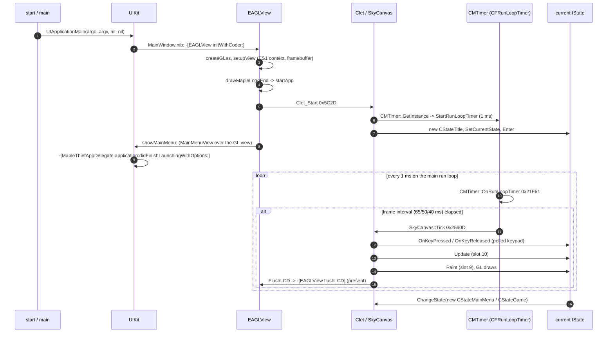

# Program flow: from `start` to a frame

How MapleThief 1.5 (armv7 slice) boots, what drives each frame, and how the `IState` state machine moves between the title, the main menu and the game ([#12](https://github.com/armaatus/maplethief-port/issues/12)). [#21](https://github.com/armaatus/maplethief-port/issues/21) (timing, threads) and [#22](https://github.com/armaatus/maplethief-port/issues/22) (the ObjC shell) build on this.

Addresses are armv7 VM addresses. Function pointers carry the Thumb bit (`0x2590D`), and call sites and data don't. Every function this page names has that name in Ghidra:

- ObjC methods come from `objc.json` ([objc.md](objc.md)).
- Vtable slots come from `rtti.json` ([cpp-classes.md](cpp-classes.md)). The `IState` slot names come from the call sites below, through `KNOWN_SLOTS` in `tools/mtport/rtti_analysis.py` (re-exported as `mtport.rtti.KNOWN_SLOTS`).
- The rest come from `work/re/names/flow.json`, written by `python3 -m mtport.flow names` (`FLOW_NAMES` in [`tools/mtport/flow.py`](../../tools/mtport/flow.py)).

`tests/test_flow_real.py` checks that every function address on this page has a name in a names file and in the Ghidra export. The decompiled listings behind this page come from `tools/ghidra/run-script decompile.py OUT ADDR...`, and the resolved `objc_msgSend` targets come from `work/re/imports.json` ([imports.md](imports.md)).

The engine is a port of a feature-phone game. A *Clet* lifecycle (`startClet` is printed at boot) drives a `SkyCanvas`, which owns the current `IState`. The game logic speaks phone keypad codes (`'0'`–`'9'`, `'#'`, `-1`…`-5`), and the iOS shell turns touches into those codes. Everything runs on the main thread from one `CFRunLoopTimer`. The game code creates no threads: `CLoaderThread` is a plain object, and the only `NSThread` use is `+isMainThread` in `GameCenterManager`.

## Overview



## Boot

| Step | Address | What happens |
|---|---|---|
| 1 | `0x27E0` `start` | crt1 (ARM). Finds `envp` after `argv` on the stack, calls `main`, then `exit` with its result. |
| 2 | `0x280D` `main` | `[[NSAutoreleasePool alloc] init]`, `UIApplicationMain(argc, argv, nil, nil)`, `[pool release]`. There's no principal-class or delegate-class argument: both come from the nib. |
| 3 | UIKit | Loads `MainWindow.nib` (`NSMainNibFile`, [nibarchive.md](../formats/nibarchive.md)). The nib holds a 320×480 `UIWindow`, the only visible window. Its one subview is an `EAGLView` (a `UIClassSwapper` from `UIView`). The nib also creates the `MapleThiefAppDelegate` object and connects `File's Owner.delegate` and `delegate.window`. Decoding the view runs `-[EAGLView initWithCoder:]`, so **the engine starts while the nib loads**, before the delegate's launch callback. |
| 4 | `0x4F6D` `-[EAGLView initWithCoder:]` | Calls `Device_SetModel` `0x65E1` (`UIDevice.model`: 0 iPhone, 2 iPhone Simulator, 1 other) and `Device_SetKorean` `0x660D` (first preferred language `ko`). Then `[super initWithCoder:]`, `createGLes` and `setupView`. Sets `EAGLView_Instance.objView = self` (`+[EAGLView_Instance Instance]` `0x5839` is the singleton the C++ code uses to reach the view), creates `characterInfos`/`robinImages`, and calls `Screen_Init(480, 320)` `0x9909`. Creates `InAppPurchaseManager` if `+[SKPaymentQueue canMakePayments]`, and `GameCenterManager` (with `AuthenticationUser`) if Game Center is available. Last, sends `drawMapleLogoEnd` → `startApp`. |
| 5 | `0x33D5` `-[EAGLView createGLes]` | `CAEAGLLayer`: opaque, `kEAGLDrawablePropertyRetainedBacking` NO, `kEAGLColorFormatRGBA8`. `[[EAGLContext alloc] initWithAPI:1]` (OpenGL ES 1.1), `setCurrentContext:`. The view gets `setTransform:` (0, −1, 1, 0), a 90° rotation into landscape, and bounds 480×320. Then `glGenFramebuffersOES` / `glGenRenderbuffersOES`, binds both, `renderbufferStorage:fromDrawable:` on the layer, attaches colour 0, reads the backing width and height into `Screen_SetBackingSize` `0x5EF5`, checks `GL_FRAMEBUFFER_COMPLETE_OES`, and enables the vertex and texcoord arrays. No depth buffer. |
| 6 | `0x3335` `-[EAGLView setupView]` | `glViewport(0, 0, w, h)`, `glOrthox(0, w, 0, h, −1, 1)` on the projection matrix, then back to modelview. |
| 7 | `0x9909` `Screen_Init` | Stores the screen size (`0x11AA8C` = 480, `0x11AA84` = 320), the 0x1C-byte surface `0x11AA88` (`Screen_GetSurface` `0x61F1`, `Surface_GetWidth`/`Surface_GetHeight` `0x62ED`/`0x6301`), and creates 11 touch widgets of 0xBC bytes (`TouchWidget_Init` `0xA2529`) at `*0xF149C`–`*0xF14C4`. `-[TouchKeyPadView touchesBegan/Moved/Ended:withEvent:]` forward to them through `TouchWidgets_Dispatch` `0x8B85`. |
| 8 | `0x4501` `-[EAGLView startApp]` | Adds `MainMenuBackground.png` as a placeholder image view. Adds a full-screen `TouchKeyPadView` (0, 0, 480, 320) and sends it `disableAll`. Calls **`Clet_Start` `0x5C2D`**, sends `showMainMenu:` (adds a `MainMenuView`), then removes the placeholder. |
| 9 | `0x5C2D` `Clet_Start` | See [Clet_Start](#clet_start-the-c-entry). |
| 10 | `0x2BFD` `-[MapleThiefAppDelegate application:didFinishLaunchingWithOptions:]` | Prints `AVAudioSession setCategory...` (`SkyCanvas::SkyCanvas` has already set `AVAudioSessionCategoryAmbient`). Gets `glView` from `[[EAGLView_Instance Instance] objView]`, makes `[[EAGLViewController alloc] initWithNibName:@"EAGLViewController" bundle:nil]` (no such nib ships), then `setView: glView` and stores the controller in `0x11A97C`. Registers for remote notifications (types 7), sets the badge to 0, returns YES. It never calls `makeKeyAndVisible` (the nib marks the window visible) or sets a `rootViewController`. |

Dead code: the logo and intro movie path is never reached. `startAppEnv`, `drawMapleLogo__` (which would `invalidate` the `ttimer` ivar) and `movieFinishedCallback:` are selectors with no selector reference, so nothing sends them. No app code schedules an `NSTimer` (the only `scheduledTimerWithTimeInterval:` send is Chartboost's), and nothing sends `-[MoviePlayerController initWithMovieFile:]`. `initWithCoder:` calls `drawMapleLogoEnd`, which goes straight to `startApp`.

### `Clet_Start`: the C++ entry

`Clet_Start` `0x5C2D` is the only call from the ObjC shell into the engine at startup. It prints `startClet`, then:

1. `new(0xFC)` + `SkyCanvas::SkyCanvas` `0x26529`. The constructor stores `this` in `0x11A950` (`SkyCanvas::GetInstance` `0x2567D`), reads the `PHONEMODEL` and `HEIGHT` properties, takes the screen surface (`+0x58`) and its size (`+0x88`, `+0x8C`), looks up `SkyCanvas.SkyCanvas.1`, and sets `AVAudioSessionCategoryAmbient`. `Clet_Start` also keeps the pointer in `0x11A410`.
2. The singletons, each stored in a non-lazy pointer slot that the rest of the code reads:

| Slot → global | Getter | Object |
|---|---|---|
| `0xF1440` → `0x11A958` | `SkyCanvas::GetInstance` `0x2567D` | the canvas |
| `0xF1450` → `0x11A968` | `Singleton_11A444_GetInstance` `0xB85D` | `new(1)`, no vtable, class unknown; used by the PNG and sprite loaders |
| `0xF1448` → `0x11A960` | `CMSoundPlayer::GetInstance` `0x1E099` | `CMSoundPlayer::CMSoundPlayer` `0x1D9B1` |
| `0xF143C` → `0x11A964` | `CMResMgr::GetInstance` `0x1B68D` | `new(0x6FC)`, `CMResMgr::CMResMgr` `0x1A65D` ([png-dat.md](../formats/png-dat.md)) |
| `0xF1444` → `0x11A95C` | `CMTimer::GetInstance` `0x22285` | `CMTimer::CMTimer` `0x22165`, **which starts the frame clock** |
| `0xF144C` → `0x11A96C` | `CPopup::GetInstance` `0x797D9` | `CPopup::CPopup` `0x7991D` |
| `0xF1454` → `0x11A970` | `CDataMgr::GetInstance` `0x5BAC1` | `CDataMgr::CDataMgr` `0x5AE39` ([save.md](../formats/save.md)) |
| `0xF1438` → `0x11A974` | `CMSocket::Instance` `0x1C935` | `CMSocket::CMSocket` `0x1C8B5` ([network.md](network.md)) |

3. `CMSprite_InitList` `0x20AAD` and `CMSpriteImage_InitList` `0x2149D` create the sprite and image lists `0x11A468` / `0x11A46C` (`PtrArray_New100` `0x25661` → `PtrArray_New` `0x255D5`; [sprprj.md](../formats/sprprj.md)).
4. `new(0x2C)` + `CStateTitle::CStateTitle` `0x98865`, stored at `SkyCanvas+0xC` (the current state). Then `state->Enter()` (slot 2). The constructor copies the device id, language, device name and model, OS name and version, country code and bundle id into fixed `CDataMgr` fields, which become the `CMSocket` hello packet ([network.md → Device identifier](network.md#device-identifier-and-push-token)).
5. `NullStub_5FC0(0, 2, 0, 0)` and `NullStub_653C(3, 1)`: both return 0. They look like remnants of the phone platform API.
6. `SkyCanvas+0xD4` = 0 (not paused).

`CMapleWorld` isn't created at boot. `CStateGame::LoadGame` creates it when the game starts ([Loading the game](#loading-the-game)).

### Static constructors

`__DATA,__mod_init_func` (`0xF14CC`, 8 bytes) holds two pointers. dyld runs them before `main`.

| Entry | Function | Initializes |
|---|---|---|
| `0xA925` `_GLOBAL__I_TextCache` | `TextCache_StaticInit` `0xA93D` (GCC's `__static_initialization_and_destruction_0(1, 0xFFFF)`) | The text texture cache at `0x11A428`: `TextCache_Create` `0xA479` allocates 50 records (count at `0xFC6A8`) of 0x418 bytes (`char text[0x400]`, texture id at `+0x400` = −1, `+0x414` = 0). at exit `TextCache_StaticFini` `0x6639` → `TextCache_Destroy` `0xA601`. `TextCache_DrawText` `0x9031` renders strings with UIKit (`MarkerFelt-Thin`) into GL textures and caches them there. |
| `0x9E041` `_GLOBAL__I_TaggedString` | `TaggedString_StaticInit` `0x9E059` | A static `TaggedString` of the script VM at `0x11AA10` (`TaggedString::TaggedString_default` `0x9EBD5`: hash and mark 0xFFFF, type 2). At exit `TaggedString_StaticFini` `0x9DBB1`. See [script-vm.md](script-vm.md). |

## The frame loop

There's no `CADisplayLink` and no render thread. The clock is one `CFRunLoopTimer` on the main run loop, and `CMTimer` keeps all of its state in static globals.

1. `CMTimer::CMTimer` `0x22165` zeroes the globals and sets the frame interval `0x11A478` to **10 ms**. It stores the canvas in `0x11A4E0` and calls `CMTimer::StartRunLoopTimer` `0x220B1` and `CMTimer::Start` `0x21DC9` (running flag `0x11A480` = 1).
2. `CMTimer::StartRunLoopTimer` stores `GetTimeMs()` `0xA0D5` (`gettimeofday` in ms) as both the last-tick and the last-frame time. It sets up the holder `0x11A4F0` with `RunLoopTimer_Init` `0x6065` (callback `CMTimer::OnRunLoopTimer` `0x21F51`) and calls `RunLoopTimer_Arm(holder, 1)` `0x8E29`.
3. The first call to `RunLoopTimer_Arm` creates the timer: `CFRunLoopTimerCreate(fire = now + ms / 1000.0, interval 0.001 s, callout RunLoopTimer_Callout 0x5F99, info = holder)`, added to `CFRunLoopGetMain()` in `kCFRunLoopCommonModes`, so it keeps firing during UIKit tracking. Later calls only `CFRunLoopTimerSetNextFireDate(now + ms / 1000.0)`. The callout calls `holder->callback(holder, holder->arg)`.
4. `CMTimer::OnRunLoopTimer` `0x21F51` runs every ~1 ms. It adds the elapsed time to each of the 4 sub-timers that are on (`0x11A4A4[i]`, accumulators `0x11A4B0 + 8i`; `CMTimer::ResetSubTimer` `0x21E81`, `CMTimer::SubTimerElapsed` `0x21EE5`). **When `now − lastFrame ≥ interval`**, it sets `lastFrame = now` and calls `SkyCanvas::Tick(canvas)` `0x2590D`. Then it re-arms for +1 ms. It runs whether `CMTimer` is running or not. The running flag only gates `Update` and `Paint` inside the tick.
5. The game speed sets the interval. `CStateTitle::LoadSettings(3)` `0x980B5`, called from `CStateTitle::Enter` (still inside `Clet_Start`, so no tick ever runs at 10 ms), calls `CDataMgr::LoadConfig`. That calls `CDataMgr::ApplyGameSpeed` `0x37C41`, which passes 65, 50 or 40 ms (table `0x108C58`, indexed by the config's speed byte, default 50) to `CMTimer::SetFrameInterval` `0x21DA1` ([save.md](../formats/save.md)). That gives about 15, 20 or 25 frames per second. The tick period, overruns and every other timer are in [timing-threading.md](timing-threading.md).

### `SkyCanvas::Tick` `0x2590D`

`SkyCanvas` fields used by the tick:

| Field | Meaning |
|---|---|
| `+0x04` / `+0x08` | keypad key now / last tick |
| `+0x0C` | current state |
| `+0xB4`–`+0xB8` | paint flags (`+0xB7` = paint pending) |
| `+0xD8` | pending press code |
| `+0xE8` | pending release code |
| `+0xF0` | input happened |

`−1000` (`0xFFFFFC18`) means none.

1. It returns at once if there's no current state. If a paint is still pending (`+0xB7`), it skips straight to step 6.
2. **Keypad polling.** If `-[TouchKeyPadView touchKeyPadEnable]` and no event is pending, it reads the pad's BOOL ivars through ObjC sends (`onAttackKey`, `onShort1Key`…`onShort4Key`, `onLeftKey`/`onRightKey`/`onUpKey`/`onDownKey`, `onJumpKey`). It turns them into one pad key and then into a phone key code:

| Pad | attack | short1 | short2 | short3 | short4 | jump | left+jump | right+jump | up+jump / down+jump | up | down | left | right |
|---|---|---|---|---|---|---|---|---|---|---|---|---|---|
| Pad id | 11 | 20 | 21 | 22 | 23 | 10 | 30 | 32 | 33 / 31 | 4 | 2 | 1 | 3 |
| Key code | `'5'` | `'7'` | `'9'` | `'0'` | `'#'` | `'2'` | `'1'` | `'3'` | `'2'` | −1 | −2 | −3 | −4 |

   A new key with nothing held becomes a press (`+0xD8`). A changed key becomes a release of the old one (`+0xE8`). Going from a diagonal jump to a plain jump doesn't release.
3. Pending press → **`state->OnKeyPressed(code)`** (slot 6). Pending release → **`state->OnKeyReleased(code)`** (slot 7). Both set `+0xF0`. `SkyCanvas::PostKeyEvent` `0x25801` fills the same two fields from the UIKit buttons (below).
4. If `CMTimer::IsRunning` `0x21E35`: **`state->Update()`** (slot 10).
5. If still running: `+0xB7` = 1, then `SkyCanvas::RepaintRect(x, y, w, h)` `0x25889` with the rectangle at `+0xA4`, or `SkyCanvas::Repaint` `0x258C9` for the whole surface. Both call `SkyCanvas::PaintState` `0x25695`. That calls **`state->Paint()`** (slot 9), which draws with GL ES 1.1 into the bound framebuffer, and clears `+0xB7`. Then they call `FlushLCD(0, surface, rect)` `0x6D65` → `-[EAGLView flushLCD]` `0x37B9` → `endDraw` `0x37F1` (`presentRenderbuffer:`) and `beginDraw` `0x3841` (`setCurrentContext:`, rebind the framebuffer).
6. Network keep-alive: if `CMSocket::GetStatus` `0x1BC4D` isn't −1 and sub-timer 3 has passed 9,999 ms, `CDataMgr::SendServerPacket(…, 0xB4)` `0x371ED`, then `CMTimer::ResetSubTimer(3)` ([network.md](network.md)).

The loaders draw outside the tick too. `Loading_Progress` `0x6AF09` runs between load steps and calls `FlushLCD` directly ([Loading the game](#loading-the-game)).

### Input from UIKit

| Source | Path |
|---|---|
| `TouchKeyPadView` d-pad and action areas | `touchesBegan/Moved/Ended:withEvent:` set the `on*Key` ivars (`firstPoint`/`secondPoint` track two fingers), which `SkyCanvas::Tick` polls (above). They also call `TouchWidgets_Dispatch` `0x8B85`. |
| `TouchKeyPadView` buttons (`click1Button:`…`clickCashButton:`, `release…:`, 53 actions) | `Clet_HandleEvent(type, p1, p2)` `0x5A75`. For type 2 (press) and 3 (release): `SkyCanvas::PostKeyEvent(canvas, type, code)` `0x25801` → `SkyCanvas::KeyPress` `0x2578D` (pending press, time `+0xE0`; `0x10004` → −5, `0x10005` → −16) or `SkyCanvas::KeyRelease` `0x25735`. Type 4 → `SkyCanvas::KeyEvent4` `0x25721` (stores `+0xEC`). Type 7 does what `Clet_Pause` does. `NullStub_6008` `0x6009` is called last. Example: `releaseCashButton:` → `(3, −26, 0)`. |
| `MainMenuView`, `ChooseCharacterView`, the other key pad views | Plain UIKit over the GL view. They talk to the engine through ObjC calls such as `characterInfos` and through the save files, not through key events. |
| `EAGLView` itself | `touchesBegan:` only prints `EAGLView Touch Press...`, and `touchesMoved:` is empty. |

### App lifecycle

| UIKit callback | Engine |
|---|---|
| `applicationWillResignActive:` `0x2BD9` | Prints `phone suspend`, then `Clet_Pause` `0x5B8D`: `NullStub_5FF4`; `SkyCanvas+0xD4` = 1; `CMTimer::Stop` `0x21DE9`; `CMTimer::MarkPause` `0x21E09`; sound stop and free (`OpenAL sound free`); **`state->Pause()`** (slot 5). |
| `applicationDidBecomeActive:` `0x2BB5` | Prints `phone resume`, then `Clet_Resume` `0x5B01`: `NullStub_5FE0`; `+0xD4` = 0; `CMTimer::Start` `0x21DC9`; `CDataMgr` and sound resume. No state slot is called. |
| `applicationWillTerminate:` `0x2ACD` | Prints `The Game is Terminated!`, deletes the current state (slot 1), and deletes the `CMResMgr` singleton. |

## The `IState` state machine

Class hierarchy ([cpp-classes.md](cpp-classes.md#istate)): `IState` (23 slots, almost all pure) ← `IStateAdaptor` (adds `UtilAdaptor` at +4 and slot 23) ← `CStateTitle`, `CStateMainMenu` (adds slot 24), `CStateGame`.

| Field | Meaning |
|---|---|
| `+0` | `IState` vptr |
| `+4` | `UtilAdaptor` vptr |
| `+8` | parent state |
| `+0xC`/`+0x10` | last pointer x, y (slot 22) |
| `+0x14`/`+0x18` | previous pointer x, y |

`SkyCanvas+0xC` holds the one *current* state.

| Slot | Name | Called by | Notes |
|---|---|---|---|
| 0, 1 | destructors | `SetCurrentState`, `applicationWillTerminate:` | slot 1 = deleting destructor |
| 2 | `Enter` | `Clet_Start`, `ChangeStateWithParam` | Title: `LoadSettings`, disables the touch key pad. MainMenu: `disableAll`, builds the menu, `LoadCharacterSlots`. Game: sets `+0x24` = 1, so the next `Paint` loads. |
| 3 | `Exit` | `ChangeStateWithParam` (on the old state) | empty in all three states |
| 4 | `Resume` | `PopState`, `ChangeStateWithParam` (when the target is the parent) | |
| 5 | `Pause` | `Clet_Pause`, `Clet_HandleEvent(7)`, `PushState` | |
| 6 | `OnKeyPressed(code)` | `SkyCanvas::Tick` | from `CStateGame.OnKeyPressed.N` keys (#9) |
| 7 | `OnKeyReleased(code)` | `SkyCanvas::Tick` | |
| 8 | `vf8` | — | no caller; empty |
| 9 | `Paint` | `SkyCanvas::PaintState` | from keys (#9) |
| 10 | `Update` | `SkyCanvas::Tick`, each frame while `CMTimer` runs | Game: `CDataMgr::Update` `0x55C85`. Title and MainMenu: empty. |
| 11 | `SetParam(p)` | `ChangeStateWithParam`, `PushState`, `PopAndRestart` | empty |
| 12 | `vf12` | — | returns 0 |
| 13 | `PushState(target, p)` | — | `Pause`, `target->SetParent(current)`, `SetCurrentState(target)`, `SetParam`, `Enter`. As written, `SetCurrentState` deletes the state it has just made the parent. |
| 14 | `PopState` | — | `Exit`, `SetCurrentState(parent)`, `parent->Resume` |
| 15 | `PopAndRestart(p)` | — | `PopState`, then `Exit`/`SetParam`/`Enter` on the parent |
| 16 | `PopAllStates` | — | pops while the current state has a parent |
| 17 | `SetCurrentState(s)` | the transitions | deletes the old current state (slot 1), clears `+8`, stores `s` in `SkyCanvas+0xC` |
| 18, 19, 20 | `SetParent`, `GetCurrentState`, `GetParent` | the transitions, `SkyCanvas::PaintState` | |
| 21 | `GetRootState` | — | |
| 22 | `OnPointerEvent(type, x, y)` | — | keeps the last and previous x, y. `CStateTitle`'s posts key −5 (OK) on type 2. No caller in this build. |
| 23 | `vf23` | — | empty |
| 24 | `CStateMainMenu::LoadCharacterSlots` | `CStateMainMenu::Enter`, `CStateMainMenu::OnKeyPressed` | `CDataMgr::LoadSlots`, fills `EAGLView.characterInfos` and `robinImages` |

"—" means no call through the vtable anywhere in the game code (checked in the decompiled code of all 1,973 `engine` and `app-objc` functions). The parent/child stack is never used: every transition goes through the non-virtual **`IStateAdaptor::ChangeState(this, target)` `0xAF65`** → `IStateAdaptor::ChangeStateWithParam(this, target, 0)` `0xADED`:

1. Return if `target` is `this` or already current. Otherwise `target->SetParam(p)`.
2. No parent: `current->Exit()`, `SetCurrentState(target)` (deletes the old state), `current->Enter()`, `CMTimer::Start`.
3. With a parent, it unwinds: each step calls `Exit` on the current state and makes its parent current. When the parent is `target` it calls `target->Resume()`. Otherwise it continues with the step 2 switch.

### Transitions

```mermaid
stateDiagram-v2
    [*] --> CStateTitle: Clet_Start 0x5C2D
    CStateTitle --> CStateMainMenu: CStateTitle::GoToMainMenu 0x97EDD (from Paint)
    CStateMainMenu --> CStateGame: CStateMainMenu::OnKeyPressed (3 sites)
    CStateGame --> CStateMainMenu: CStateGame::OnKeyPressed / PaintExitToMenu / Game_ExitToMainMenu
```

| From → to | Where | Object |
|---|---|---|
| boot → `CStateTitle` | `Clet_Start` `0x5C2D` (`SetCurrentState` directly) | `new(0x2C)`, `CStateTitle::CStateTitle` `0x98865` |
| `CStateTitle` → `CStateMainMenu` | `CStateTitle::GoToMainMenu` `0x97EDD`, called from `CStateTitle::Paint` `0x981B9` on its 5th paint (`LoadSettings(3)` `0x980B5` zeroes the count at `+0x20` and sets step `+0x1C` = 3): 250 ms after `Clet_Start` at the default speed. The `MainMenuView` is already up, so a Play released earlier finds `robinImages` empty and ends the game ([ANALYSIS.md, #122](../ANALYSIS.md#program-flow)) | `new(0x94)`, `CStateMainMenu::CStateMainMenu` `0x97BBD` |
| `CStateMainMenu` → `CStateGame` | `CStateMainMenu::OnKeyPressed` `0x9462D` at `0x954AE`, `0x95844`, `0x964D2`, each after `closeMainMenu:` (and a Chartboost `showInterstitial`) | `new(0x4D8)`, `CStateGame::CStateGame` `0x940D9` |
| `CStateGame` → `CStateMainMenu` | `CStateGame::OnKeyPressed` `0x8D4C9` at `0x8F5C4` (after `showMainMenu:`), `CStateGame::PaintExitToMenu` `0x83C71` at `0x84604`, and `Game_ExitToMainMenu` `0x54BF9` at `0x5540A` (saves, Chartboost, `showMainMenu:`) | `CStateMainMenu::CStateMainMenu` `0x97BBD` |

Every transition after boot is `new` + constructor + `IStateAdaptor::ChangeState(this, new)`. The old state is deleted inside the call, so its code must not touch `this` afterwards. The constructors call `IStateAdaptor::IStateAdaptor` `0xA995` (which calls `IState::IState` `0xB14D`) first.

The main menu itself is UIKit. While `CStateMainMenu` is current, `MainMenuView` and `ChooseCharacterView` sit over the GL view, and the state's `Paint` (348 bytes) does little.

### Loading the game

`CStateGame::Enter` sets the game-phase global `0x11AA00` to 8 and `+0x24` to 1. When `CStateGame::Paint` `0x87501` finds the phase at 8, it sets it to 6 and makes `new(0x30)` + `CLoaderThread::CLoaderThread(state, mode)` `0x6B705`, stored at `+0x20`. The mode is 0 when `+0x24` is set (first entry) and 1 otherwise (presumably a map change, which also puts the phase back to 8). Despite the name, it is no thread: the constructor stores the state in `0x11A9B8` and the mode in `0x11A9B4`. Then `CLoaderThread::Run` `0x6AEF9` → `CLoaderThread::Load` `0x6AEB5` runs synchronously inside `Paint`:

- mode 0: `CStateGame::LoadGame` `0x86C1D` creates `CMobs` (`+0x34`, `CMobs::CMobs` `0x775DD`), **`CMapleWorld`** (`new(0xC)`, `CMapleWorld::CMapleWorld` `0x6DEDD`, `+0x28`) and `CHero` (`new(0x164)`, `CHero::CHero` `0x68A59`, `+0x30`), plus the chat box, drops, effects, quests and the Lua VM. Then it calls `CStateGame::LoadMap`.
- mode 1: `CStateGame::LoadMap` `0x868D5` only. It loads the map and runs the NPC state script pass `CStateGame::RunNpcStateScripts` `0x839BD`.

Between steps, `Loading_Progress` `0x6AF09` draws the loading screen and calls `FlushLCD`, so the screen updates while the run-loop timer is blocked. After a new map loads, `CStateGame::Paint` runs the map script. The script entry points (hero interaction `CHero::InteractWithObject` `0x63191`, NPC state pass `0x839BD`, map script in `CStateGame::Paint`) are in [script-vm.md → Entry points](script-vm.md#entry-points).

## For the port

- **One thread, one clock.** A port can call `CMTimer::OnRunLoopTimer` from its own 1 ms (or per-vsync) main-thread timer and get the same frame gating. Speed 65/50/40 ms is the game's frame rate. [timing-threading.md](timing-threading.md#for-the-runtime) has the pacing the runtime needs.
- **The engine starts inside the nib load.** The shell has to create the window and an `EAGLView`-equivalent, then run `initWithCoder:`'s sequence (device model and language, GL context, `Screen_Init`, `startApp` → `Clet_Start`) before the delegate's `didFinishLaunching`.
- **GL ES 1.1, fixed-point ortho, 480×320 landscape via a view transform.** `beginDraw`/`endDraw` in `FlushLCD` are the only present points.
- **Input is phone key codes.** The touch pad has to keep producing the `on*Key` ivars that `SkyCanvas::Tick` polls, and the button actions have to keep calling `Clet_HandleEvent`.

## Open unknowns

1. What `NullStub_5FC0(0, 2, 0, 0)` and `NullStub_653C(3, 1)` were on the original phone platform, and whether `Clet_HandleEvent`'s type numbers (2 press, 3 release, 4, 7 suspend) follow that platform's event codes.
2. Event type 4 (`SkyCanvas::KeyEvent4`, `+0xEC`): which buttons send it and who reads `+0xEC`. `SkyCanvas::Tick` doesn't.
3. Slots 8, 12, 23 and 22 (`OnPointerEvent`): what the original phone code called them. Nothing here calls them. Whether `PushState`'s delete of the new parent is a latent bug or a misreading: it is never called, so it doesn't matter for the port, but a recompiled `PushState` would inherit it.
4. The class of the 1-byte singleton `0x11A444` (`Singleton_11A444_GetInstance` `0xB85D`, slot `0xF1450`) and the kinds of the 11 touch widgets (`TouchWidget_Init` `0xA2529`).
5. Which branch of `CStateGame::Paint` calls `CStateGame::PaintExitToMenu` `0x83C71`, and which caller leads to `Game_ExitToMainMenu` `0x54BF9` (death, quit or ending).
6. The exact meaning of the `SkyCanvas` paint flags `+0xB4`–`+0xB8` and of the dirty rectangle at `+0xA4`.
7. The `EAGLViewController` from `didFinishLaunching` gets the GL view as its `view` but never joins the window. #22: its only use is as the presenter of the Game Center leaderboard (`-[EAGLView viewGameCenterRank:]` `0x4E09` through the global `0x11A97C`), and it allows only interface orientation 4 ([objc-shell.md](objc-shell.md#eaglviewcontroller)). Whether that presentation works on iOS 3–5 without a `rootViewController` is still untested.
8. Whether anything else re-enters `SkyCanvas::Tick` (for example modal `UIAlertView` loops while a load blocks the run loop).
